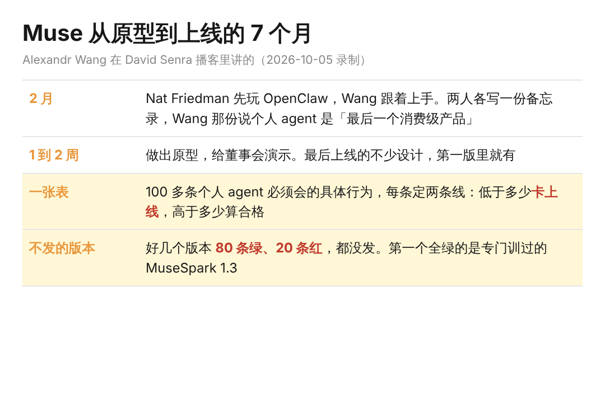
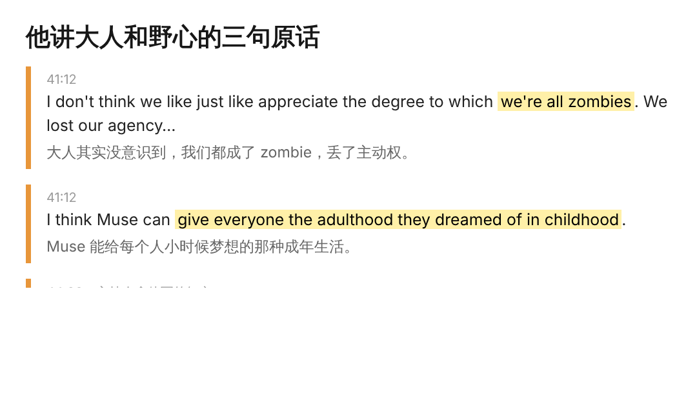

让 AI 读完自己的邮件和照片，再一轮一轮追问你到底是个什么样的人，Alexandr Wang 今年 2 月真这么干过。他说那一次，相当于把三年的心理治疗一口气做完。

Wang 还不到 30 岁，创办 Scale AI 做了九年。去年 Meta 投资拿下 Scale 49% 的股份，他带着几个人去 Meta 从头重建 AI 实验室，现在直接向他汇报的研究员有 200 多个。

10 月 5 日他上了 David Senra 的播客，聊了 72 分钟。主线是 Meta 今年 9 月推出的个人 agent，叫 Muse，从第一个原型到上线用了七个月。

这些归结起来是同一件事：你敢把自己的生活交给 AI 多少。挑三段说。

1、让 AI 把自己从头剖一遍，他说整个过程很脆弱

年初 OpenClaw 正火，一个开源的个人 agent，装上以后能读你的邮件和照片，还能自己上网查东西。

和 Wang 一起管实验室的 Nat Friedman，是他们团队里第一个用上的人。Nat 是 Stripe 最早的一批客户，也参与做了 GitHub Copilot，新东西他一向上手很早。

Nat 跟 agent 说想多喝点水，agent 就去看家里的监控，盯着他喝，喝完还夸一句 good job。Wang 形容 Nat 那阵子的状态，介于恐惧和狂喜之间。

Wang 说的心理治疗，其实是 Nat 写的一个提示词，让 agent 给人做一次完整的心理剖析，一波一波往深里问。Wang 装好 OpenClaw，人就坐在 Nat 旁边，第一件事就是跑它。

agent 读了他的邮件和一堆照片，自己去查别的信息，拼在一起问他。他的原话是 I was very vulnerable，整个过程他很脆弱。

那之后两个人各写了一份备忘录。Wang 那份说，个人 agent 在很多意义上是最后一个消费级产品。一两周后原型做出来，给董事会演示。

当时行业的共识是只有编程 agent 重要，Anthropic 遥遥领先，所有人都往那挤。Meta 偏去做个人 agent。

Wang 的理由是，AI 会接走人不得不做的事，时间腾出来花在想做的事上，而 Instagram、WhatsApp 装的正是人想做的事。

2、80 条绿、20 条红的版本，不发

OpenClaw 自己火了一阵就没人用了，偶尔有神奇时刻，大部分时候不太好使。Wang 说从原型到上线那七个月，是整件事里最不光鲜的部分。

团队列了一张表，100 多条个人 agent 必须会的具体行为，每条都定了两条线：低于多少卡上线，高于多少算合格。

中间好几个版本 80 条绿、20 条红，都没发。第一个全绿的，是专门训过的 MuseSpark 1.3。

模型和产品加起来不到 200 人，是故意不扩的。他说大公司做的产品，容易变成每个 PM 往里塞一样东西，最后搅成一杯 smoothie。Muse 只能有一个视角，最后拍板的是 Nat 的品味。

为什么这么较真，他的解释是个人 agent 站在刀刃上。靠谱，就是有史以来最好的消费产品之一；不靠谱一次，用户就觉得是垃圾。年初那批 agent 产品，几乎所有用户都流失了。

主持人讲了他一个朋友的用法。这人管着一家千亿美元的公司，把证件落在了包机上，跟 Muse 说这事他一点都不想管。Muse 自己安排快递去取，过了办公室的安保，一路送到楼上。

Wang 说用户留下来靠的是 trust fall。先交给它一件小事，做成了，再交一件大一点的。一开始不信，只是好奇，一点一点往上加。

我自己就停在半路。工作那台电脑上没有私人聊天软件，邮件和聊天权限都开了，它会替我发东西。个人电脑上只给了 Grok 和 Claude 一个邮箱的只读权限，平时清清垃圾邮件，把重要的内容理出来。

最后两页是照 Nat 那个结构写的剖析提示词。看完我没跑，现在还不想把所有权限都开给 AI。

3、大人都成了 zombie，他觉得 AI 能把野心还回来

聊到 Muse 到底想做成什么，他说每个人小时候都有大梦想，想当宇航员、想拯救地球。念完书、上几年班，这些就被磨没了，大人其实没意识到，自己早成了 zombie。

他想让 Muse 给每个人小时候梦想的那种成年生活。实现一个，再梦一个更大的，像一部一直往上走的扶梯。他那篇讲 Muse 的短文，主持人说已经有 550 万浏览。

他举了自己 19 岁生日那天。那年他在 MIT 读大一，寒假在交易公司 HRT 实习，十来个人吃饭，大多是竞赛里认识的同学。

后来那一桌，Jeffrey Yan 创办了 Hyperliquid，Scott Wu 创办了 Cognition，Jesse Zhang 创办了 Decagon。

前阵子他见到 HRT 的创始人，对方说在考虑做一级投资。他的建议是，给实习生都开种子支票。

小时候那些天马行空的 idea，以前常因为各种限制落不了地。现在在它们还没被磨掉之前，年轻人就能先做出来，这一点上 AI 给了年轻人一点公平。
