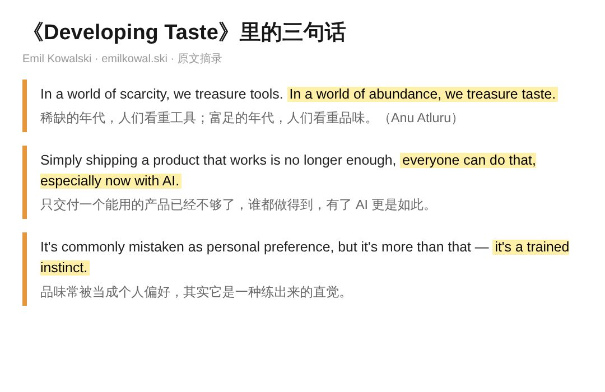
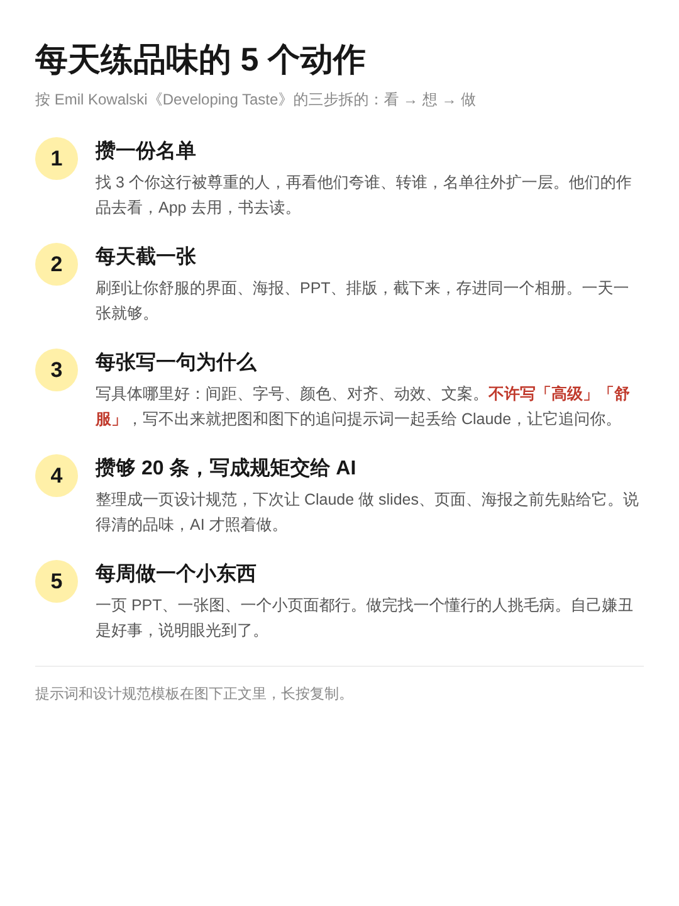

这两年，AI 帮你把东西做出来已经不稀奇了，稀奇的是做得不丑，这一步靠品味。

之前我做了一个视觉识别的高尔夫训练软件，从 0 到 1 上线，代码基本是 AI 写的。东西能跑，但整个设计语言用的全是 Claude 默认那一套，很丑，UI 和交互也笨。

这两天读到设计工程师 Emil Kowalski 的短文《Developing Taste》，讲的就是这件事。一位字节的工程师转了它，5235 次浏览，108 人收藏，收藏比点赞还多一半。

很多人觉得品味是天生的，或者就是个人喜好，没法讨论。Emil 的看法完全反过来：品味是一种练出来的直觉。我读完多想了一步：品味还得说得出来，只有一句「感觉不对」，AI 是接不住的。他给的练法，我按自己的理解拆成五条。

1、能用已经不值钱了，因为现在谁都做得出能用的东西。

他开头举的是汽车。最早的汽车出来时，没人在乎它什么颜色、什么外形，因为它的对手是马。等到满街都是车，品质和细节才开始值钱。

软件现在走到了同一步。有了 AI，一个人一个周末就能做出能跑的 App，用户默认它就该能用。我那个高尔夫软件就是这样，功能都在，打开第一眼还是一股默认模板的味道。

他引了 Anu Atluru 的一句话，大家看第一段标黄的地方：

2、品味可以练，它更像一种被训练过的直觉。

Emil 的说法是，品味常被当成个人偏好，其实是练出来的本能：能看到显而易见之外的东西，认得出是什么让一件作品往上走了一层。有些设计让人觉得毫不费力，靠的就是这个。

所以这件事跟天赋关系没那么大，跟你看过多少、想过多少、做过多少有关。他给的练法也就是这三样。

3、先让好东西把自己围起来。

做设计的多看好设计，写东西的多读好书。他引了乔布斯的话，大意是去接触人类做出过的顶尖作品，再把它们带进你正在做的事里。

具体做法挺实在：找到你这个领域里被尊重的人，再看他们欣赏谁，攒一份自己的名单。他们的设计去看，App 去用，书去读。这个办法 Emil 是从 Julie Zhuo 那篇《On taste》里学来的。

4、喜欢一个东西，要说得出为什么。

读完我反复想的是这一条。Emil 说校准品味的时候，别急着给东西贴「好」或「坏」的标签，也别只靠第一感觉，要去拆它为什么让人舒服。做设计的别只是用 App，要研究某个交互为什么手感好；拍电影的别只是看电影，要想导演为什么这么拍。

放到 AI 身上，这条的分量更重了。你说得清的那部分品味，才能变成它照着做的规矩。

我之前用 Claude 做 slides，先把设计师给的那套设计元素固定进去，再让它出稿。高尔夫软件那次我什么都没给，Claude 只能拿自己的默认值填。两次的差别就在这：一次有人把品味讲清楚写进去了，一次没人讲。

不写代码的人也一样。用 AI 做 PPT、改简历、排一张活动海报，只说一句「做得高级一点」，它只能按默认去猜。你得说出高级具体指什么，用哪种字体，留多少白，哪个颜色只拿来做强调。

5、自己动手做，做出来嫌丑，说明眼光已经到了。

Emil 的第三样是练：设计师就去设计，写东西的就去写，同时找对的人要反馈。对的人一句好批评，比自己反复试错快得多。

刚开始做出来的东西多半不好，他说这反而是好迹象，说明你的品味已经够用，看得出自己的作品还没到那个水平。这个说法来自 Ira Glass 讲过的 taste gap。

这句话放在我那个高尔夫软件上挺准。它能用，我自己看着嫌丑，说明我知道好的长什么样，只是当时没把它讲清楚、交给 AI。

照这五条，我把每天能做的练法排成了一张图，提示词和设计规范模板放在图下正文里：

当然，练品味没有捷径，这几样哪样都要花时间，攒名单和写为什么尤其磨人。

以后能把东西做出来的人只会越来越多，做得不丑的还是少数。品味算是 AI 一时半会儿替不了你的那部分，前提是你自己先说得出来。
