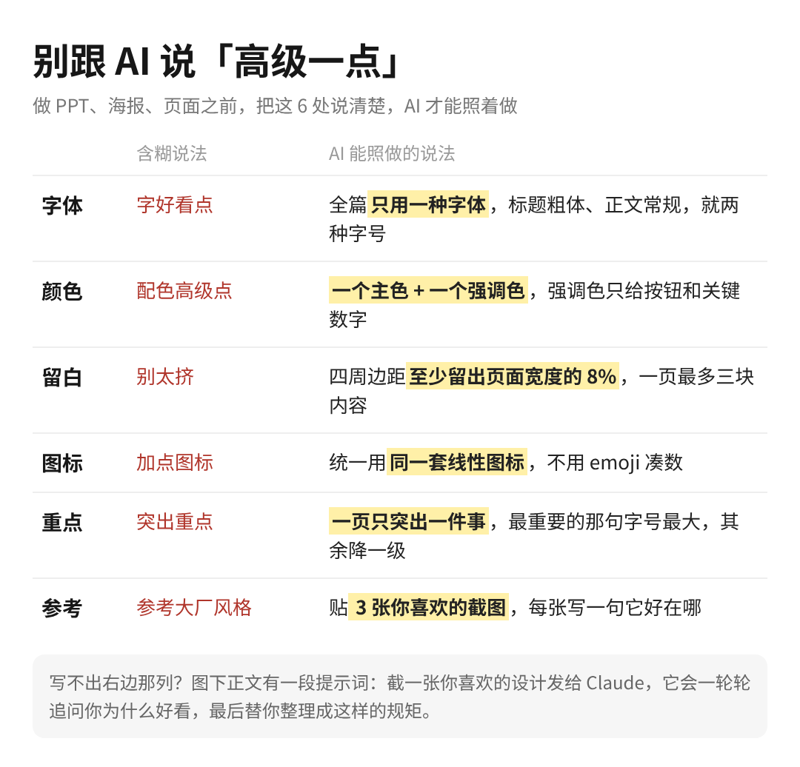

读了设计工程师 Emil Kowalski 的一篇短文《Developing Taste》，写得很好。他的观点很直接：现在谁都能做出一个能用的软件，有了 AI 更是如此，真正让产品拉开差距的，是设计、好不好用、整体体验，一个词，品味。

他开头举了汽车的例子。第一辆汽车出来的时候，没人在乎它的颜色和外形，因为它的对手是马。现在满大街都是车，品质和细节反而比过去更重要了。软件也走到了这一步。

这件事我最近亲身体会了一次。我和我老婆这阵子沉迷高尔夫，就用 AI 手搓了一个训练 App，开摄像头对着人拍，挥杆的时候实时语音指导，从 0 到 1 上线，代码基本没自己写。

功能都能跑，但整个设计语言用的全是 Claude 默认那一套，很丑，交互也笨。大家看上面的截图，黑底配荧光绿按钮，右上角两个 emoji 当图标，一排绿色胶囊标签。

原因其实很简单，我一句设计要求都没给，AI 只能拿默认值填。你看，把东西做出来已经不难了，难的是做得好，而好不好看这件事，得我自己先说得清。

那什么是品味？很多人以为就是个人喜好，Emil 说不止，它是一种练出来的直觉，能看到表面之外的东西，认得出是什么让一件作品更好。有些设计让人觉得毫不费力，靠的就是这个。

他还引了 Anu Atluru 的一句话，大家看第一段标黄的地方：

既然是练出来的，就有练法。他讲了三个。

第一个是多看好东西。做设计的看好设计，写东西的读好书。他引了乔布斯的一句话，大意是去接触人类做出过的那些顶尖作品，再把它们带进你正在做的事里。具体做法很实在，先找到你这行里被尊重的人，再看他们欣赏谁，攒一份自己的名单，他们的设计去看，App 去用，书去读。

第二个是想清楚自己为什么喜欢。别急着给东西贴「好」或「坏」的标签，要拆它为什么让人舒服。做设计的别只是用 App，要研究某个交互为什么手感好；拍电影的别只是看电影，要想导演为什么这么拍。

这一条我觉得放到 AI 身上更重要。我之前用 Claude 做 slides，是先把设计师给的那套设计元素固定进去，再让它出稿。高尔夫 App 那次我什么都没给，它只能自己猜。

不写代码的人也一样。用 AI 做 PPT、改简历、排一张活动海报，只说一句「做得高级一点」，它只能按默认来。我把最常见的 6 处含糊说法和能照做的说法列成了一张对照表，下次让 AI 出稿之前对着过一遍：

第三个是自己动手做，再找对的人要反馈。刚开始做出来的东西多半不好，Emil 说这反而是好迹象，说明你的眼光已经到了，看得出自己的作品还没到那个水平。这个说法来自 Ira Glass 讲的 taste gap。

这句话放在我那个高尔夫 App 上挺准。我看得出它丑，说明知道好的长什么样，只是当时没把它讲清楚、交给 AI。

所以我觉得，AI 时代品味确实会变成一个人的护城河。前提是你说得出来，说得出来的品味，才能交给 AI 去执行。
