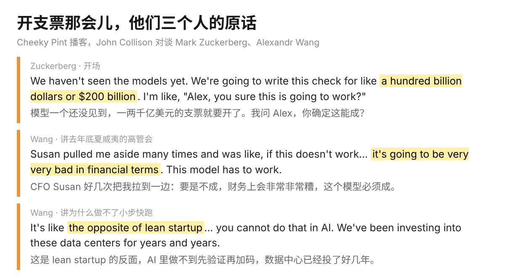
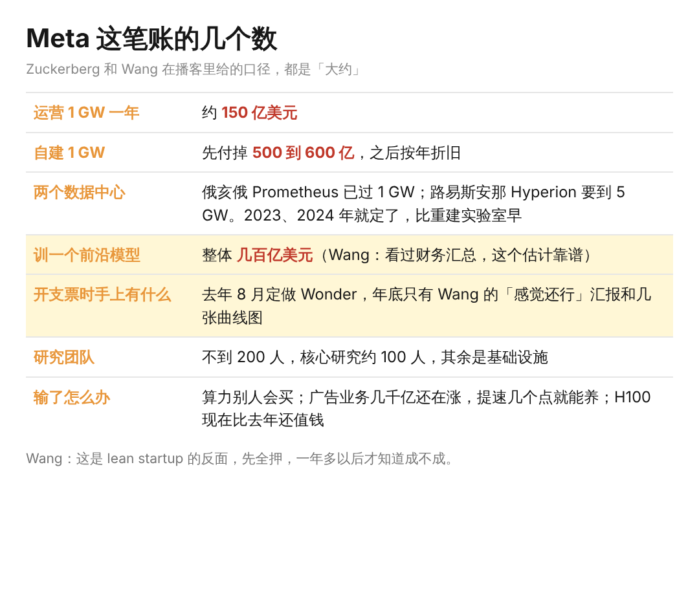

去年底 Meta 高管在夏威夷开会，CFO Susan Li 好几次把 Alexandr Wang 拉到一边，说这个模型要是不成，财务上会非常非常糟。那时候 Muse Wonder 连影都没有，一千亿到两千亿美元的支票已经开出去了。

这是 Stripe 联合创始人 John Collison 的播客，请了 Zuckerberg 和 Wang 喝 Guinness，聊了两个多小时，主题就是 Meta 刚发的这个前沿模型。

Wang 不到 30 岁，Scale AI 做了九年，去年 4 月 Llama 4 发完没几天 Zuckerberg 给他打了个电话，一年多时间从零重建了 Meta 的 AI 实验室。

两个多小时里最值得看的是三件事：这笔钱是怎么下的，模型好不好他们自己怎么判，还有 Muse 里为什么连一个模型选择器都没有。

一、这笔账，是照着 lean startup 反着来的

先讲钱有多大。Zuckerberg 给的口径是，运营一个 1 GW 的集群一年大约 150 亿美元，自己建的话先付掉的钱接近 500 到 600 亿。

Meta 在俄亥俄的 Prometheus 已经过了 1 GW，路易斯安那的 Hyperion 要做到 5 GW，这两个数据中心 2023、2024 年就定了，比重建实验室还早。所以训一个前沿模型整体要花多少，Wang 说他看过财务汇总，几百亿美元是个靠谱的估计。

Wang 讲了一段很实在的话。创业公司都讲 lean startup，先做一点，看到有效再加码。AI 里完全做不到，数据中心得提前好几年动工。

Muse Wonder 从去年 8 月就定了要做，年底开支票的时候，手上只有他一份「感觉还行」的汇报和几张曲线图，没有任何证据说明这个模型会好。Zuckerberg 当时问他的原话是，Alex，你确定这能成？

Zuckerberg 自己倒不觉得有那么险，他算的是另一笔账。要让这事亏，不是 Meta 的模型失败就够了，得整个 AI 都失败，因为只要 AI 还在，算力就有人要。

核心的广告业务几千亿美元还在涨，靠模型把它提速几个百分点，就能养活很大一块投入；数据中心自己建还能按年折旧，H100 现在的价值比去年还高。所以他说的不是不险，是输了也有人接盘。

我想了一下，最近五年工作里真的没有一件事是资源先投下去、结果要很久才看得到的，大家都在小步快跑，一个版本一个版本验证。Meta 这种押法倒像价值投资讲的长坡厚雪，先认一条坡，再花几年等雪。

二、公开榜单他们越看越少

Collison 问得挺直接，大家都说模型在刷榜，benchmark 一变成目标就不准了，你们训模型的人怎么看。

Wang 的回答是，顺着一个公开 benchmark 往上游看，它多半是某个博士生读博期间做出来的。你盯着它，等于把自己的产品思考外包给了一个碰巧做出爆款榜单的博士生。

他们的做法是，刚起步的时候看公开榜单，那阶段只是在确认模型活着，之后每发一版，内部 eval 占的比重就更大一点。内部那张表上是上百条很细的能力，每一条对用户可能只差 2%，加起来才是用着顺手的感觉。

有一条他们专门拿出来量，叫 big model smell，大模型闻起来是什么味。量法是看模型在训练分布之内和分布之外的表现差多少，差得越小，越像是真的大，而不是针对题目练出来的。从 Muse Spark 到 Muse Wonder，这个差距缩了一大截。

Zuckerberg 补了一个例子，说明为什么他们要的能力和别家不一样。你怀孕了或者有过敏，让 agent 订一家餐厅，它得知道你的情况，又不能把你的病情告诉餐厅。编程 agent 不用管这个，所有人看的是同一份代码库，这种分寸它根本用不上。

我自己从来没看过公开榜单，选模型看的是手上的活。Claude 是最贵的那个，各方面能力顶级，最核心最难的任务给 Claude 的 Fable 5。

Codex 工作里天天用，代码强；Grok 的好处是能连到 Twitter，英文圈最新的东西从那拿。三个模型三张桌子，哪个榜单也排不出这个分工。

三、Muse 里没有模型选择器，也没有 effort 选择器

Collison 说这是 Muse 最显眼的一个产品决定。Wang 的解释是，AI 产品大多是技术人做的，脑子里没有一个「随机抽一个美国人」的用户。

模型的命名数字一会儿倒着走，一会儿换一个新词，不读 API 文档的人根本不知道该选哪个。所以 Muse 的做法是付费之后 Wonder 自动接管难任务，用户的感受只有一个，它变好了。

Zuckerberg 把这件事往前推了一步，他们内部的说法是 the model is the product。产品那一层越来越薄，agent 真正要做的产品工作剩下隐私和权限模型。

性格、分寸、什么时候主动找你、怎么跟你说话，全都是训进模型里的。Nat Friedman 想让产品手感好一点，谈的其实是 post-training。

天天切三个模型的人是少数。大多数人要的就是「它变好了」，不想知道 Wonder 和 Spark 差在哪，这一点上 Meta 做得对。

最后 Zuckerberg 说了一句挺有攻击性的话，别家都在忙着自动化知识工作，超级智能最高的用处是发明和创造，不是自动化。把活交给 AI 这件事我做了两年，自动化干的是今天的活，腾出来的时间才轮得到创造，顺序大概是这样，先后不太好颠倒。
