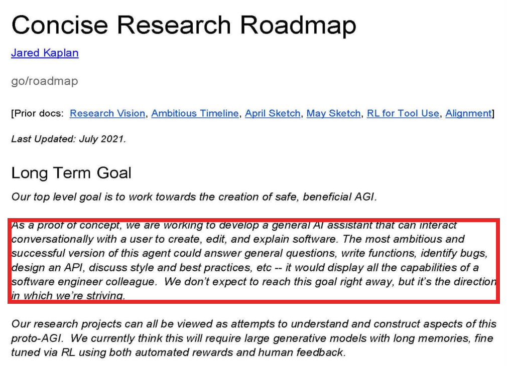

今天刷到一份 Anthropic 五年前的内部文件，看完我有点坐不住。

那是 2021 年夏天，ChatGPT 还没出来，大多数人还不知道大模型到底是个什么东西。这家做 Claude 的公司那时候刚成立几个月，就已经把接下来五年要做的事写在了三页纸上。

文件是他们一个联合创始人写的研究路线图，页脚写着「高度机密」，是打版权官司的时候被法庭给披露出来的。三页正文，旁边还有二十几条同事当天留下的评论。

你今天在终端里敲一句话、然后看着它自己把整个仓库改完的那个东西，其实五年前就写在这份文件的第一段里了。

1

文件开头先讲的是目标，安全有益的 AGI，这句话你在他们官网上也能看到的。

但往下那一段就有意思了。他说，作为概念验证，我们要做一个通用的 AI 助手，能跟用户对话，帮人把软件写出来、改好、讲明白。最有野心的版本能回答问题、能写函数、能找 bug、能设计接口、还能跟你讨论代码风格，「显示出一个软件工程师同事的全部能力」。

你看，这不就是 Claude Code 吗。写下来的时候是五年前的夏天，真的发出来是去年初，中间隔了三年半。

我自己用它快两年了，当时觉得这东西是一夜之间冒出来的。现在才知道，它是一群人五年前就想清楚了、然后花了五年才做出来的。

2

再往下看，他写了这个助手到底需要什么。原话是「带长期记忆的大型生成模型，用强化学习来微调，奖励既来自自动化也来自人类的反馈」。

文件后面给了具体的研究方向。要训万亿参数以上的模型，要研究超长的上下文，要用强化学习教模型用工具，还要用代码提交记录这种数据把人的意图和模型的行为连起来。

有一条我看了很久。他们提出要研究推理时算力的 scaling law。这个词大家是前年底才因为 o1 开始讨论的，他们那时候就已经把它列进研究清单里了。

3

正文就三页，我觉得更好看的其实是旁边那二十几条评论。

全是同一天下午五点半前后那十几分钟里留的，Dario 和几个创始成员就在文档的边上你一句我一句。

有一个人留了一条：我最大的问题是，不沙箱的工具怎么安全部署？Dario 在下面接了一句：尤其是部署的时候能执行代码的那种工具。

这个问题你今天还在面对。上周我写定时 agent 那篇，讲的就是给它的权限只给只读、沙箱只连白名单。五年前他们在文档评论里问的，就是你现在每次开权限的时候犹豫的那件事。

还有一条是 Amanda Askell 留的。她说有点担心，如果对齐研究做在自然语言上、能力研究做在代码上，两边会脱节，「对齐会变成一座孤岛」。

你现在用 Claude 的感觉大概也是这样，代码这块它确实强得离谱，但你让它写一段像人说的中文，还是要费点劲的。

最后一条我想说的，是另一个研究员和 Dario 的一来一回。他说，做最好的编程搭档，和做一个能让人信服的工具使用演示，这两件事是有张力的，前一件该先做仓库搜索，后一件该先做打印调试和编辑器。Dario 回了一句：短期先做后者，长期做前者。

这就是一个 PM 在排优先级嘛，只不过他那张表的跨度是五年。我平时做产品，排期的单位是两周，看完这份文件说实话有点惭愧。你手里那些两周一迭代的事，放到五年的尺度上能不能连成一条线，我自己是答不上来的。
