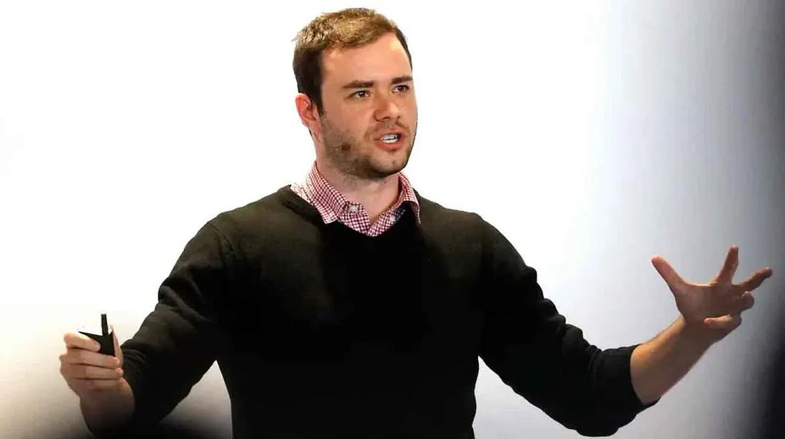

这周刷到 Karpathy 的一条长推，讲的是一件事：大家对 AI 有多强的认知，差距不但没缩小，还在拉大，形状是个漏斗。按他的定义，我已经做到了头部 0.2%。

K 神是 OpenAI 的创始成员，后来去特斯拉管了五年自动驾驶的 AI，2022 年离开，回 OpenAI 待了一年又走，中间自己做 AI 教育，在 YouTube 上一行一行手写代码教人搭大模型。

今年 5 月他加入了 Anthropic，带一个用 Claude 来加速预训练研究的小组。去年「vibe coding」这个词就是他造的。

他粗算了四层人。

1、60 亿人连碰都没碰过，这是地球上四分之三的人。

2、10 到 20 亿人用免费版，觉得它是个傻聊天机器人。当成好一点的搜索，帮忙写点东西。很多高管也在这层，每天的工作是跟人说话，对 AI 的理解是二手的。

3、2000 万人，0.2%，在数学和代码里用最前沿的模型干活。这群人亲眼看到以前几周几个月的项目，一个提示词交给 agent 就做完了。他自己一年前还在一个字一个字敲代码，偶尔按 Tab 补一小段。

4、5000 人在实验室内部用还没发布的版本。几千个 agent 协作几周做一个软件巨型项目，挖漏洞、用机器速度攻防、推进数学前沿。人类的审查已经跟不上了。

我在第三层。以前做产品，调研一圈竞品要 3 天，现在交给 Claude，10 分钟。每天早上追行业动态要 1 小时，现在 5 分钟，看 Grok 给我总结的浓缩版。这就是「几个月的活一个提示词干完」在产品经理这行的版本，比例差不多。

Grok 那个早上抓推特的 bot，上周定时 agent 那篇写过。

原文里这句我划了线：

「Somewhere around 20M people (0.2%) see first-hand that large, complex projects that used to take them weeks/months can now be completed by agents with a prompt.」

大约 2000 万人亲眼看到，以前要几周几个月的大项目，现在一个提示词交给 agent 就能做完。

漏斗是三样东西推出来的。

头一样是问题够不够大。一个一段话能答完的问题，根本压不出这套系统的能力，你得手里有一堆又大又难、自己真在乎的事。

竞品调研就是这种事，以前三天是因为要翻几十个页面、对功能表、写总结，这整套交出去才看得出差别。你让它查一个词的意思，它跟搜索引擎没区别。

第二样是能力长得锯齿状。模型在数字化、可验证、有经济价值的领域最强，因为训练靠的是能判对错的奖励，训练环境又是按赚钱潜力挑的。所以代码和数学先起飞。

第三样是你用的哪一档。免费版、付费版、内部版，看到的根本不是同一个东西。很多人去年试过免费版 ChatGPT，就拿它定了对 AI 的看法。

这三样里，卡住我身边人的是头一样。我没劝过谁，工作方式已经固化的人，你给他一个 Claude Code 他也只会拿来问问题，手里没有一件够大的活交出去。工具他有，缺的是一件愿意整个交出去试一次的活。

不写代码的人也一样。做运营的，把这个月所有竞品的活动页截图扔进去，让它列一张表；做 HR 的，把二十份简历和岗位要求一起给它，让它按匹配度排序并说理由。这两件都是以前要半天的活。

小红书上年轻人最容易 FOMO，刷到「0.2% 已经一周干完几个月」这种话，第一反应是又被落下了。从第二层到第三层其实不用学编程，只要换一件活：别再问它问题，把手上最烦、最花时间的那件整个交出去，三天的活交一次就知道了。

推文最后一段讲现在的怪异之处：大众觉得 AI 是傻机器人，一小撮人正经历曲线竖直上升的眩晕，这些全在同时发生。眩晕我没有，十分钟做完三天的活那种不真实感，有过几次。
