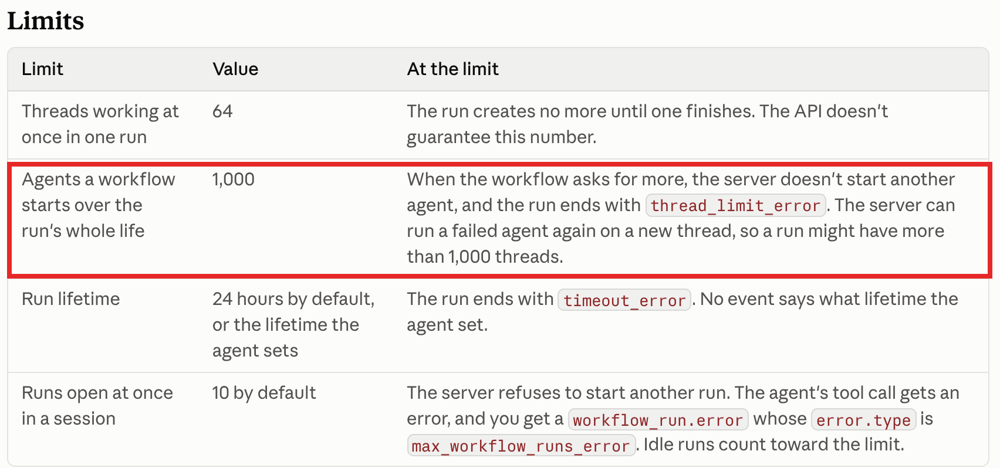
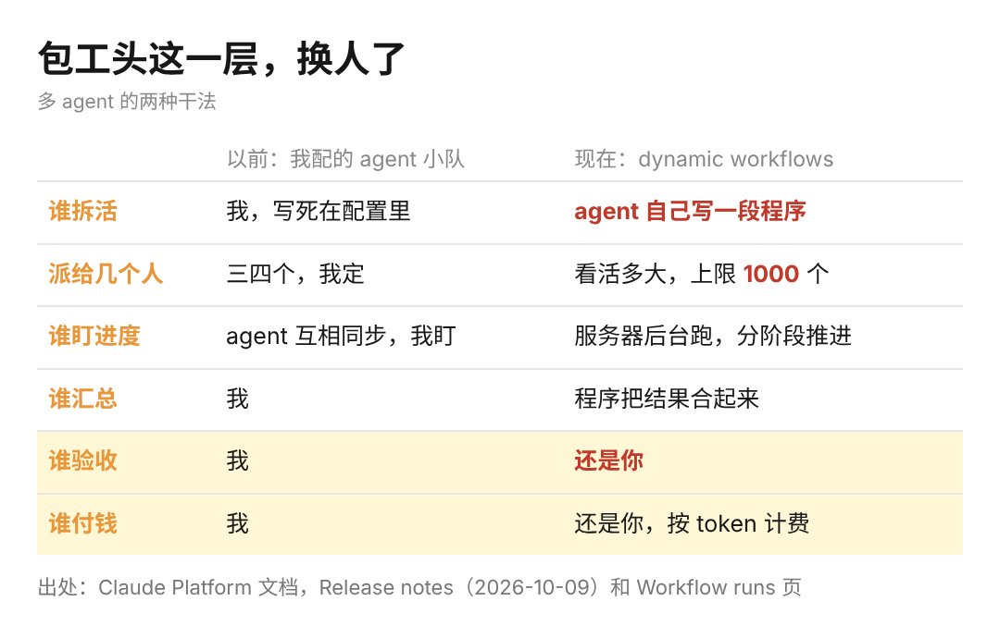

这两天又刷到有人说多 agent 是「烧钱的玩具」，我挺烦这种撇撇嘴就下结论的说法。

但说这话的人，多半自己没真派过活。我现在每天有十几个定时任务在跑，难的活、写代码的活、盯英文圈消息的活，分给三个不同的 AI。说白了，我每天干的就是包工头的事：自己不砌墙，把活拆好、分出去，最后验收。

上周五，Claude 上了一个新功能，叫 dynamic workflows，还在测试阶段。我看完文档的感觉是，包工头这活，AI 也开始抢了。

很多人看到它一次能起 1000 个 agent，第一反应就是这得烧多少钱。其实这次真正变的地方在别处，在于谁来当那个包工头。

以前的多 agent 是什么样，我自己配过。Claude 刚能组 agent 小队那阵，我搭了一个：一个接数据查询，一个搭前端，一个做分析，它们之间互相同步进度。

可是谁干什么、谁先谁后，全是我提前写死在配置里的。就像包工头先把图纸画好，工人照着图干，图纸要是错了，大家就跟着一起错。

这次的做法是，画图纸这一步也交出去了。你丢给它一个很大的活，文档里举的例子是审几百份文档，它会自己写一段程序：先派一批工人，每人读几份，读完再派一批人去核对，最后把结果合到一起。这段程序在服务器后台跑，你可以去忙别的，回头再来看进度。

换句话说，以前 AI 是工人，你是包工头。现在 AI 自己当了包工头，你往后退一步，变成了甲方。

这也不是一家在做。这个月 OpenAI 的 Codex 加了让几条任务并排跑的功能。GitHub 那边也开放了让 AI 直接操作电脑的预览。各家都在往同一个方向走，就是一个人指挥一群 AI。

你如果是带团队的人，可以想想自己一周里有多少时间花在「这个活给谁、什么时候交、交上来怎么拼」上面。很多时候，这部分比你自己干活的时间还长。

比如你是做用户研究的，手上有三百份访谈记录，要挑出所有抱怨价格的段落，再按行业分好类。这种活以前你得拆给三四个同事，现在拆活、派活、汇总这三步，它都能自己写程序干完。

当然，我不觉得这事已经能放心交出去，卡点至少有三个，都是我自己踩过的。

头一个是钱。文档写得很清楚，这个功能没有单独的价格，每个工人用掉的 token 照常计费，到了预算会自动暂停。

我上个月底就把公司企业版 Codex 的额度用完了，十几个定时任务，背后每次都要跑很重的数据查询。十几个就能烧完，一千个是什么量级，你可以自己算一下。所以预算那个开关，真的别当摆设。

第二个是拼不起来。我那十几个任务里，老出问题的从来不是单个任务，而是最后把数据拼成一个页面的那一步，经常数据源和页面上显示的对不上。工人各交一份活不难，难的是把一千份活拼成一面不歪的墙。

第三个是你得会验收。一千个工人交上来的东西，你没办法一份一份看。包工头怕的不是工人偷懒，是自己根本不知道墙砌歪了没有。

所以我对多 agent 的判断是，它先拿走的是包工头拆活、派活的那一层，而会拆活、会验收的人，反而会更值钱。

以前要当包工头，得先在工地上熬好些年。现在第一天就能当，前提是你心里清楚，那面墙最后应该长什么样。
