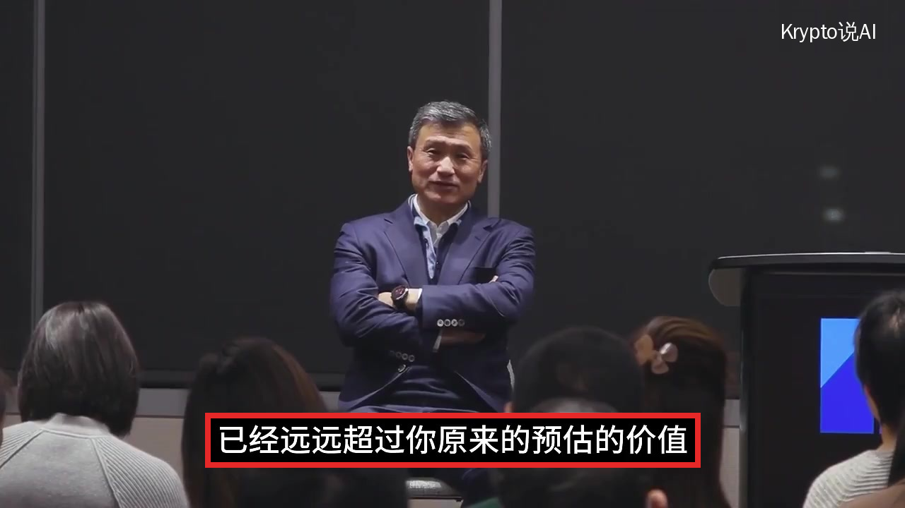
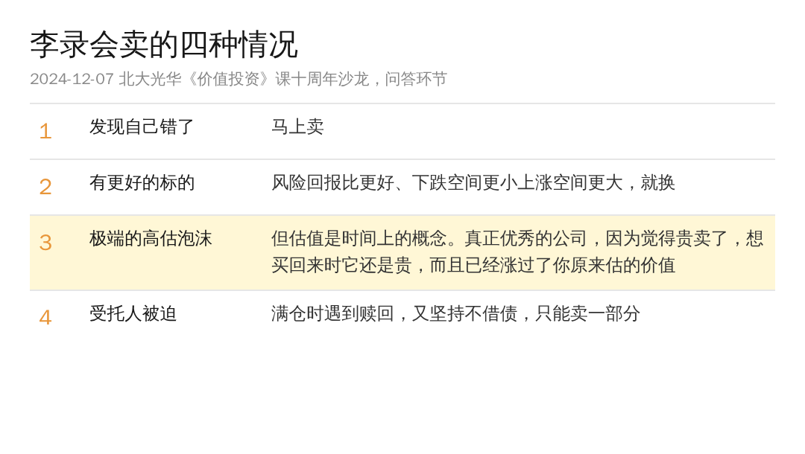
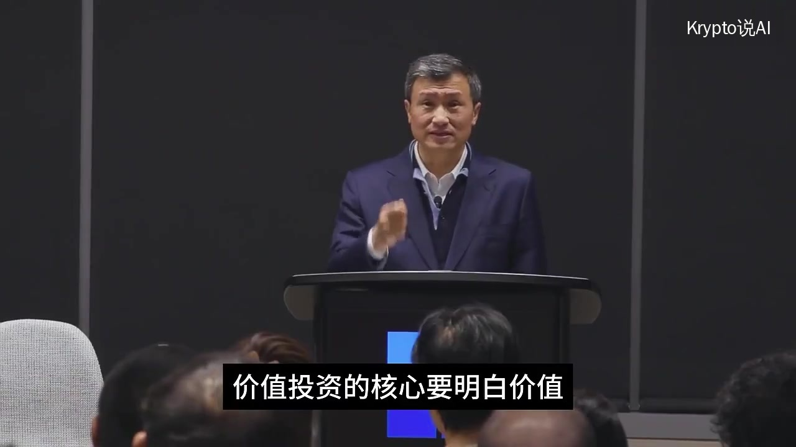

买股票的道理大家都听过不少，什么时候该卖，却很少有人讲清楚。你可能也有过这种时候：涨了一倍，心里开始发虚，卖了，然后眼看着它又涨了一倍。

李录在北大被问到的就是这件事：好公司被市场明显高估了，涨到什么程度你会减持？他答这个问题时说了一个数字，比亚迪他们拿了 22 年，这期间股价至少七八次跌掉一半。

李录生在唐山，在纽约创办了喜马拉雅资本，芒格这辈子只把自家的钱交给过他这一个外人打理，巴菲特买比亚迪也是他牵的线。上周写过他怎么看 AI，这次这段是他的本行。

这是前年年底北大光华《价值投资》课十周年的那场沙龙，问答环节里的一段。他说会卖的情况只有四种，前两种几句话就讲完了，真正花时间的是第三种。

1、发现自己犯了错，马上卖

这是他说的第一条，听上去也是这四条里头简单的那一条。

但我觉得这条其实挺有争议的，因为很多时候，初级投资者根本做不到「发现犯错」。股价跌了，你分不清是自己看错了，还是市场暂时看错了，等你确认是自己错了，往往已经晚了。

所以这一条的前提，其实是后面他花了大半时间讲的东西：你得先真的懂这家公司。

2、有了更好的标的也会卖，不一定是手上这只变差了

同样一笔钱，如果另一个机会的风险回报比更好，也就是下跌的空间更小、上涨的空间更大，他会换过去。

这条没什么可争的，就是把钱挪到更划算的地方去。

3、极端泡沫会卖，但好公司别轻易因为「贵」就卖

第三种是市场出现了极端的高估泡沫，但这一条呢，他自己马上就打了个折扣。他说估值很多时候是一个时间上的概念，取决于这家公司长期能长多大，而人类共同的毛病，是常常放大短期因素、忽视长期因素。

问题是，能长期增长的公司其实极其难找：竞争力能长期压过对手，增长空间很大，资本回报率又好。他说这种公司凤毛麟角，所以他们管它叫「圣杯」。

真找到了、也真理解了，他的建议是别轻易丢掉这个筹码。你因为觉得高估卖掉它，再想买回来，会发现还是同一个问题，它还是贵，你还得接着等。等的这段时间里，它的增长可能已经远远超过你原来估的价值。

这段我太有体会了。去年过年买的美光，翻了一倍之后我觉得已经高估了，就卖了，想再买回来的时候，它又翻了一倍。

他说一家你研究明白的好公司，同时又很便宜，这种机会他做了这么多年投资，也就只碰到过那么几次。所以难的不只是找到，还有拿不拿得住。

先拿伯克希尔来说。大家都觉得它是一座城堡，由全世界顶尖的投资人打理，几十年屹立不倒，可它的股价也有过三四次跌超 50%。那个时候你能不能继续拿着，取决于你是不是真的理解它手里那一堆资产和子公司。

然后就是比亚迪了。他们拿了 22 年，股价至少七八次跌掉一半以上，有一次跌了 80%。还有一年，比亚迪创造的价值明明在增加，股票却跌了 70%。

他说每一次大跌，都在考验你能力圈的边界是不是真的：你是真的懂吗？真的知道它值多少、创造了多少价值吗？他的原话是，只有触摸到边界，才能确认这个圈是否存在。

这 22 年里，比亚迪的销售额从十亿元涨到将近一万亿元人民币，现在还在涨。

说得再直白一点：拿得久不是靠耐心，是靠真懂。跌一半的那一天就是一场考试，你答得出这家公司值多少钱，就拿得住；答不出，拿住了也只是运气。

我自己拿 Circle 的时候，波动很大的那几次也是这么过来的，判断它的价值还没被 priced in，就拿得住。当然这得分品类，不是每只都能这么拿。

4、作为受托人，有时候不得不卖

最后一种呢，是被动的。基金满仓的时候遇到赎回，而他们有一条基本原则是不借债，那就只能卖掉一部分。

为什么死守不借债，他的解释是：只有不借债，才扛得住整个组合跌掉一半的极端情况，个股大跌在投资里本来就很正常。他说如果你的投资生涯里没经历过几次这样的考验，就很难弄清楚自己的能力圈是真的还是假的，你是真明白、真勇敢，还是真鲁莽、真运气。

回到开头那个问题，涨了一倍要不要卖。按他的说法，先别看涨了多少，先问自己：如果明天它跌一半，你还拿得住吗？

问答快结束时，他又提到演讲最后讲的那件事：芒格 99 岁还买入了一只股票，而那个行业他已经研究了至少六七十年。他说能力是可以复利增长的，所以年轻的时候可以从简单的做起，先买最便宜的股票，因为只有价格足够便宜，你才能安心地长期拿着，才有时间去理解这门生意。

他最后说，长期持有的前提是真正理解，而不是为了长期持有而长期持有。能力圈要一点点建立，不必着急。
