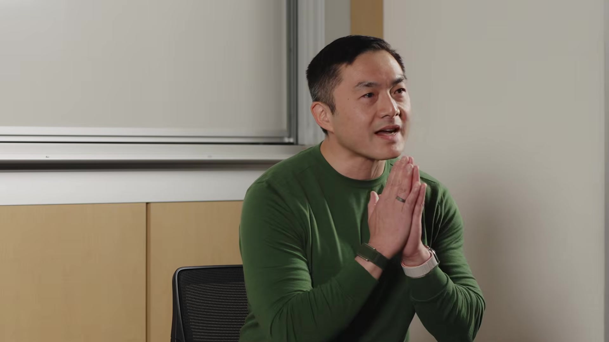
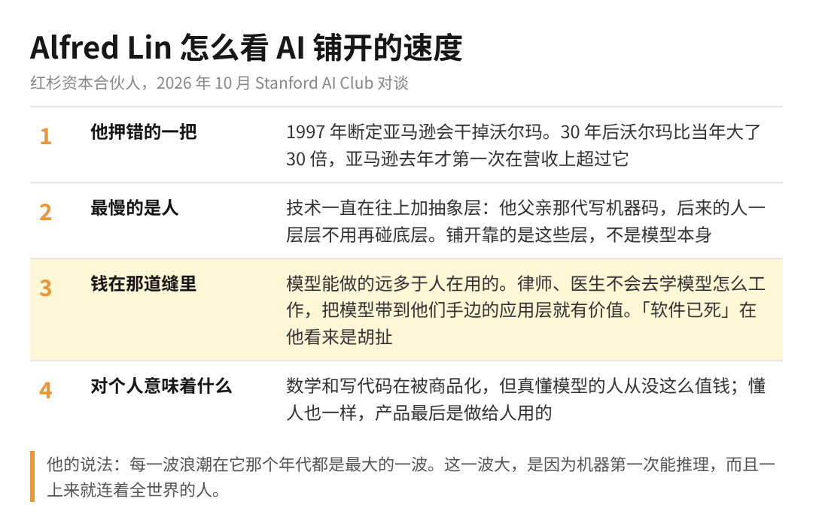
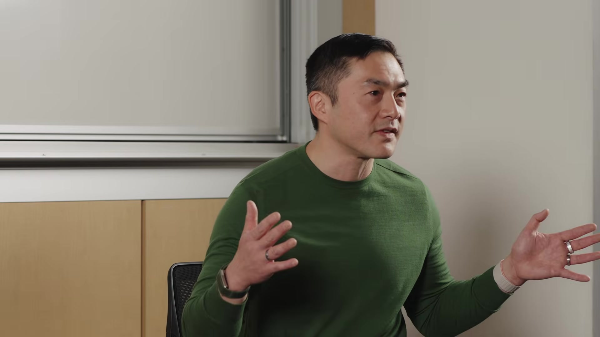

怕被 AI 淘汰的人，多半把它铺开的速度想快了。每周都有新模型刷榜，看着就像下个月你那个岗位就要换人，会慌其实很正常。

但有个红杉合伙人前几天在斯坦福讲了自己押错的一把，听完你大概会松一口气。

那是互联网刚冒头的时候，他认定亚马逊迟早会把沃尔玛干掉。三十年过去，沃尔玛反而比当年大了三十倍。

他叫 Alfred Lin，红杉合伙人这个位置他坐了 16 年，Airbnb 和 DoorDash 都是他投的。在这之前，他做过 Zappos 的 COO 和 CFO，后来把这家卖鞋的公司卖给了亚马逊。最早他在斯坦福读博士，读到一半退学，跑去了一家刚起步的互联网公司。

这场对谈从他的虎爸虎妈一路聊到 AI 泡沫，看着很散，其实都在回答一件事：AI 这一波到底有多快，钱和机会会落在哪。我挑了三段。

1、当年押错，是因为他把人想快了

他退学的理由就是互联网来了。那时候谁都看得出来互联网一定会发生，所以他才敢断定亚马逊会把沃尔玛吃掉。可亚马逊直到去年，才第一次在营收上超过沃尔玛。他说 AI 这一波确实比以前哪一波都快，但快归快，照样得花很长时间。

原因听起来很朴素：技术里走得最慢的，是用技术的人。人这几十年其实没怎么变，进化本来就慢。模型能做到的，和普通人真的拿去用的，中间永远隔着一大段。

拿他自己家来说，父亲那一代要直接写机器码，到他这儿只在一门汇编课上碰过，台下这些学生大概谁也不想去写。技术就是这样一层层往上加抽象，加到普通人不用懂底层也能用，才算真正铺开。

所以模型变强是一回事，你身边的人真的用起来是另一回事，而后面这件事要慢得多。

2、钱就在模型和人之间那道缝里

聊到这儿，他顺口骂了一句「软件已死」的说法，原话是 kind of BS。在他看来，你叫它软件也好，叫它应用、叫它扩散层也好，说的都是同一道缝：模型能做的，和人真正在用的。

律师、医生、做市场的、管财务的，不会为了用 AI 先去搞懂模型是怎么工作的。谁能把模型送到他们手边，谁就站在这道缝上。他举了红杉投的 Harvey，一开始是建在前沿模型上的，现在开始训练自己的模型，因为想把自己的智能握在手里。

另一个例子是 Open Evidence。他说医生就算拿到一模一样的答案，也不愿意用 ChatGPT，他们在乎的是这个回答有没有循证依据。所以这家公司没去推翻谁，就是做了一个医生愿意天天打开的东西。

还有一句话他常挂在嘴边：每个问题都有解法，每个解法又会带出新的问题。所以活是干不完的，这也是他不当末日派的原因。

3、会写代码在贬值，真懂模型的人在升值

主持人问他，AI 正在把数学和编程吃掉，技术背景还值钱吗。他说数学和写代码确实在被商品化，但真正懂模型怎么运转的人，从来没有像现在这么值钱过，而且最懂的那批人，已经不怎么写代码了。

他又补了一句，越是技术强的人，越要花力气去懂人。产品最后是做给几十亿人用的，钱也是从人手里流过来的。

放到你自己身上，多半就是这个意思：你担心的「AI 明天就替掉我」，按他的看法，要很多年才会真的落地。这中间的几年，既懂模型又懂你那一行的人，正是把模型带过那道缝的人。

快结束的时候，他说每一波浪潮在它那个年代都是最大的一波，PC、互联网、移动都是。这一波之所以更大，是因为机器第一次能推理，而且一出来就连着全世界的人。每一代人都得扛这种被推着走的感觉，他管这个叫进步的代价。

对着台下的学生，他的建议是趁年轻多冒点险，真不成，大不了还有斯坦福的学位兜底。这句他开场讲了一次，没人笑；快结束时又讲了一次，笑声多了一点。

他自己押错过一次，所以他说慢，我是信的。
