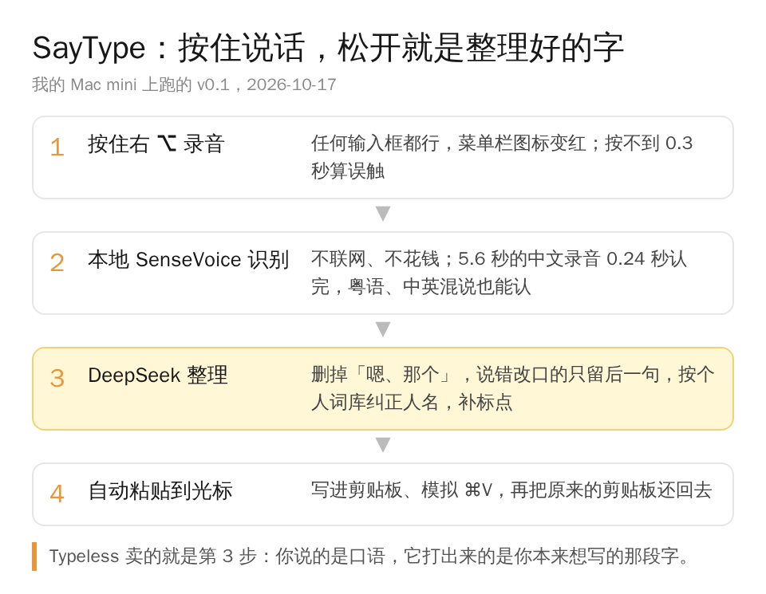
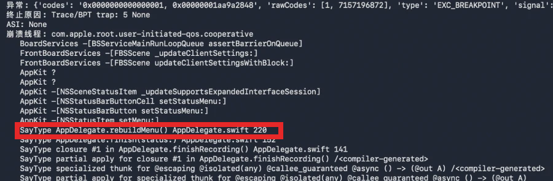
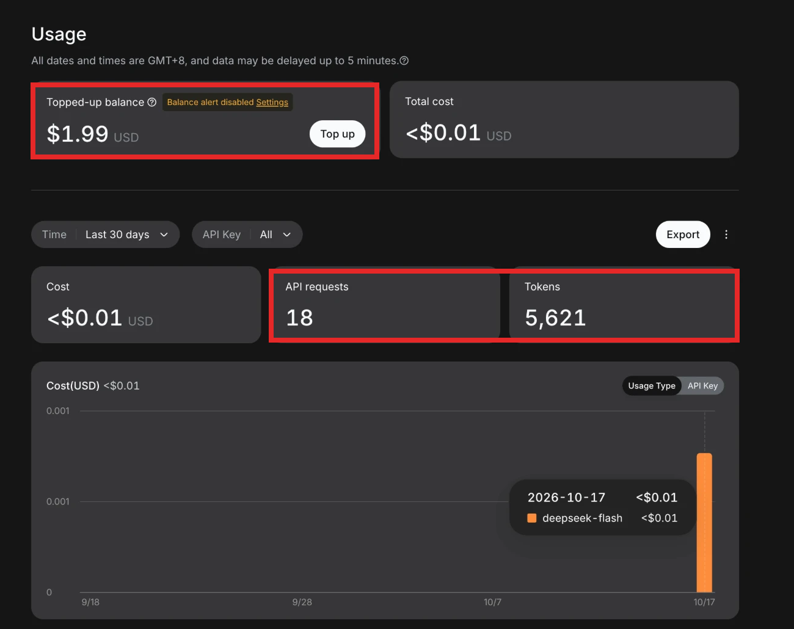
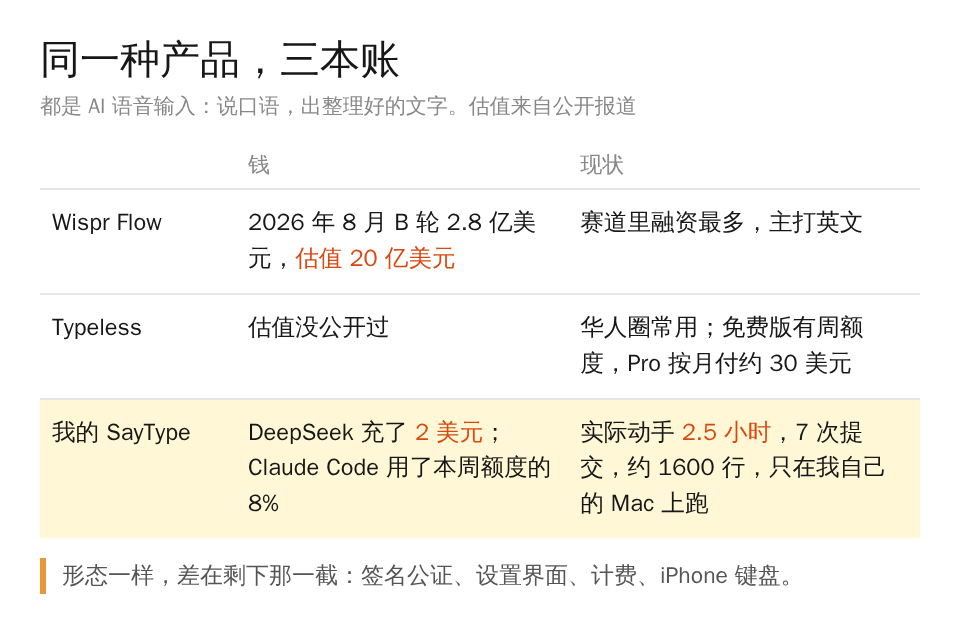

这周我第一次把 Typeless 的免费周额度用完了。它没有直接停掉，而是给我降速，我对着电脑说一大段提示词，要等很久字才出来。

Typeless 是一款 AI 语音输入法，在华人圈挺流行，我用了很久但一分钱没充过。被降速那天我想的是，与其充钱，不如自己做一个。周六中午 12 点 43 分，我在 Claude Code 里开了个新对话。

我先问它，能不能用一个逆向工程的项目把 Typeless 拆开照着做。它劝我别逆向，有法律风险也没必要，开源组件拼一拼就够了。我回了一句「好的」，15 分钟后第一版代码就提交了，21 个文件，1482 行。

中间我去忙别的，晚上十点半回来接着弄。前后真正动手的时间加起来大概 2.5 小时，23 点 11 分，我在备忘录里按住右边的 ⌥ 键说了一句话，松开以后屏幕上出现了上面这行字。

它做的事情其实就四步。

前两步谁都会做，手机自带的听写也能把声音变成字。真正值钱的是第三步，你说话的时候会有「嗯」「那个」，会说到一半改口，Typeless 卖的就是把这些口语收拾成你本来想写的那段字。我这版让 DeepSeek 来做这一步，本地识别用的是开源的 SenseVoice，5.6 秒的中文录音 0.24 秒就认完了。

当然也翻车了。第一句话打出来，App 紧接着就崩了，菜单栏的图标直接消失。我把崩溃报告扔给 Claude，它定位到是识别完以后在后台线程刷新了菜单栏，红框那一行就是。

修完这个，重装的时候又碰到识别服务注册失败，再修一次。第三个问题到现在也没完全解决：我戴着 AirPods 说中文人名，它经常认错，最后加了一个个人词库，让 DeepSeek 按词库去纠正。

成本这块我自己都有点意外。整个项目只用了 Claude Code 本周额度的 8%，按 API 价格折算是 10.34 美元。DeepSeek 我充了 2 美元，听说能用很久，到现在 18 次请求，花了不到 1 美分。

做完以后我就没再打开过 Typeless。

然后我去查了一下这个赛道值多少钱。Typeless 自己的估值没公开过，它最大的对手 Wispr Flow，今年 8 月刚拿了 2.8 亿美元的 B 轮，估值 20 亿美元。

你要是每天也对着 AI 说一大段话，大概能明白这个产品为什么值钱：打字跟不上脑子的时候，谁替你把话说清楚，谁就是你每天打开次数最多的那个软件。

我当然不会说我做了一家 20 亿美元的公司。离能卖还差一大截，签名公证、设置界面、计费，还有 iPhone 键盘不让用麦克风这件事，每一样都比那 2.5 小时难。但至少产品形态是一样的，按住说话，松开就是整理好的字。

所以我在认真想下一步：找投资人，做出海。Typeless 和 Wispr 主打英文，国内有豆包和微信输入法免费听写，我想先试东南亚市场的 AI 语音输入法。

作为一个 AI builder，这是我第二次从零做一个 App，上次是跟老婆打高尔夫手搓的训练软件。这次从想法到能用，一个晚上。
