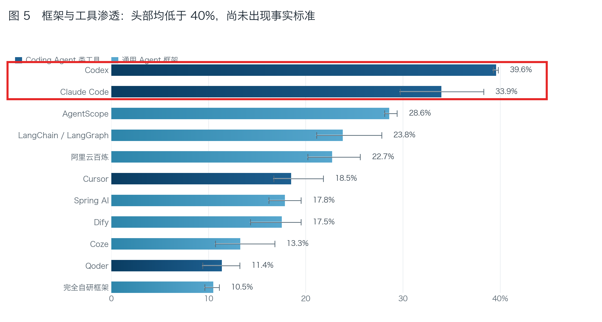
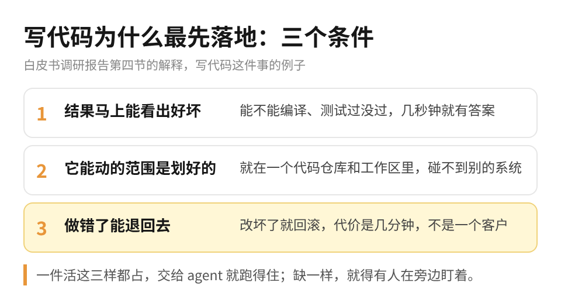
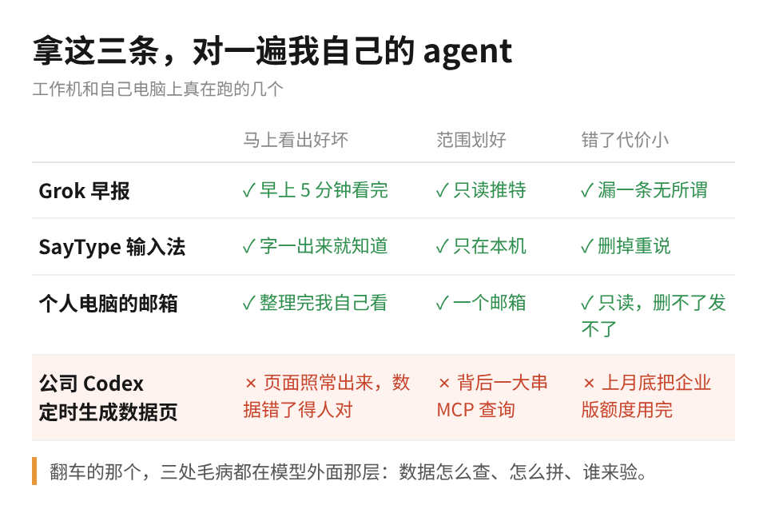

我手上每天跑着十几个定时任务，真正敢不看结果就放手的，其实没几个。

问题一般不出在模型笨。你要是在公司被要求「用 agent 提效」，大概也碰到过：demo 那天大家都说好，过两周就没人打开了。

这两天翻了阿里云开源的一本 AI Agent 白皮书，开篇是一份 1906 人的开发者调研：在做 Agent 的企业占 46%，真部署到生产的只有 18%。

很多人第一反应是模型还不够强，书里的结论偏偏不是这么回事。原话是：「卡点不是企业意愿，也不是模型能力，而是能优化 Harness 层开箱即用的工程配套。」

Harness 可以很粗略地理解成模型外面那层东西：给它看什么资料、能用哪些工具、权限开到哪、做完谁来验收。书里的说法是，Agent 等于模型加上这层，任务越长、工具越多，外面这层就越要紧。

这本书一共三十章，从架构一路写到调优，开放一个多月，GitHub 上已经一千六百多个 star。全书我觉得最好用的不是哪一章，是调研报告里顺手解释的一段：为什么写代码是 Agent 第一个跑出规模、企业愿意掏钱的场景。

调研里 57% 的企业采购了编程工具。大家看图里框出来的两行，排最前面的就是 Codex 和 Claude Code，也是我天天在用的两个。

书里给的原因有三条。结果马上能看出好坏，能不能编译、测试过没过，几秒钟就知道；它能动的范围是划好的，就在一个代码仓库里；做错了能回滚，代价是几分钟。换句话说，写代码先跑起来，不是因为程序员的活简单，是因为这三样它刚好全占。

我拿这三条对了一遍自己在跑的 agent，结果挺扎心。

跑得最稳的是 Grok。它每天定时去推特上抓我感兴趣的内容，以前我每天要花一小时追行业动态，现在早上看五分钟它总结的精华就够了。看完就知道今天抓得好不好，它只能读推特，漏一条也不要紧，三样全占。

上一篇写的那个语音输入法也一样。按住键说话，松开字就出来，对不对一眼就看见，错了删掉重说。那天晚上十一点多它崩过一次，我也是第一时间就发现了。

翻车最狠的是公司那批 Codex 定时任务。我让它们每天生成 ChatGPT 的 sites，背后每次都有很重的 MCP 查询和计算，数据一多，组装就乱，数据源和前端展示都会出问题。上个月底，公司企业版的 Codex 额度被我用完了。

按书里那三条看，它一条都不占：页面每天照常生成，看起来没毛病，数据错没错得有人去对；背后连着一大串查询，范围根本划不清；额度烧掉就是烧掉了。这些全是模型外面那层的事，换个更聪明的模型，数据照样会拼乱。

书里还有一组数挺能说明问题：55% 的企业判断 Agent 好不好用，靠人工抽查；能用运行记录自动评估的，只有 6%。说白了，大部分 agent 出没出错，要靠人碰巧看到。

权限这块，我自己的做法其实也是在压第三条。工作机上我给了 AI 邮件和聊天权限，它能替我发东西；个人电脑只给了一个邮箱的只读权限，它帮我清垃圾邮件、整理重点，但删不了也发不出去。错了代价小，我才敢让它天天跑。

不写代码的人也能用这三条。书里有个会计师事务所的例子，信永中和，一万两千多人，先上的几个 agent 是查公司制度和流程、在 OA 里查工时填工时、整理文档和汇报框架。

这几件事的共同点是，员工问完马上知道答案对不对，agent 能碰的系统是划好的，填错一条工时改回来就行。你要是做运营、做行政，被老板要求「找几件事交给 AI」，可以先拿这三个问题过一遍手上的活：结果能不能马上看出好坏，它要碰几个系统，做错了谁来收拾。三个都答得上来的，先交出去。

答不上来的也别急着换模型。我从来不看公开的模型榜单，最难的活给 Claude，代码给 Codex，英文圈的一手信息让 Grok 去找，模型这块其实早就够用了。卡住的时候，多半是外面那层还没搭好。

这本书后面二十多章，讲的基本都是这层怎么搭：怎么记录、怎么评估、怎么管权限。工程师可以从第 3 章看起，不写代码的人看调研报告、架构篇和实践篇就够了。
