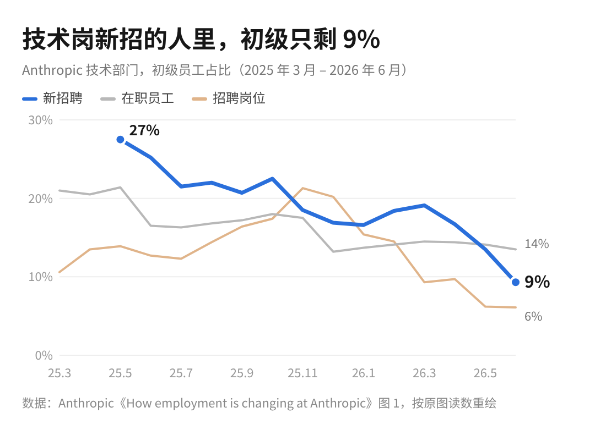

今年我们几乎没招校招生。我自己也当面试官，评估标准里单独加了一条：考察他们使用和管理 agent 的能力。

AI 不会取代新人。它取代的是只会执行、不做判断的那一层人，新人只是原本就站在那一层。

上周四，Anthropic 的首席经济学家 Peter McCrory 牵头发了两份报告，拿自己公司当样本。里面的数据，说明的是同样的问题。

1、新人的位置没了，是因为执行那一层被 agent 接走了。

Anthropic 技术岗新招的人里，初级的占比一年多就掉到了 9%。也是在同一段时间里，员工派出去的 agent，工作时长涨到了员工自己的 6 倍。活一件没少，但干活的已经换了。

你要是刚毕业，看到这里大概会心里一紧。被拿走的是「接活、照做、交差」这一套动作，不是你这个人。前提是，你别只会这一套。

2、活交给 agent 之后，人不会更轻松，只会更累。

活干得快了，不代表你可以摸鱼了🤡。Claude 的对话里，大约 80% 的时间它在等人回复；不写代码的员工，光把 agent 的产出读一遍就要用掉半周工时。有个工程师说，管这些 Claude 像带一屋子小孩，果汁盒打不开和手指割破流血，喊得一样急。

我对这个可太能共情了。我每天跑十几个定时任务，看板和监控做了一堆，可这些东西说到底是做给人看的，人的精力就那么多。一不留神几天没看，看板停了不更新，出了 bug 我也没注意到。

看板没人看，跟没做差不多。现在卡住的不是 AI，是看结果的那个人还有没有精力。

3、面试问的，已经从「你做过什么」换成了「你让 agent 做过什么」。

以前面校招生，我常让他们讲一个自己做过的产品 feature，从头到尾的流程、遇到什么问题、怎么解决的。现在换成问他们做过什么 agent、搭过什么自动化工作流。

Anthropic 那边也一样。报告翻了几千份面试评语，技术岗里涨得最多的一项是夸候选人「自主、有判断力」，讲领域专长和执行力的分量反而小了。

会写哪种代码、会用哪个工具，AI 随时能补上，在我这里已经不太加分。我更想知道的是，你分不分得清哪件活该交出去，交出去以后会在哪里出错。

4、现在慌的人，往往是最早看见的人。

Anthropic 员工觉得到 2030 年，AI 能做掉自己 75% 的活，美国在职的人只答 28%。报告的结论是，两拨人对就业的推理一模一样，差别只在亲眼见过 AI 能干到什么程度。

越在头部拥抱 AI 的人，越能感受到被替代的迫切；AI 还没普及开的那一大群人，暂时还感受不到。McCrory 说 Anthropic 用 AI 大约领先整个经济一年半。你现在没感觉，大概率只是那条线还没走到你这儿。

当然，AI 公司本来就特殊。这批员工大多还预计公司明年会扩招，AI 做掉的是活，不等于做掉了人。

5、明年找工作的话，带一个你自己的 agent 来面试。

面试前手上最好就有一个自己搭的 agent，或者一条跑起来的自动化工作流。我会问它是做什么的、哪里出过问题、你是怎么发现又怎么改的。这些答得出来的校招生，我会抢着要。
