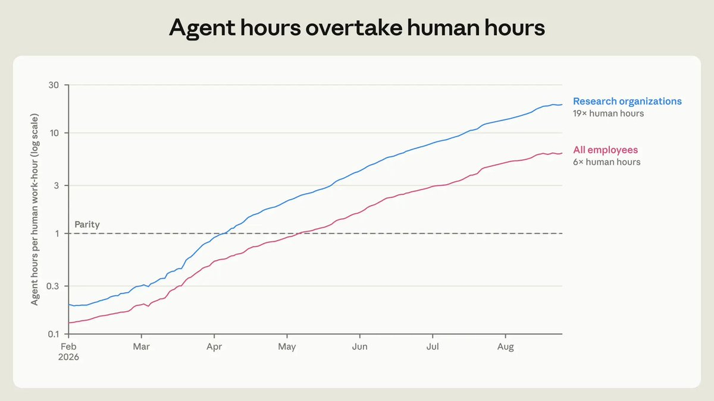
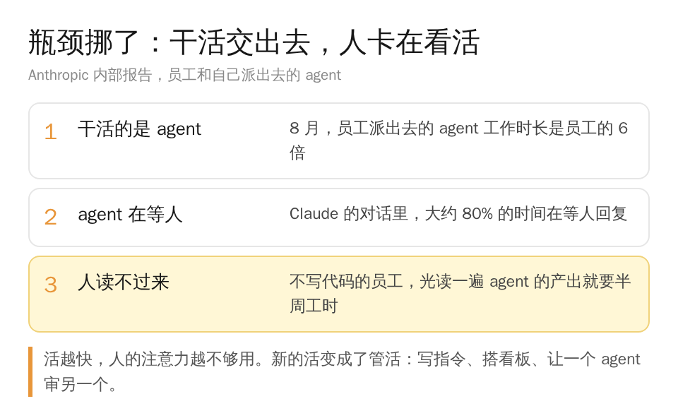
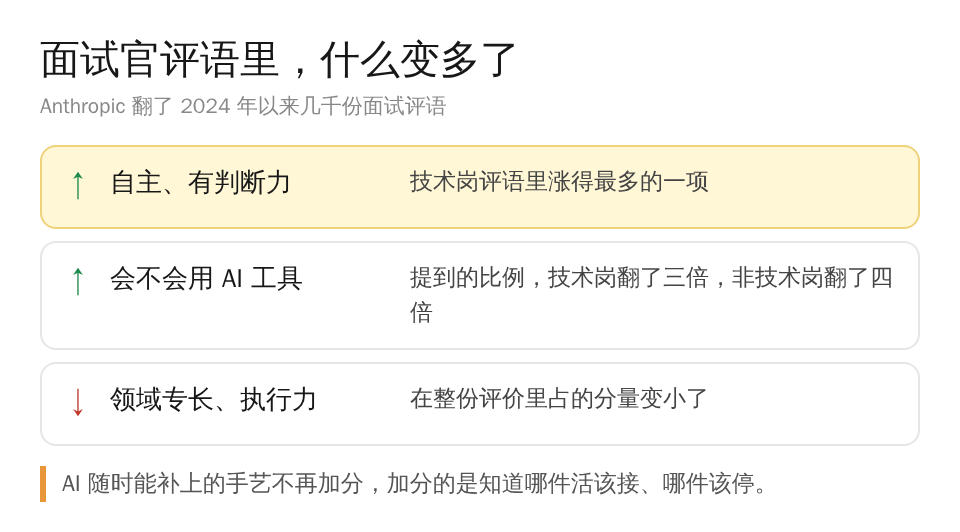
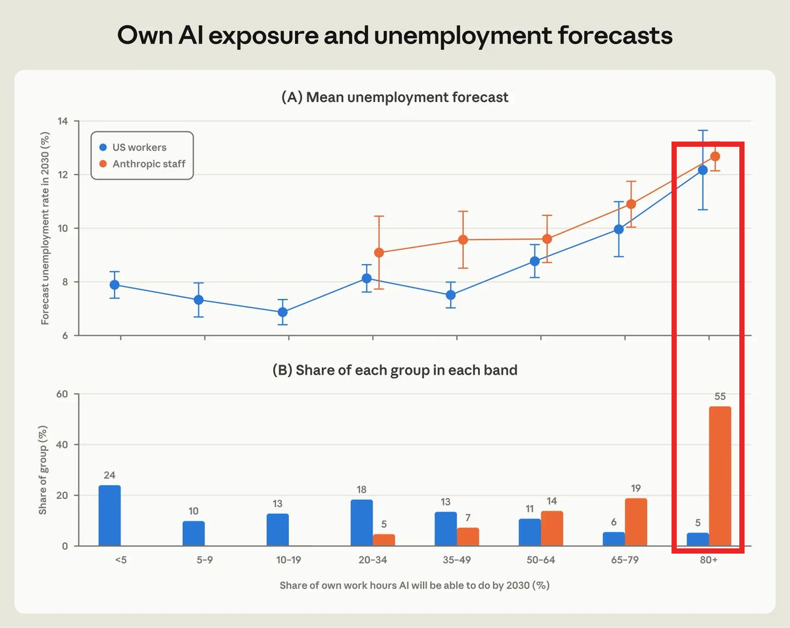
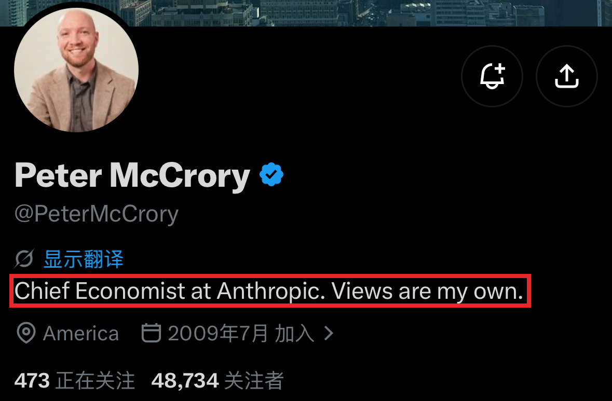

今年我们几乎没招校招生。我自己当面试官，评估标准里已经单独写了一条：考察他们使用和管理 agent 的能力。

你要是刚毕业，或者才工作两三年，看到这里大概会心里一紧：AI 是不是先拿新人开刀了？

上周四 Anthropic 拿自己当样本发了两份报告。技术岗新招的人里，初级的占比一年多就掉到了 9%，大家看图里那条蓝线。

我看完以后觉得，这条线只是结果。报告真正讲清楚的，是新人原来的位置为什么没了。

活其实还在，只是干活的换成了 agent，人被挤到了另一层。

Anthropic 就是做 Claude 的那家公司，上周那篇写过它五年前的内部路线图，这次它干脆把自己当成了实验田。

先看 agent 干了多少。员工自己派出去的 agent，到了今年夏天，工作时长加起来已经是员工的 6 倍。可以很粗略地理解成，每个人手下都坐着六个不下班的实习生。

活干得快了，新的麻烦也跟着来。Claude 的对话里，大约 80% 的时间它在等人回复。

不写代码的员工也躲不开，光把 agent 的产出读一遍，就要用掉半周工时。

有个工程师的形容挺好笑。他说管这些 Claude 像带一屋子小孩：一个喊果汁盒打不开、这是紧急情况，另一个手指割破了在流血，两个喊得一样急。

我对这个太熟了。我每天跑十几个定时任务，也给它们做了一堆看板和监控，可这些东西说到底是做给人看的，人的精力就那么多。

有时候一不留神几天没看，看板停了不更新，出了 bug 我也没注意到。

Anthropic 的员工后来干脆把力气花在管 agent 上。写给 agent 的长期指令，一年里攒了八千多条。

有人搭了一个 agent 当幕僚长，专门分拣别的 agent 的请求。还有人给自己的 Claude 团队写了一份绩效评估。

换句话说，干活这一层已经交出去了，人卡在看活这一层。

人的位置一变，招人的标准就跟着变。报告翻了几千份面试官评语，技术岗里涨得最多的一项，是夸候选人「自主、有判断力」。

讲领域专长和执行力的分量反而变小了。提到会不会用 AI 工具的，技术岗翻了三倍，非技术岗翻了四倍。

有个招聘经理说得很直白：他预计模型会一直这么参差不齐，所以想要团队里的人能在不同领域之间随便调。

某一门手艺 AI 随时可能补上，他要的是哪里有缺口都能顶上去、还知道该不该顶的人。

不写代码的岗位也一样。Anthropic 有个写产品文案的团队，Claude.ai 上跟你打招呼的那句「Hello night owl」就出自他们。

今年春天的时候，他们整理了一套资料让 agent 自己写文案，之后整个团队转去写提示词和评测。经理的说法是，以前用语言驱动人的行为，现在用语言驱动 Claude 的行为。

还有员工说，原来工作里 20% 是战略，现在战略占了 90%。

所以我面试校招生时单独看管 agent 的能力，跟 Anthropic 是同一个逻辑。新人以前靠执行攒经验，现在执行那一层 agent 接走了，进门第一天就得站到看活和拍板这一层。

第二份报告更有意思。Anthropic 问了员工和一万多个美国人同一个问题：到 2030 年，你现在的工作 AI 能做掉多少？

员工平均答 75%，美国在职的人平均答 28%。天天用 AI 的程序员，答的数也离普通人更近。

差这么多，两拨人的推理方式却一样。觉得自己大部分活会被 AI 做掉的人，猜的失业率都在 12% 左右，比金融危机最糟的时候还高。

大家看框出来那一列，员工有一半多站在这里，美国人只有零头。

报告的结论是，两拨人对就业的想法没差别，差在亲眼见过 AI 能干到什么程度。

这跟我自己的感觉对得上。越在头部拥抱 AI 的人，越能感受到被替代的迫切；反而是 AI 还没普及开的那一大群人，暂时还感受不到。

你要是现在还没什么感觉，先别急着松口气，可能只是那条线还没走到你这儿。

牵头这两份报告的是 Anthropic 的首席经济学家 Peter McCrory。他在推特上说得更直接：Anthropic 用 AI 大约比整个经济领先一年半，发出来就是想让大家早点准备。

当然，AI 公司本来就特殊，销售成单多一部分是产品好，报告自己也承认很多做法学不来。

而且这批员工大多预计公司明年还会扩招，AI 做掉的是活，不等于做掉了人。

我觉得 AI 先抽走的是执行那一层，新人倒霉在原本就站在那一层。抽走之后，人还值钱的地方是看活和拍板：agent 交上来的东西对不对，哪件该停，出了错谁来扛。

最先慌的那批人，正是最先看见这件事的人。慌完了，他们已经在往拍板那一层挪。AI 取代的，是不做判断的人。
