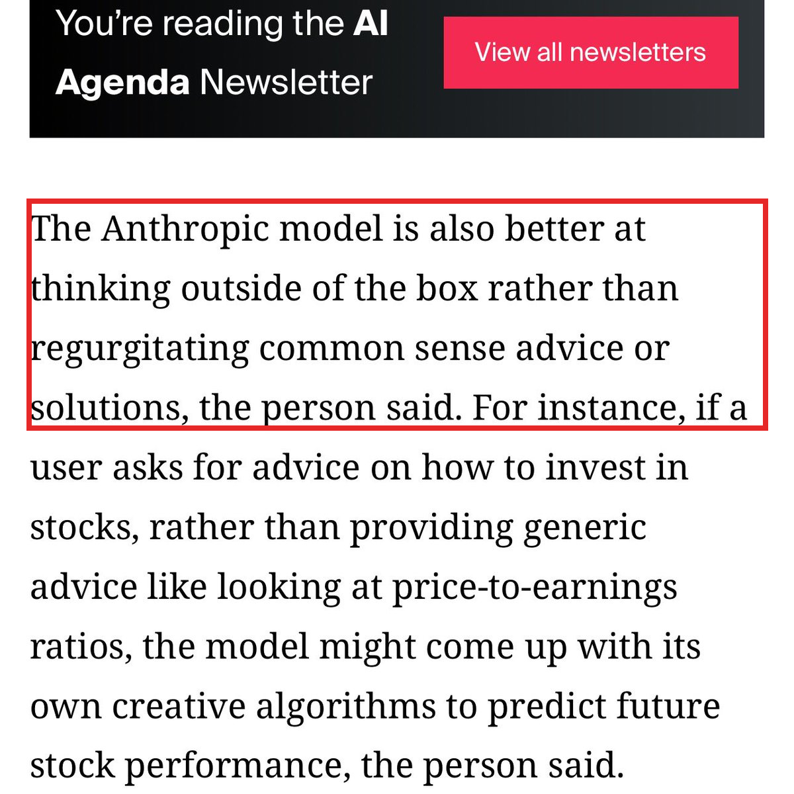

十月要扎堆了。根据 The Information 昨晚的爆料，Anthropic、Google、OpenAI 三家都把新模型排在了这个月，最快几周内就能用上。

Google 的叫 Gemini 4 Carbon，OpenAI 的 Terra 可能也要出新版本。Anthropic 这款最神秘，名字没定，属于哪个系列也没说。

它有两个长处。一个是读意图，用户没给多少信息，它也能猜出背后真正想要什么。另一个是不照本宣科：问它怎么买股票，它不只让你看市盈率，可能自己琢磨一套预测算法出来。

Anthropic 这款我非常期待。这家今年的量也够大：月初有人发现 Opus 5.5 在悄悄把一部分请求转给一个更强的模型，Fable 5.5 的痕迹也被看到了，现在又排了一款新的。量大管饱，这个月我第一个试它。

