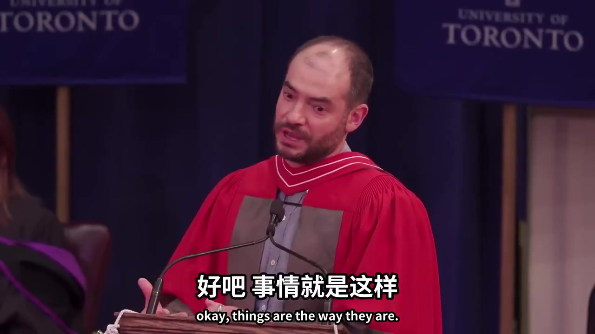
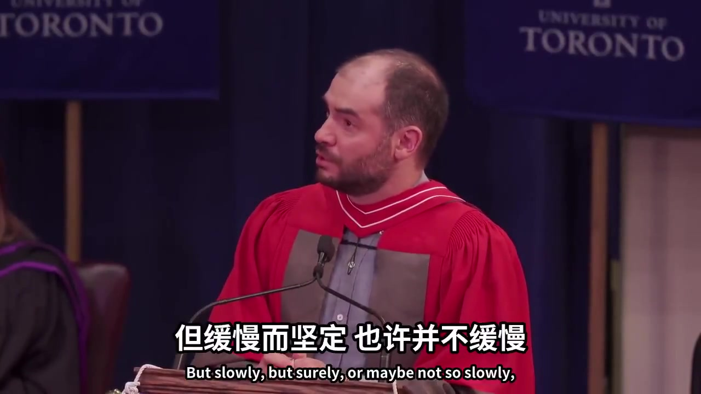
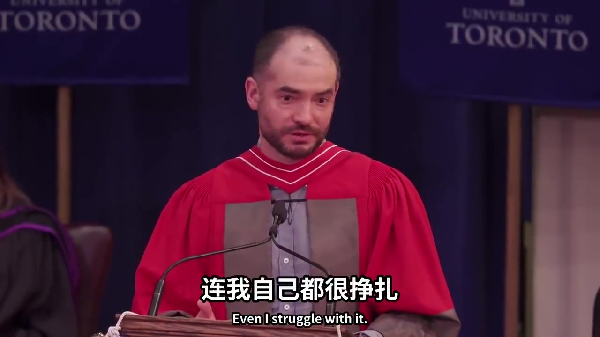
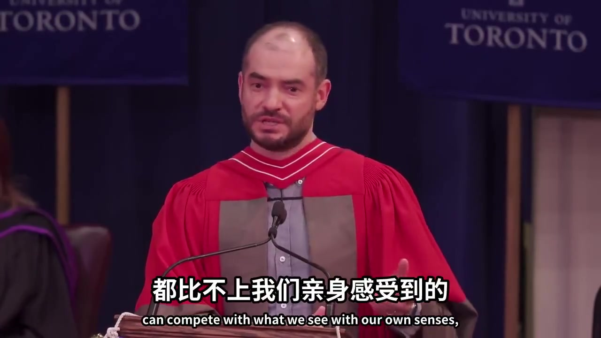

今年 6 月，多伦多大学授予 OpenAI 联合创始人 Ilya Sutskever 荣誉学位。这是他在这所学校获得的第四个学位，二十年前的本科学位也是在同一个礼堂领取的，导师是 Geoffrey Hinton。演讲不到十分钟，开场先自嘲了一句：毕业演讲照例要给一些人生建议，这次不打算多讲，因为想讲的其实是另一件事。

建议只留了一条：接受现实本来的样子，不要反复后悔过去，把精力放在下一步怎么走。Ilya 坦言这一条很难做到。人一遇到挫折，很容易反复回想当初哪个决定做错了、哪次运气不好、哪里不公平，一想就是大半天。更有效的做法是对自己说一句「好吧，事情已经这样了」，然后继续往前。他每次这样做，事情都会顺利一些。但他也承认，这是一场和自己情绪的长期拉锯，讲给台下的毕业生，也是讲给自己。

接下来才是正题。Ilya 认为，我们正处在有史以来最不寻常的年代。这种说法每一代人都听过，但这一次不是套话，原因是 AI。今天的 AI 已经在相当程度上改变了「做学生」的含义。你对着电脑说话，它能听懂，能回答，还能替你写代码。当然，它做不到的事情还有很多，不少领域仍然差得很远。有人预测三年，有人预测五年、十年，各种时间表满天飞。Ilya 的判断是：进展也许缓慢但确定无疑，也许根本不缓慢，AI 会持续变强，总有一天能完成我们能完成的所有工作。不是其中一部分，而是全部。任何他能学会的事情，任何台下这些人能学会的事情。

凭什么这么肯定？他的论证只有一句话：每个人都有大脑，大脑是一台生物计算机，数字的大脑没有理由做不到同样的事。

讲到这里他停了一下，说你只要稍微想一想，就会觉得有些不安，而这还只是冲击的一部分。如果人类把 AI 用于更多研发，用于 AI 研究本身，进步的速度会快到难以想象。这些前景太极端了，很难从感情上真正接受。Ilya 的原话是：连我自己都很挣扎。

对于该怎么办，他借用了一句老话：你可以不关心政治，但政治会关心你。放在 AI 身上，这句话加倍成立。他给出的办法只有一个：去使用。把当下最好的模型用上一段时间，亲眼看看它能做什么，判断力自然会建立起来，而且会越来越准确。无论读多少文章、听多少解释，都比不上亲眼看一遍。

这场演讲里，我最看重的不是「AI 会做一切」那句判断，而是最后这个办法。因为对 AI 的判断力既买不来，也读不来，只能用自己的工作去换取。把一项完整的任务交给它，看它完成到什么程度，看它在哪个环节出错，判断力才会建立起来。读十篇解读，不如自己失败一次。

很多人的做法恰恰相反：每天追 AI 新闻，觉得自己跟得很紧，手上的工作却一项都没有交出去。我的体会是，让我相信 AI 的事情，没有一件来自文章。以前做一次竞品调研要三天，现在交给 Claude 只要十分钟；以前每天要花一小时跟进行业动态，现在早上用五分钟看 Grok 整理的摘要就够了。这两个数字是我自己测出来的，不是任何人告诉我的。

失败的经历同样重要。我曾经让 Codex 定时生成一批数据站点，背后每次都要执行很重的 MCP 查询和计算。结果 token 消耗极快，数据量一大，页面组装就会出错。经历了这次失败，我才知道它在哪个环节不可靠，也才知道哪类工作应该留给自己。这种判断力，看一百条「Codex 又更新了」的推文也得不到。上周写 Anthropic 就业报告那篇时我提到过，今年面试校招生，我问的是他们做过什么 agent，因为我想确认的正是这种判断力是否已经建立。

Ilya 在台上说，连他自己都很难从感情上接受这个未来。我的理解是，接受与否其实不重要。先把一项完整的工作交给 AI，看它做成什么样，剩下的判断自然会跟上来。
