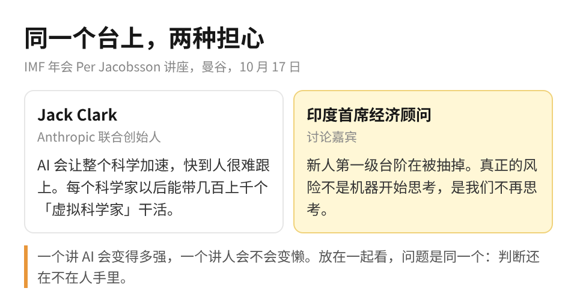

物理学家被 AI 改对了答案，这件事我看完以后，第一反应跟 AI 有多厉害没关系，我想的是自己已经有多久没回去查过它交上来的东西了。

讲这件事的是 Jack Clark，Anthropic 的联合创始人。上周六他在 IMF 年会上讲了一场，这个讲座办了六十多年，台上一直是央行行长和财长，这回是头一次请做 AI 的人上去。

他讲的是上周刚出的一篇论文。一群物理学家拿自己还没发表的研究出了 50 道题，答案网上根本搜不到，出题的人自己都说，不靠 AI 没人能做出其中大部分。第一轮打分，模型拿了八十多分。可是物理学家去看它错在哪的时候，模型不认账，坚持说错的是专家给的标准答案。专家只好回去重算，结果好几道题真的在计算很深的地方找到了自己的错。因为答案改过来了，模型的分数也跟着往上爬，最后只错了一道。

Jack 在台上打了个比方：电影演到三分之二，总有一场戏是学生向导师证明自己能单飞了，他说这场戏上周真的演了。

整场听下来，我最想说的一件事是：AI 越是能改专家的作业，人越得自己先算一遍。因为专家这次能被改对，是他们先出了题，而且回去把自己的计算重查了一遍；要是出题的人已经不会算了，AI 说你错了，你连从哪一步查起都不知道。

刚把一份数据分析交给 AI、看一眼觉得差不多就转发给老板的人，这篇讲的就是那一眼。

看到「AI 改对了物理学家的答案」，很多人的第一反应多半是，那我更没必要自己算了，它比专家还准。我的体会跟这个相反。这两年我把最难的活都交给 Claude，一直默认它交作业、我来批改。可是即便我给它非常明确的指示，做出来的东西还是会偏离我的要求，而且偏在哪里，只有我自己从头过一遍才看得出来。所以它越准，我越不能把那一遍省掉，因为省掉之后我就分不清它是对了还是碰巧对了。

前阵子我还吃过一次亏。做了一堆看板和监控，本来是给自己看的，结果人的精力有限，几天没盯，看板停了更新都没发现，bug 就这么漏了过去。活是交出去了，判断那一层我也跟着交出去了，这才是出问题的地方。

所以这阵子我在改派活的方式。以前是把格式写清楚让它做，出来的东西时好时坏；现在学着先问它「这个方案哪里不对」，让它给意见，然后听不听由我定。

坐在 Jack 旁边的印度首席经济顾问，讲的几乎是另一面。他说企业招的新人越来越少，美国二十出头的年轻人在最容易被 AI 替代的岗位上，就业已经比同岗位的年长员工落后了大约 19%。以前新人靠干杂活学本事，公司靠这些杂活收回培训成本；现在杂活被 AI 便宜地干掉了，培养新人就成了纯成本。他说了一句很重的话：明天检查 AI 工作的人，是今天在第一级台阶上培养出来的。

他还引了 MIT 的一个小实验，一群人用 ChatGPT 写作文，写完才几分钟，83% 的人连自己刚写的一句话都引不出来，研究者管这个叫认知债务。实验很小，但他说这跟老师们反映的情况对得上。他最后那句我记得最牢：真正的风险不是机器开始思考，是我们不再思考。

Jack 说奇点已经来了，经济顾问说人不再思考才是风险，听起来是两边，其实说的是同一件事。物理学家能被 AI 改对，恰恰是因为他们还会算、还肯回去算。等到没人会算了，AI 再准也没人能确认它准。

你手里那份刚交给 AI 的分析也一样。它给的数你信了，老板问起来你答不上为什么，那一刻丢的不是面子，是你对这件活的判断权。

以前我给 AI 派活，写的是「按这个格式做」；现在在学着问它「这个方案哪里不对」，然后自己再算一遍。做 AI 的朋友，下次它跟你的答案打架，先查自己那一步。

担心被淘汰的朋友，每周留一件活自己从头算一遍，判断力这东西欠久了是要还的。
