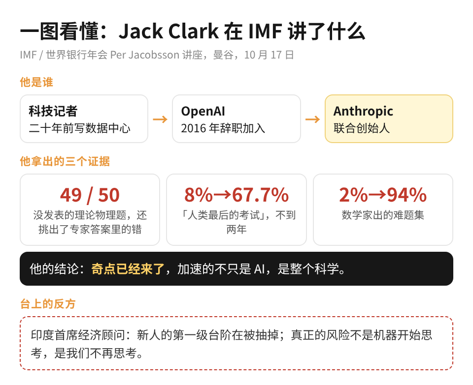
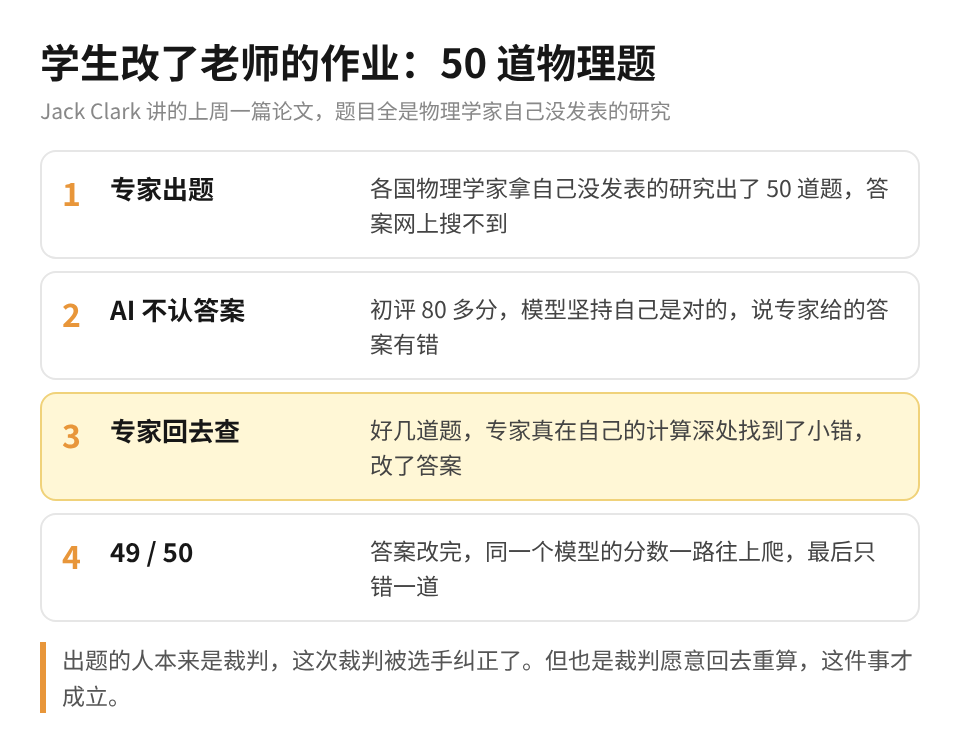
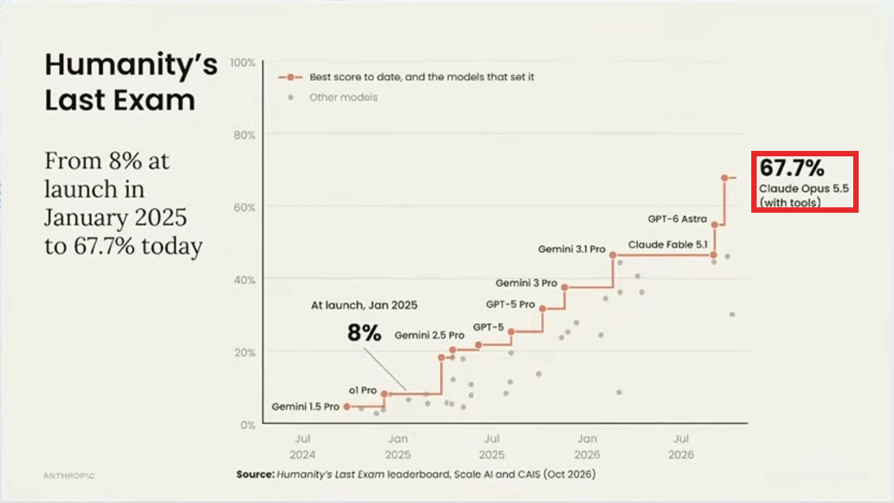

一群物理学家拿自己手上还没发表的研究，出了 50 道题去考 AI。AI 交卷以后却反过来说：你们给的标准答案有错。专家回去一查，还真是自己算错了。

讲这件事的是 Anthropic 的联合创始人 Jack Clark，上周六在 IMF 年会上。这个讲座办了六十多年，台上站的一直是央行行长和财长，这是头一回请做 AI 的人上去讲。

他二十年前是写数据中心的科技记者，写着写着迷上了 AI，后来辞职去了 OpenAI，又出来和几个同事一起做了 Anthropic。他在台上这么介绍自己：这辈子干的就是一件事，找到对未来重要的信息，再讲给所有人听。

这两年我把最难的活都交给 Claude，一直默认是它交作业、我来负责批改。物理学家这次碰上的，就是这个分工倒了过来。

整场演讲看下来，我最想说的一件事是：AI 已经能改专家的作业了，人手里最值钱的，变成了出题和判断它这次到底对不对。会被替掉的，是连判断也一起交出去的那批人。

如果你刚工作几年、开始担心被 AI 淘汰，或者已经在让 AI 干正经活、心里其实没什么底，这篇想讲清楚一件事：AI 变强以后，你手里该留哪一层活。

1、学生第一次把老师的作业改对了。

这篇论文上周刚出来，题目都是各国物理学家自己的研究，答案在网上根本搜不到。出题的一位印度物理学家说，他不知道有谁能不靠 AI 做出其中相当一部分。

第一轮打分，模型拿了八十多分。但物理学家去看它错在哪的时候，模型坚持说自己没错，错的是专家给的答案。专家只好回去重算，好几道题真在计算很深的地方找到了小错。答案修正过来以后，模型的分数一路往上爬，最后只错了一道。

Jack 讲到这里打了个比方：电影演到三分之二，总有一场戏是年轻主角向导师证明自己能单飞了，他说这场戏上周真的演了。出题的人本来是裁判，这次裁判被选手纠正了。

你可能觉得理论物理离自己很远。但你每天交给 AI 的周报、方案、数据，其实是同一个结构：答案是它给的，对不对还得有人回去算一遍。

2、他说的奇点，是整个科学一起加速。

Jack 给奇点下的定义是：AI 把整个科学和技术进步的速度，提到了人很难跟上的程度。他在台上说得很直接：奇点已经来了。

他拿出来的证据是一组考试分数。有一套题叫「人类最后的考试」，专门出得特别难，去年年初刚出来的时候，最好的模型只有 8%，到这个月已经是 67.7%。

他说自己电脑里有个文件，光上周就攒了一百张这样的图，换哪门科学都是同一个形状，最近两年开始往上翘。

讲到人的部分，他拿自己举例：世界上只有一个他，攒够做这场演讲的经验花了快四十年。如果能同时跑几百上千个他，还能让这些复制品在他的监督下干活呢？他说未来几年，很多行业就会是这个样子。

3、台上的反方：真正的风险是人不再思考。

坐在 Jack 旁边的印度首席经济顾问，讲的几乎是另一面。他说企业招的新人越来越少，美国刚入行的年轻人，在最容易被 AI 替代的岗位上，就业已经比同岗位的年长员工落后了大约 19%。新人本来靠干杂活学本事，现在杂活被 AI 便宜地干掉了，学本事就成了企业的纯成本。

他还引了 MIT 的一个小实验：一群人用 ChatGPT 写作文，第一次写完才几分钟，83% 的人一句都引不出自己刚写的东西。研究者管这个叫认知债务。

他最后打了个比方：AI 是一匹很强的马，但马没有车夫，跑不到你想去的地方。然后他说了全场我印象最深的一句：真正的风险不是机器开始思考，是我们不再思考。

Jack 自己也没回避这一块。被问到年轻人的工作，他说他们的模型确实预测了很剧烈的就业冲击，他来讲这场，就是想直说这可能会发生。

4、两个人说的，其实是同一件事。

物理那个故事里，AI 能把专家的答案改对，是因为专家先出了题，并且愿意回去把自己的计算再查一遍。要是出题的人已经不会算了，AI 说你错了，你连从哪查起都不知道。

我这阵子也在改自己派活的方式。以前给 AI 拍任务，格式写清楚就让它做，出来的东西时好时坏；现在在学着让它先给我提意见。可是意见再好，听不听还得人来定。AI 取代不了人，它取代的是不再做判断的人。

以前我给 AI 派活，写的是「按这个格式做」；现在在学着问它「这个方案哪里不对」。

做 AI 的朋友，下次 AI 跟你的答案打架，别急着让它修改，先回去查自己那一步。担心被淘汰的朋友，每周留一件活自己从头算一遍，判断力这东西，欠久了是要还的。
