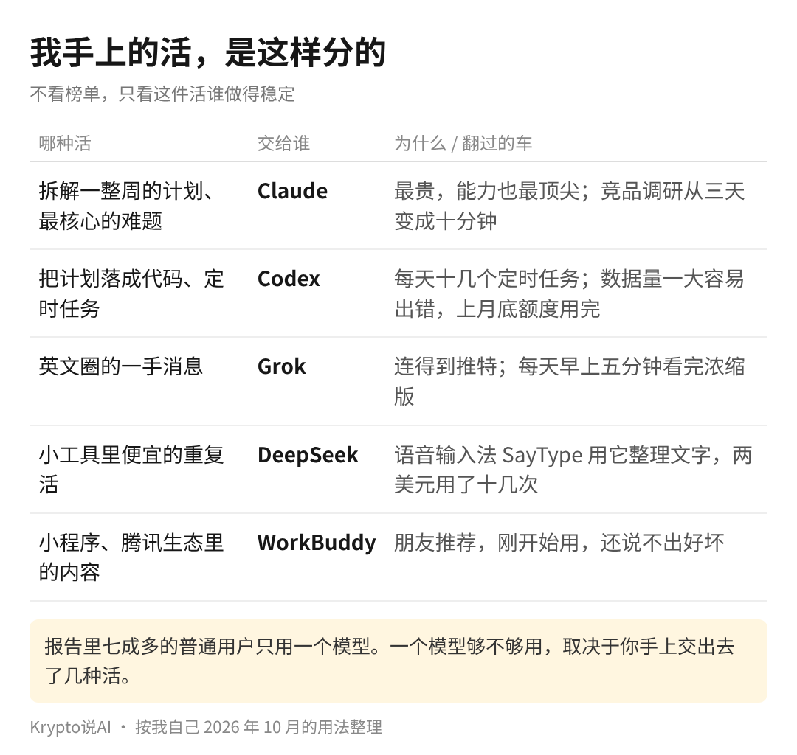

LobsterAI 九月这份《中国办公 Agent 用户行为报告》，大家转得多的是假期晚上写代码那张图。我反倒觉得第 06 页那组不起眼的数更值得看，它说的是接下来谁用 AI 用得更顺手。

普通用户里，七成多从头到尾只用一个模型；重度用户平均用 2.4 个，一半以上会同时搭两个以上。

你可以完全不在意自己用的是哪家模型，但用得多的那批人，已经在按活给模型分工了。

把这组数放回整份报告里看，分量会更重一点。同一份报告里，用户单次交给 Agent 的任务量，从三月的 6.3 万 token 涨到九月的 20.2 万，半年涨了三倍多。

活越交越大，一个模型扛下所有活的做法，会先在这批人身上撑不住。

很多人对「多模型」有个误解，以为是在比谁更厉害，挑出一个冠军就够了。其实重度用户做的事情很朴素：先把活拆开，再看每一种活要的是什么。有的要脑子，有的要便宜，有的要连得上外面的消息。

我自己这两年就是这么一个一个加上去的。难度大、又核心的活，比如一周的工作计划，先交给 Claude 拆解；

落成代码交给 Codex，公司每天十几个定时任务都跑在它上面，它也翻过车，上个月底企业版的额度直接被吃光了。

英文圈的一手消息交给 Grok，每天早上五分钟看完。上周六做语音输入法 SayType，把口述整理成通顺文字这种便宜的重复活，交给了 DeepSeek，充了两美元，跑了十几次才花掉不到一美分。最近一个在国内大厂做产品的朋友推荐 WorkBuddy，我准备拿它做小程序，于是又多了一个。

报告第 07 页也能看出为什么要分。各家的缓存命中率都在九成上下，算上缓存以后的实际花费，却能相差七倍多。

缓存可以粗略理解成，Agent 反复读同一份要求时，读过的部分打折，只是每家打几折不一样。同样一件活，交给哪一家，月底的账单差得很远。

所以争论哪个模型排第一，对干活的帮助其实不大。重度用户和普通用户之间差的，主要是手上交出去了几种活。

用得多的人都在按活分工的时候，普通人要留意的，是自己手上是不是一直只交出去一种活：润色文案、整理表格，交来交去还是那一件，模型再厉害也只用到了一个角落。

大家现在交给 AI 的活有几种？是一个模型包圆，还是已经分了工？

我自己的答案是先数活，再挑模型。公开的 benchmark 榜单我从来没看过，每一次多用一个模型，都是因为手上多了一种活。
