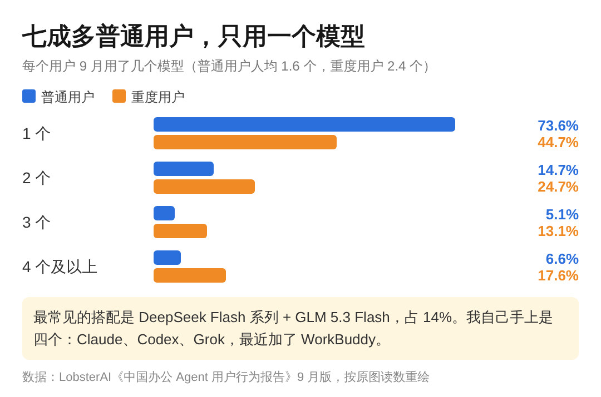
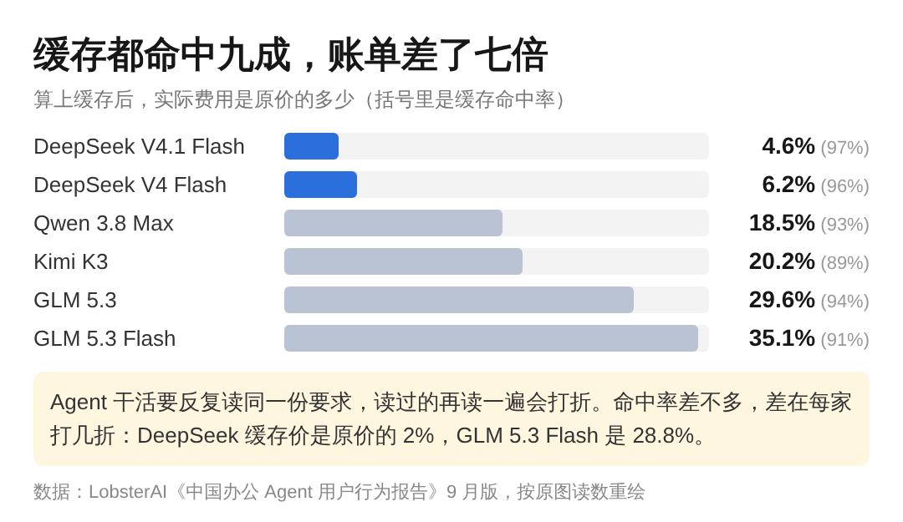

「办公 Agent 成了普通人学编程的夜校」，这两天这句话传得挺广，我不太信。

不写代码的人刷到它，第一反应多半是慌，觉得别人放假都在偷偷学，就自己还在玩。其实用不着慌。

这句话的依据是 LobsterAI 9 月出的一份办公 Agent 用户报告。国庆那几天，大家用 Agent 的高峰从下午挪到了晚上 10 点，写代码这类任务的占比涨得最多。

办公 Agent 可以很粗略地理解成装在电脑上的 AI 助手，你派一件活过去，它会自己去读文件、写代码、整理表格，干完再交回来。推特上有博主看完报告写了一句，它「还变成新一代普通人学编程的夜校」。

我最想说的一件事是：夜校还没开学，假期晚上坐在教室里的，还是白天就会写代码的那批人。

如果你不写代码、正担心自己被落下，或者已经在用 AI 干活、想知道自己落在哪一档，这篇想讲清楚一件事：这种报告里的数字，怎么读到你自己身上。

1、晚上十点用 Agent 写代码的，大多本来就会写。

报告里还有一个数，转发的人很少提。如果按用户的行业来分，编程和 IT 本来就占了全部任务的四成，学生只占个零头，而且这个月还在往下掉。四成的大头放假多干了一点，份额自然就涨了，这说明不了有一群新人进来。

假期里涨的另外两类是学习和个人生活，确实有人在学，只是涨幅还不到编程的一半。跌得最多的反而是数据与表格，这恰恰是不写代码的人平时拿 Agent 干的活，上班的时候整表格，放假了就不碰。

说白了，普通人用 Agent 还是为了上班，还没到下了班去上课那一步。

我自己就是那条晚上十点曲线上的一个点。上周六晚上十点半到十一点多，我在调自己做的语音输入法 SayType，按住一个键说话，松开就打出字来。

之前做的美股宏观数据监控、高尔夫动作 AI 教练，也都是用 Claude Code 做出来的。可我拿 Claude 和 Codex 干活已经两年了，怎么也算不上夜校新生。

2、七成多的人只用一个模型，至少对我来说不够。

报告里另一组数，普通用户七成多只用一个模型，重度用户平均要用两三个。最常见的搭配是 DeepSeek 加智谱的 GLM。

我手上是四个，是按活来分工的。最难、最核心的活给 Claude，价格最贵，能力也最顶；写代码落地交给 Codex；英文圈的一手消息让 Grok 去抓；最近朋友推荐了 WorkBuddy，我准备拿它做一些腾讯生态里的活。公开的 benchmark 榜单我从来没看过，选哪个只看手上这件活谁干得稳。

所以一个模型够不够，取决于你手上有几种活。只用一个模型的人，多半是只交出去了一种活。

换成不写代码的人，这件事更简单。比如你做运营，每周一要把上周的投放数据整成一张表发给老板，这件活交给 Agent，一个模型完全够用。等你交出去的活多了，表格要整，周报要写，竞品资料也要查，再去想第二个模型也不迟。

钱也是同一个道理。报告里各家的缓存命中率都在九成上下，算上缓存以后的实际费用却差了七倍多。缓存可以粗略地理解成，Agent 反复读同一份要求的时候，读过的那部分打折，只是每家打几折不一样。

这一块我得老实说，我自己从来没看过缓存。上个月底公司企业版的 Codex 额度用完了，我也只是换着用，没去算钱到底花在了哪。DeepSeek 我充了两美元，跑了十几次请求才花掉不到一美分，便宜到我根本没想过要算。

报告最后一页是日活，9 月比上个月涨了 83%，前几个月每个月只涨两三成。门开得很快，只是进来的人里，还是老面孔多。

以前我手上三个模型各管一摊，现在为了腾讯生态又加了第四个。做 AI 技术的朋友，看这种报告先翻「谁在用」那一页，再去账单里找缓存那一栏。不写代码的人用不着急着报夜校，先把每周最烦的那件上班的活交出去。

夜校早晚会开学，只是现在还没有。
