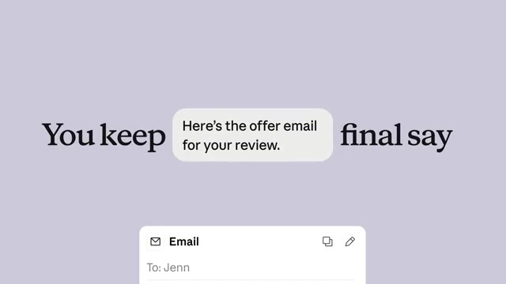
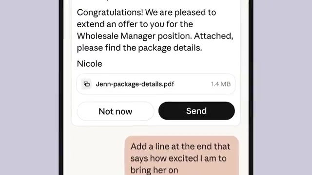

北京时间今天凌晨三点，Anthropic 发布了一个新应用，叫 Claude Duet。官方账号的四条推文，十几个小时里已经有四百多万次浏览。它和过去所有的 AI 应用有一个根本区别：不是你去找它，是它来找你。

官方演示只有一百秒，讲的是一个开连锁店的老板。早上一条通知：今天要办三件事，申请卫生许可、定招聘人选、续签一个合同。许可证它已经起草好了，等你过目；合同那件可以等，周一再说。你走开去面试，它继续盯着，面试官的记录整理好了再来提醒你。要给候选人发 offer 邮件，它写好放在你面前，只给两个按钮：「现在不发」和「发送」。所以最后一步永远是你按的。

官方的说法是，这套判断「什么需要你、什么可以等、什么时候该先问你」的能力，建立在 Opus 5.5 上。记忆、技能和已经连接的应用直接从你的 Claude 账号继承，几乎不用重新设置。安全方面讲了两句：它从不直接接触你的密码，有一个新的分类器专门防止敏感信息外泄。目前是研究预览，美国的 Pro 和 Max 用户排队申请。官方自己也承认，它仍然可能误判什么是紧急的。

这条新闻真正的信息量在最后那句承认。因为主动型 agent 的胜负手不在它能做多少事，在它判断「什么时候该来打扰你」准确不准确。因为判断得准，你会越来越依赖它；判断错一次，比如在你开会的时候弹出一件根本不急的事，你多半会直接把通知关掉。这样一来，之后它做得再多也没有机会了。Anthropic 把目前最好的模型用在这一个判断上，而且提前说了可能判错，说明他们清楚这才是难点。

很多人看完演示，第一反应多半是：这不就是提醒事项加自动化吗？我的体会不一样。这两年我做过一堆看板和监控，美股宏观数据、公司的业务指标，全部做给人看。问题是人的精力有限。几天没盯，看板停了更新都没发现，有一次 bug 就这么漏了过去。看板的逻辑是等人来看，人不来就等于没有。Duet 把这个方向反过来了，它来找人。

我自己能做到的最接近的版本，是让 Grok 的 bot 每天定时抓推特上我关心的内容，再推给我。它确实主动，但它不会判断轻重缓急，重要的和不重要的一起塞过来，看不看还是取决于我那天有没有空。差的正是「什么可以等」这一步。

权限这件事我也早就在做同样的取舍。公司的机器，我给了 AI 邮件和聊天权限，它会替我发一些东西；个人电脑只给邮箱的只读权限，让它清理垃圾邮件。Duet 的「动手之前先问你」和「不碰密码」，划的就是这条线。

写到这里我看了一眼，我那几块看板今天还没打开。等人来看的东西，终究还是没人看。
