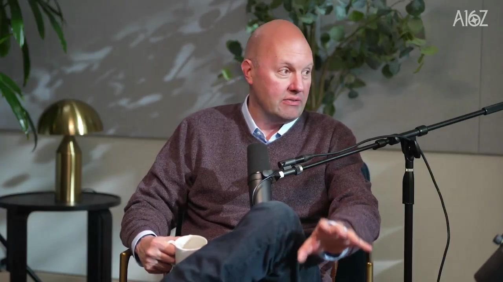
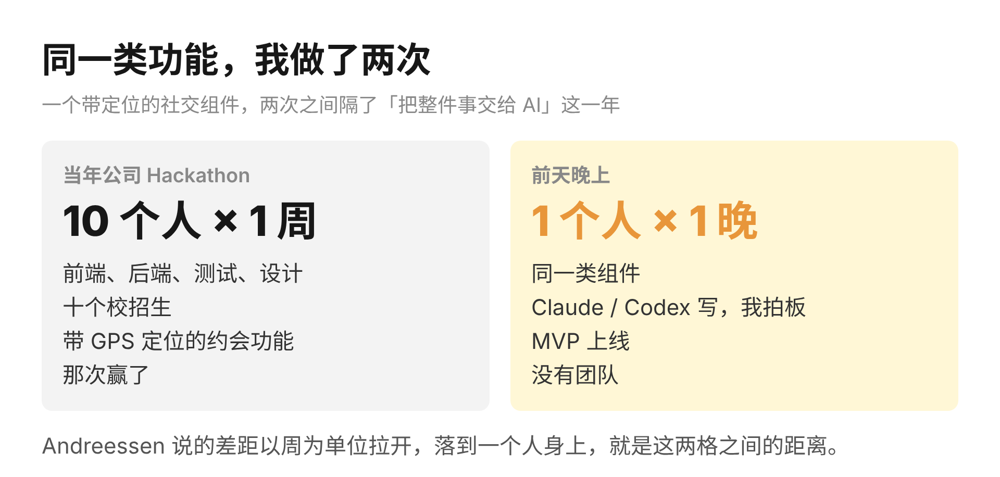

a16z 最近一期播客里，Marc Andreessen 讲了一段两分多钟的话。他是 a16z 的联合创始人，九十年代做出过第一款流行的浏览器。这段话只讲一件事：早期用上 AI 的人和普通人之间的差距。

Andreessen 的原话是，这是他整个职业生涯里见过最大的一道差距，而且还在继续拉开，因为 AI 的能力以周为单位往前跑。他每天打交道的那批创业者和工程师，每过一周就比传统公司里的人更往前一步。公司层面更明显，AI 原生的初创公司和各行业的老公司，对「AI 能拿来做什么」的看法完全是两套。

这段话里真正有分量的是「以周为单位」这几个字。差距以周为单位拉开，说明拉开差距的不是知识，因为知识一篇文章就能补上。拉开的是一个人把整件事交给 AI 之后，每周多做出来的那些东西。所以接下来两年，决定差距的不是谁用的模型更厉害，是谁肯把整件事和权限交给它。一个人加一组 agent，已经能做完以前一个十人小组的工作。

讲到后半段，Andreessen 回到自己身上。1994 年做浏览器的时候，要是手里有 Claude 和 Codex，他和合伙人 Ben 两个人能做出什么来。接下来的创业者会带着这种能力进场，产品计划更复杂，商业计划更野心，公司膨胀得更迅速。他们也不会再把自己当成一家软件公司、硬件公司，甚至不当 AI 公司，会像概念艺术家一样把好几个领域拼在一起。这句话的意思是，以前一家公司能碰几个领域，取决于招得起几种人；现在一个人配上 agent 就能同时做软件、硬件和内容，公司的边界就只剩下创始人想做什么。

这个节奏我自己也能感觉到。现在的 AI 军备竞赛非常明显，几乎每家模型以周为单位出新模型或者新功能，海外那几家的发布节奏又走在国内前面。很多人听到「差距以周为单位拉开」，第一反应多半是来不及了。我的体会是另一种。这个差距我上周刚碰到过，不过是从前面那一头碰到的。我让 Grok 的 bot 帮我申请 Muse 的权限，又让它去申请另一个 Hackathon 的名额。它自己打开我的 Outlook，注册、登记、填表，连生日和个人信息都是它填的。整个过程我没碰键盘。国内几家大厂的生态正好相反，倾向于在自己的圈子里做闭环，别的模型和 agent 进不去。所以同一件事，海外的模型能替你办完，国内的还得你自己点。这不只是方便不方便的问题。因为 agent 能不能替你办事，取决于它拿不拿得到权限，而权限掌握在平台手里。平台把门关上，用户再会用 AI 也只能停在聊天框里，差距就是这样在用户看不见的地方拉开的。

更早一点的对比在我自己身上。我是做产品出身的，当年在公司的 Hackathon 赢过一次。那次我带了一个完整的团队，前端、后端、测试、设计都有人，一共十个校招生。我们干了整整一周，做出一个带 GPS 定位的约会功能。前天晚上我给另一个产品做了同一类组件，从动手到 MVP 上线，只用了一个人和一个晚上。

这就是 Andreessen 说的那道差距在一个人身上的样子。同一个功能，中间隔的不是技术，因为两次用的技术栈差别不大。隔的是我这一年养成的习惯：需求、代码、测试整件事交出去，我只做拍板和返工。

代价也有。前几天发了一篇讲 Claude 的内容，评论区很搞笑，有些人明显没用过，但偏见已经先到了。那一刻会觉得自己在白说。但反过来想，他们不信，正好说明这个差距还在，而差距就是我的 edge。

你刷到这篇的时候，心里多半也在嘀咕「又在吹」。差距以周为单位拉开，意思是今天开始交出去一件事，下周你就在前面那一头了。
