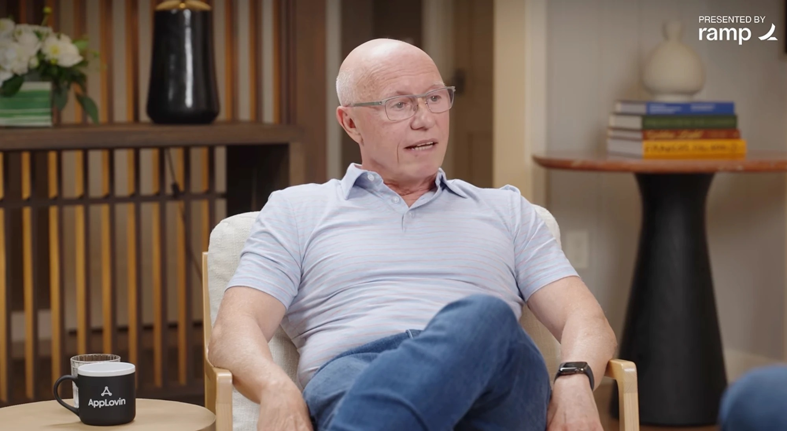
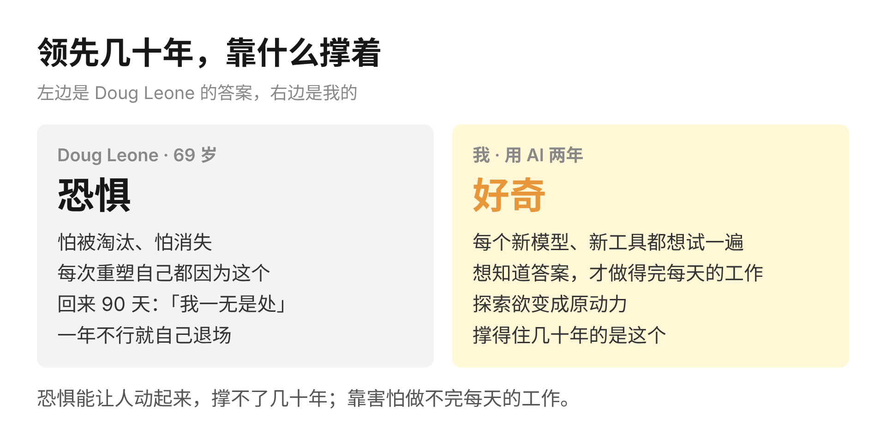
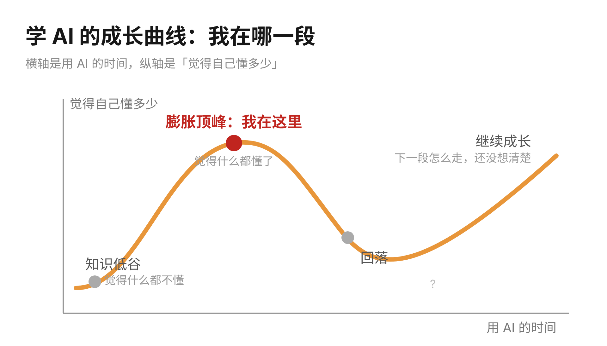
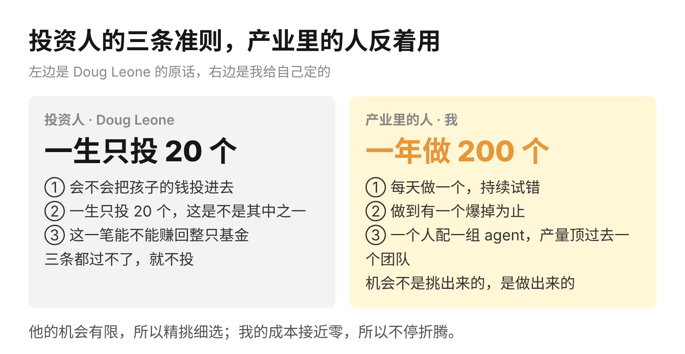
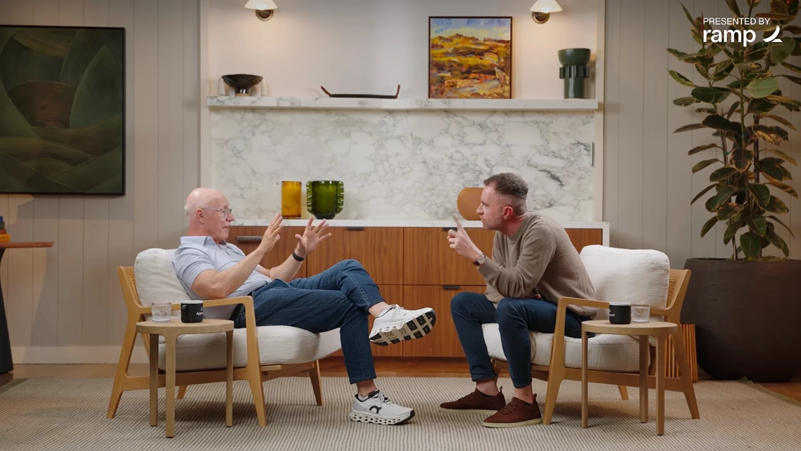
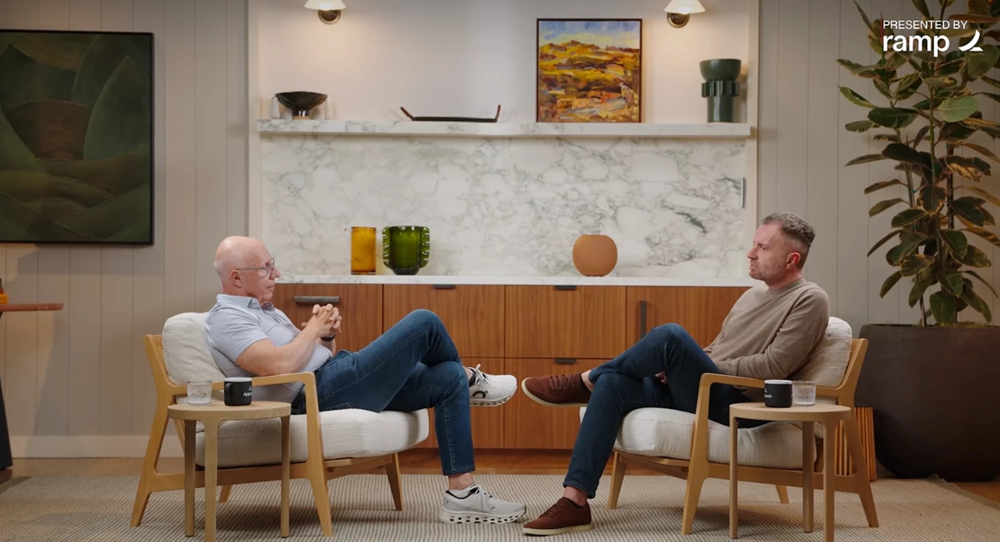

Doug Leone 在红杉干了 26 年。65 岁生日当天，他按自己立下的规矩退休，把位子交给下一代。四年后，新一代合伙人登门相请。回去的条件只有一个：先用 90 天重新校准，期间一笔投资都不做。90 天过去，给合伙人的汇报是四个字，一无是处。AI 离自己比刚回来时还要远，如果一年之后仍是如此，就主动退场。

主持人的第一个问题是，一个人怎么做到领先几十年。Doug Leone 把它拆成了两问。为什么能领先，答案是恐惧。每一次重塑自己，都出于害怕被淘汰，而非什么宏大的远见，到了 69 岁这种怕依然在。怎么做到，答案是放下自我，每一次都当自己什么都不懂，从最底层重新开始。所以回到红杉之后，出资人问起「董事长」这个头衔，回答是，我只是个低级分析师。

> Doug Leone 的原话：每一次重塑自己，都出于怕消失，而非对伟大的向往。

恐惧这一条，我并不赞同。这两年我在 AI 上能走在同龄人前面，靠的是好奇和探索欲：每一个新模型、新工具出来，我都想亲手试一遍，这股好奇最后变成了原动力。恐惧能让人动起来，却撑不了几十年。==靠害怕做不完每一天的工作，能让人把工作一件件做完的，只有想知道答案的那点念头。==

说到这里得承认一件事。我给自己画过一张成长曲线：先是知识低谷，再到自我膨胀、以为什么都懂，最后才慢慢继续向上。AI 的低谷我刚刚经历过，那时觉得自己什么都不懂。现在正在往上走，而且已经到了膨胀的顶峰，觉得什么都懂了。接下来会怎么变，我还没有想清楚。至于 Doug Leone 回到红杉之后站在曲线的哪一段，恐怕只有他自己清楚。

访谈里他讲了自己的三条投资准则。会不会把孩子的钱投进去；一生如果只能投 20 个项目，这是不是其中之一；这一笔能不能赚回整只基金。三条有一条过不了，就不投。理由在于，一辈子能投的项目也许有两百个，大多数只赚两三倍，值得出手的只有能赚一百倍的那种。

这三条准则，在我看来只适合投资人。投资人的机会有限，所以必须精挑细选。产业里做事的人恰恰相反，必须持续试错、反复折腾，才有机会真正做成一件事。所以我不会把自己框在「一生只做 20 个产品」里。我可以每天做一个，一年做 200 个，直到有一个爆掉。上周写 a16z 那篇时我提过，同一类功能，当年十个校招生做了一周，如今我一个人一个晚上就能上线。==这 200 个在过去是一个团队的产量，现在是一个人配一组 agent 的产量。==

访谈里还有一件从未公开讲过的事。当上红杉合伙人的第一个月，他正好离婚，把钱全给了前妻，每个月只剩 400 美元的车补。红杉当时会给新合伙人买一辆车。车买了，家却没有，于是在车里睡了一周，每天到沙丘路的办公室洗澡。这件事他当时就觉得好笑，因为红杉合伙人未来的收入不会差，睡在车里只是一时的不便。

把这件事和前面的恐惧放在一起看，能看出另一层。眼前的困境从来吓不住他，那只是不便；真正让人害怕的，是不再被需要。红杉如今的招人标准被压缩成一句话：极度好胜，又有一颗金子般的心。按 Doug Leone 的说法，这跟红杉想投的创始人是同一种人。

Doug Leone 给自己的期限是一年。我给自己的曲线还没画完，下一段往哪里走，写到这里也没有答案。==能确定的只有一件事：69 岁的人还在从最底层重新开始，我没有理由停在膨胀的顶峰。==
