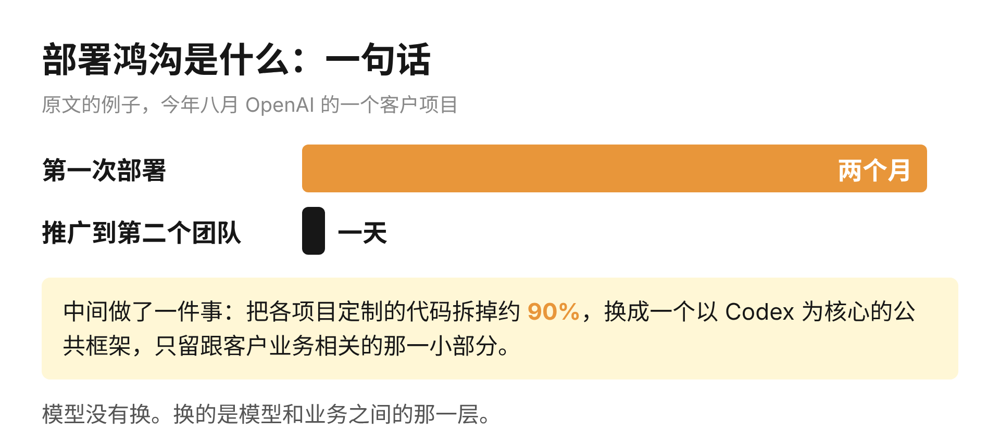
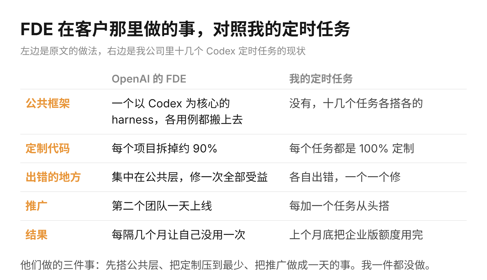

昨天 OpenAI 发了一篇文章，作者是他们 FDE 团队的负责人。FDE 的意思是前置部署工程师，做法是把工程师派到客户公司里驻场，把 AI 真正接进对方的业务。这个团队是去年年初建起来的，文章讲的是这一年多他们在客户那里到底做了什么。

文章里最值得看的一个数字是时间。今年夏天的一个项目，第一次部署用了两个月。同一套方案推广到客户的第二个团队，只用了一天。

中间的差别在于，他们把各个项目里定制的代码拆掉了大约九成，换成一个以 Codex 为核心的公共框架，剩下的只有跟客户业务直接相关的那一小部分。因为公共的那一层已经搭好，第二个团队要做的只是把自己的数据接上去。

文章还说了一句不太像招聘广告的话。负责人叫 Colin Jarvis，原话是，如果我们每隔几个月就把自己变得没用，这个团队就算是在尽职。意思是，一件事第一次要靠工程师驻场两个月才能跑通，但等产品和模型跟上来，这件事就应该不再需要他们。

这篇文章对普通人的信息量，在于 OpenAI 自己承认了一件事：模型的能力早就跑在前面，企业用不上 AI，卡住的是把一件完整的工作交出去之后那一圈周边。Jarvis 给这件事起的名字叫部署鸿沟，模型看起来能做的事，和人在工作里敢放心依赖的事，中间差着一大截。所以连做模型的公司都要派自己的工程师进客户的办公室，一待两个月，做的工作是把权限、数据、流程和返工这些东西一件件接上，跟训练模型没有关系。模型再强一个版本，这一圈周边也不会自动出现。

文章里还有一句：有时候缺的是一个产品，有时候模型在榜单上分数很高，到了真实的工作里，带着各种变量和限制就做不了。这跟我自己选模型的办法对得上。之前写扎克伯格那篇播客稿时我提过，我从来不看公开的榜单。最难的任务给 Claude，代码给 Codex，英文圈的一手信息让 Grok 去找。因为榜单测的是模型单独做一道题，但工作里的任务从来不是单独的一道题，它连着数据、权限和返工。

很多人读到这里，第一反应多半是：OpenAI 都要派人驻场两个月，那我一个人更不用想了，等产品做好再说。我的体会不太一样。我每天跑着十几个定时任务，公司用的是 Codex 的定时任务功能。每个任务都让它生成一个 ChatGPT 的 site，背后接着很重的 MCP 查询，也就是让模型自己去数据库里取数再计算。每一个任务都是单独搭的，没有一个公共的框架。结果是数据一多，页面组装就混乱，数据源和前端对不上，token 消耗得非常厉害。上个月底，公司企业版的 Codex 额度就这样被我用完了。

回头看文章里那九成被拆掉的定制代码，我那十几个任务就是反面。因为每个任务都在重复做同一件事，所以每个都在各自的地方出错，出了错也只能一个一个去修。文章里那个两个月到一天的差距，差在有没有人把公共的那一层搭出来，跟模型版本没有关系。OpenAI 是派一个团队去搭，我这边没人派，只能自己当自己的 FDE。

另一个例子讲的是模型本身不够的时候怎么办。OpenAI 的工程师和 Thrive 旗下三十多家会计师事务所一起做了半年，做出一个报税的 AI。试点处理了七千份税表，效率提高了大约一半。工程师负责定义任务，研究团队在每一版模型里补能力缺口，评测从六成升到九成以上。所以一件事做不成，先要分清是模型不会还是没人接进流程。模型不会的那部分可以等下一个版本，没人接进流程的那部分等再久也不会变好。

你把一个流程交给 AI 跑了一周，第三天开始手动补数据，第五天干脆自己做了。你心里的结论多半是，AI 还不够强。但按这篇文章的说法，这个结论有一半可能是错的，错在没有人去搭那一层周边。

Jarvis 说他们每隔几个月就要把自己变得没用一次。我那十几个定时任务，到现在一个也没有退役过。先用完的是额度。
