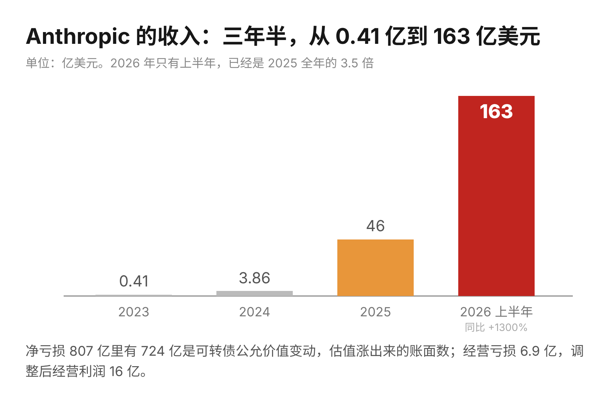
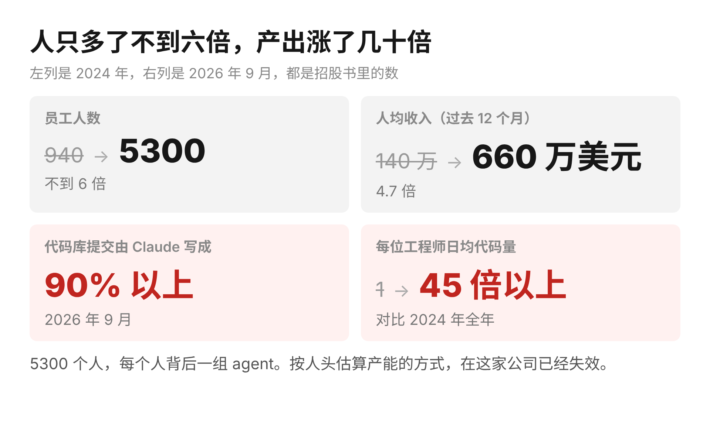
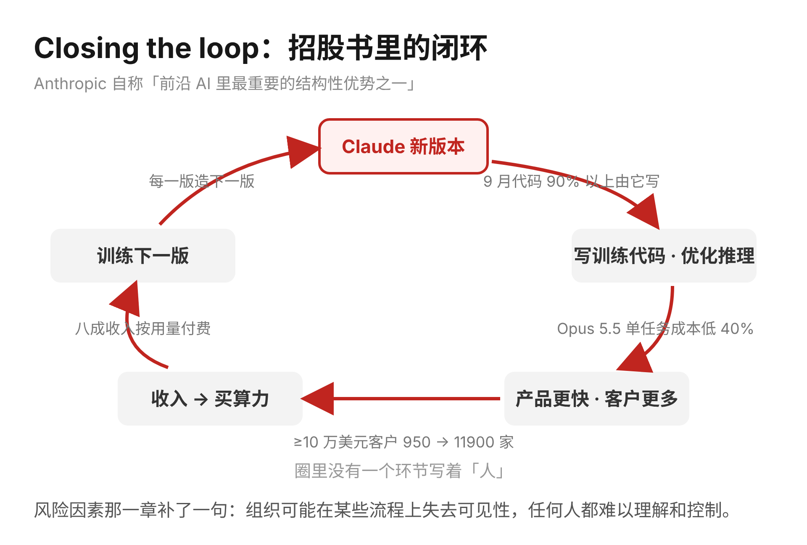
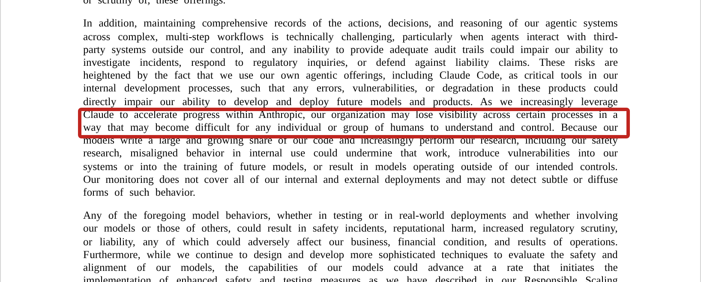
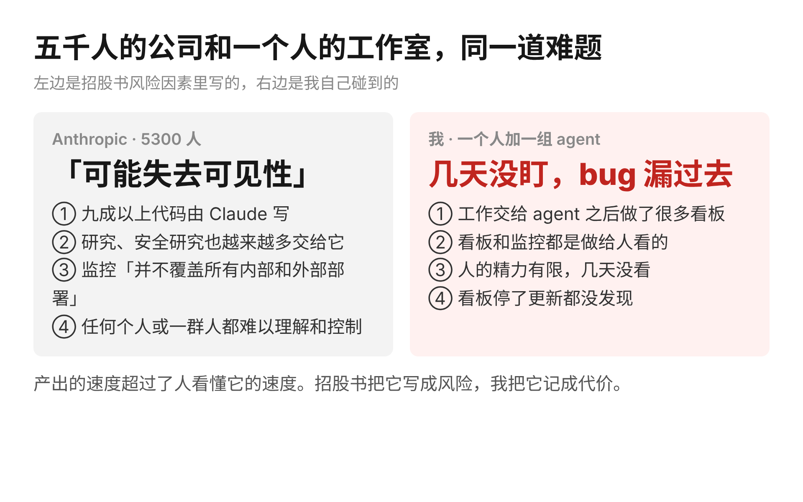
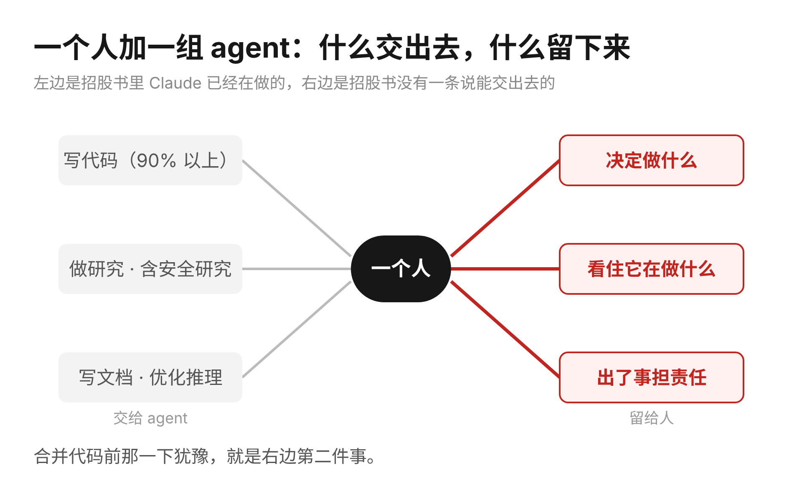
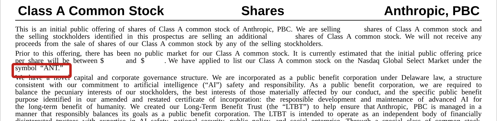

Anthropic 的招股书有两万多行。发行价和股数都还空着，经营数字已经填满。2023 年收入 4100 万美元，2024 年 3.86 亿，2025 年 46 亿，2026 年上半年 163 亿，同比增长 1300%。账面净亏损 807 亿美元看着吓人，其中 724 亿来自可转债的公允价值变动，公司估值涨得越快，这项账面亏损就越大。真正的经营亏损是 6.9 亿，调整后的经营利润已经转正，16 亿。

这些数字媒体今天都会写。我更在意的是另一组放在一起看的数。

员工从 2024 年底的 940 人增加到今年 9 月的 5300 人，不到六倍；同期季度收入从 1.97 亿涨到了几十亿，增长了几十倍。按过去十二个月计算，人均收入从 140 万美元涨到 660 万美元。招股书自己给出了原因：2026 年 9 月，代码库里九成以上的提交由 Claude 写成，每位工程师每天贡献的代码量是 2024 年的 45 倍以上。

读者按直觉会想，连 Anthropic 自己的工程师都只剩一成代码可写，程序员这个职业还能撑几年。我的体会不太一样。这两年 Anthropic 的员工翻了近六倍，招股书里写公司还要继续扩张。写代码的岗位没有被压缩，被压缩的是「一个需求、几个人、几周」这种按人头估算产能的方式。==以后衡量一个团队，先数每个人背后带着多少 agent，再数有多少人。== 上周写 a16z 那篇时我提过，同一个带定位的组件，当年十个校招生做了一周，前些天我一个人一个晚上就把 MVP 上线。招股书把同一件事放大到了五千人的尺度。

招股书给这种模式取了个名字，closing the loop，闭环。每一版 Claude 参与制造下一版：写训练代码、写推理优化、写评测，新模型出来又接着写再下一版。Anthropic 把它列为「前沿 AI 里最重要的结构性优势之一」。收入里八成按用量付费，年收入超过 10 万美元的客户有 11900 家，一年前是 950 家。所有数字连成一条线：模型越强，写的代码越多，产品越快，用的人越多，再拿钱买算力训练下一版。我自己的小尺度上也是这样：出图脚本、定时任务、检查脚本，都由上一轮 agent 写出来，这一轮再由 agent 接着修改，我只负责看结果对不对。

有意思的部分在风险因素那一章。写招股书的律师必须把最坏的情况列出来，于是出现了这样一段：随着公司越来越依赖 Claude 加速内部进展，组织可能在某些流程上失去可见性，以至于任何个人或任何一群人都难以理解和控制。

> 招股书原文：Our organization may lose visibility across certain processes in a way that may become difficult for any individual or group of humans to understand and control.

因为模型写了大部分代码，也越来越多地在做研究，包括安全研究，一旦它在内部使用中出现偏差，可能把漏洞带进系统或者下一代模型的训练里。公司的监控「并不覆盖所有内部和外部部署」。

这一段我格外在意，因为同样的事我在很小的尺度上碰到过。我把工作交给 agent 之后，给自己做了很多看板和监控，监控都是做给人看的，人的精力有限。有一回几天没盯，看板停了更新我都没发现，一个 bug 就这样漏了过去。==五千人的公司和一个人的工作室，碰到的是同一道难题：产出的速度超过了人看懂它的速度。== 招股书把它写成风险，我把它记成代价。

所以这份招股书在我看来，最有价值的部分是它顺带定义了一种新的组织形态。5300 个人，每个人配一组 agent，代码、研究、文档都交出去，人留下来做三件事：决定做什么、看住它在做什么、出了事担责任。这三件事招股书里没有一条写成可以交给 Claude，风险因素那一段恰恰说明公司自己也清楚边界在哪里。你如果最近刚让 AI 写完一个完整功能，合并之前犹豫要不要自己再看一遍，那个犹豫就是三件事里的第二件，它值得花时间。

发行价那一栏还空着。等它填上，市场会给这 5300 个人一个数字。==我更想知道的是另一个数字：一年之后，这家公司每个人背后带着多少 agent。==
