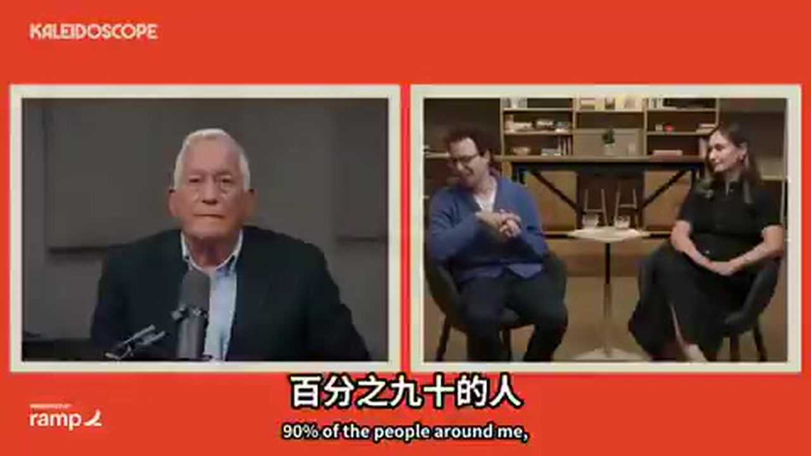
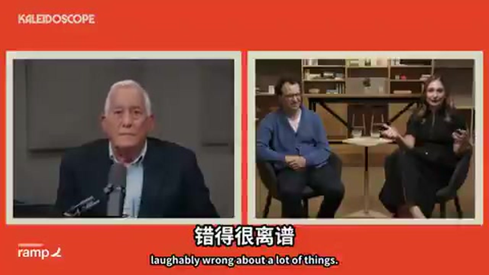
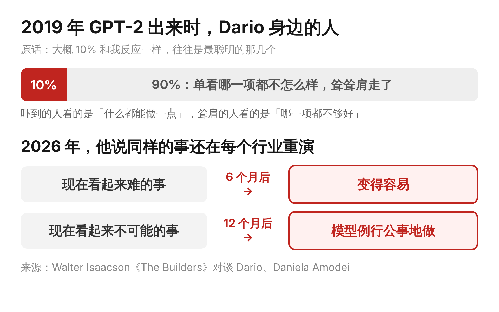

这两天看完 Anthropic 创始人兄妹的一期访谈，有一段让我愣了很久。

主持人是写过《乔布斯传》的 Walter Isaacson，这是他新开的访谈系列第一期。对面坐着 Dario 和 Daniela Amodei，兄妹俩当年在 OpenAI 一个带研究、一个管安全，后来一起出来创办了 Anthropic。

让我愣住的是 Dario 讲 GPT-2 的那段。2019 年，GPT-2 是第一次正式检验「模型做得越大就越聪明」这个假设的实验，而他是力主把规模做上去的那个人。在 Dario 看来，这是科学史上那种关键实验：你先提出一个听上去很奇怪的预测，如果结果真的对上了，就说明自己抓住了真东西。GPT-2 的结果对上了，他的第一反应是被吓到，原话是：「再把它放大一百万倍，它会在所有事情上比人强。这是现代最关键的经济和科学时刻，只是我们还不知道。」

可是他身边的大多数人没有这个反应。Dario 说，当时周围大概只有一成的人和他一样坐不住，而且往往是最聪明的那几个；剩下九成看了看，耸耸肩就走了。理由也很具体：GPT-2 翻译一般，总结文档一般，写几行代码也一般，单拿哪一项出来都不怎么样。它厉害的地方在于什么都能做一点，偏偏这一点最难被看见。

Daniela 那时在 OpenAI 负责安全，她补了一个比喻。如果你这辈子只见过大人、从没见过小孩，第一次看到一个小东西在地上走，你很难想象它有一天能做大人做的所有事。GPT-2 在很多问题上错得很离谱，但它已经开始走路了。

说起当年在推特上嘲笑 GPT-2 的那批研究者，兄妹俩一点都不客气：说它是伪科学的人，不少现在正在给大模型公司投简历。

Dario 随后把这件事拉回了今天。Anthropic 最近宣布要用模型为罕见病研发药物，评论里又是那套熟悉的话：科技公司以前也试过，模型还有这样那样的局限。他的回应是：「六个月后，现在看起来难的事会变容易；十二个月后，现在看起来不可能的事，模型会例行公事地做。」GPT-2 那一幕，正在越来越多的行业里再演一遍。

听到这里，我想起三年前的一个晚上。朋友婚礼的前一天，第一次用 GPT 帮忙写婚礼誓词，它写出来的比我自己写的还好。那一晚大概算是那一成里的人，心里清楚这东西不一样。后来身边有朋友直接转行做了 AI 创业，这件事我都看在眼里，却一直没有动作。没有看走眼，但也没有行动。

所以六个月、十二个月那句话，在我看来一点都不夸张，是很写实的描述。站在前沿的人每隔几周就会撞见一次「原来这也能做了」。离前沿远一点的人只看得见每一项都还不够好，于是觉得是夸大，2019 年那九成人也是这么想的。前几天聊 a16z 那期播客时，Andreessen 说早期用户和其他人的差距正以周为单位拉开，跟 Dario 说的是同一件事，一个按周算，一个按月算。

而能不能看见，今天已经不是门槛了，三年前那个晚上就看见了。拉开距离的是看见之后的那几年：朋友那几年在做 AI 产品，同一段时间里，我在观望。

你第一次觉得「这东西不一样」，是在哪个晚上？我的是朋友婚礼的前一晚。
