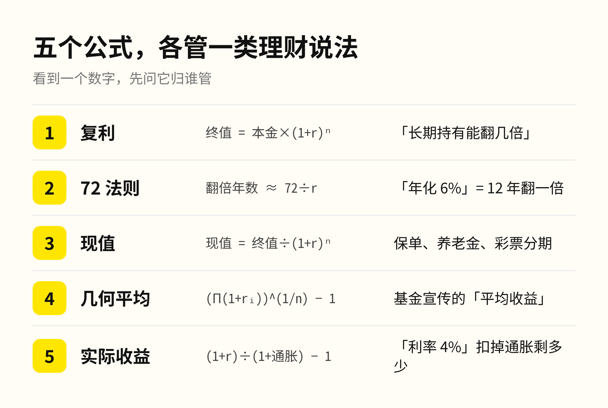
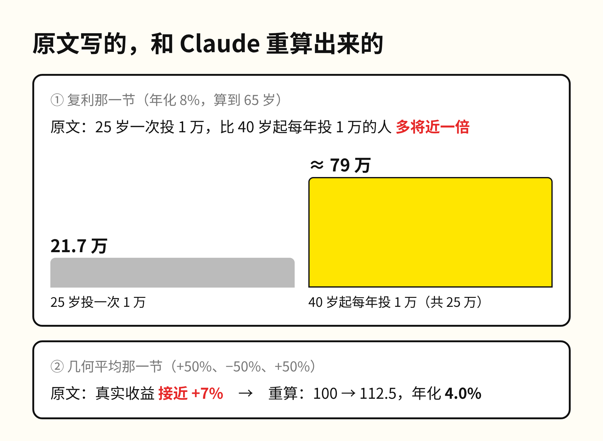
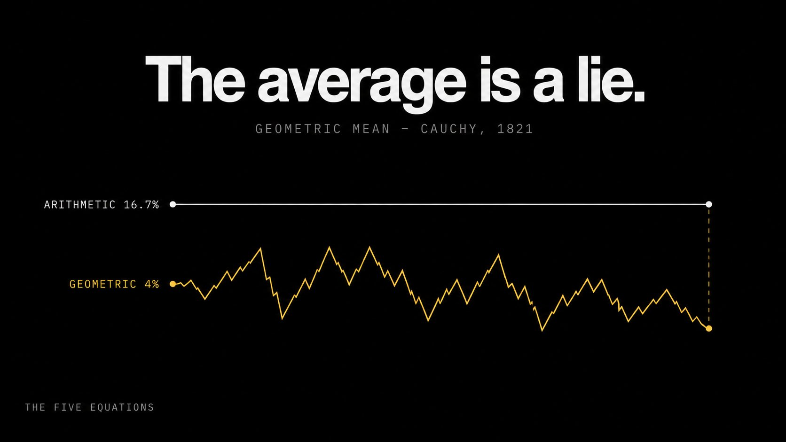

今天我把一篇理财长文交给 Claude，只提了一个要求：把里面每个数字重新核算一遍。它找出两处算错，其中一处把结论算反了。

这篇文章发在 X 上，三个多月攒了 1440 万浏览、1.18 万次收藏，题目是「悄悄决定你一生财务的五个公式」。开头的判断很有感染力：钱不是一门学科，是穿着西装的应用数学；懂这几个公式的人并不比你聪明，只是手里多了一张从来没人递给你的纸。

五个公式本身都站得住，每一个都值得记住。

第一个是复利，终值等于本金乘以「1 加收益率」的年数次方。1 万美元按 8% 放 40 年，会变成 21.7 万，最后十年涨出来的钱比前三十年加起来还多。曲线前面平得像没动，后面陡得像要竖起来。

第二个是 72 法则，翻倍需要的年数约等于 72 除以年化收益率。4% 的债券 18 年翻一倍，3% 的通胀 24 年让同样的钱只剩一半购买力。这个心算法最早写在 1494 年意大利数学家帕乔利的书里，就是把复式记账带进欧洲的那本。

第三个是现值，也就是把复利倒过来计算。一张 30 年后赔付 50 万的保单，按 5% 折现，今天只值 11.5 万左右，保险公司真正要预留的就是这个数。

第四个是几何平均。基金宣传的平均收益多半是算术平均，一年涨 30%、下一年跌 30%，算术平均是 0，账户里的钱实际少了 9%。波动越大，两个平均数差得越远。

第五个是实际收益，扣掉通胀才是钱真正做了什么。存款利率 4%、通胀 3%，账户数字涨了，购买力只多出 1% 左右。

问题出在作者自己举的例子上。讲复利那一节，原文举了两个人。25 岁的人一次投 1 万，此后一分不加；40 岁的人从那年起每年投 1 万。原文的结论是，到 65 岁时前者的钱更多，「不是多一点，几乎多一倍」。

Claude 按原文同样的 8% 把两边都算了。前者到 65 岁是 21.7 万。后者 25 年一共投进 25 万本金，到 65 岁是 79 万左右，是前者的 3.6 倍。原文想用这个例子证明「时间胜过天赋」，算出来的结果说明的却是另一件事：复利要靠时间，也要靠一直往里投钱，只靠早一点起步撑不起后者那个数。

第二处在几何平均那一节。原文先说 +50%、-50%、+50% 三年下来的真实收益「接近 +7%」，下一句又自己算出 100 美元变成 112.5 美元、年化大约 4%。同一段里两个数对不上，作者自己做的配图上写的也是 4%。这一处不影响结论，但它偏偏出现在教人「别被平均数骗了」的那一节。

也有算对的地方。原文说 2% 的管理费复利 40 年会吃掉将近一半的最终财富，Claude 重算的结果是：收益率从 8% 降到 6%，40 年后的钱只剩不收费时的 47%，这一句经得起核对。

这篇文章最有分量的一句话是：金融业不需要你完全不懂数学，只需要你「有选择地」不懂数学，会签合同、会交手续费，但看不出合同在做什么。这句话说得很准确，而这篇文章自己就提供了一个例子。1.18 万人收藏了它，按常理，回头核算过的人很少。过去这也不能怪读者，核对一个复利例子要开表格、写公式、确认钱是年初投还是年末投，十分钟起步。今天把全文贴给 AI，说一句「每个数都用代码重算，标出跟原文不一致的地方」，一分钟就有结果。核对的成本已经降到这个程度。这时候还只收藏不重算，就等于把判断交给了写文章的人，不管对方是基金经理、保险销售，还是一个千万浏览的博主。

所以这五个公式值得记下来，但记下来只是第一步。下次再看到「年化 12%」「早投十年多赚一倍」，先问它归哪个公式管，再让 AI 把数字重新核算一遍，提示词就用这次查出错的那一句。

1.18 万次收藏里，有多少人按过一次计算器？
