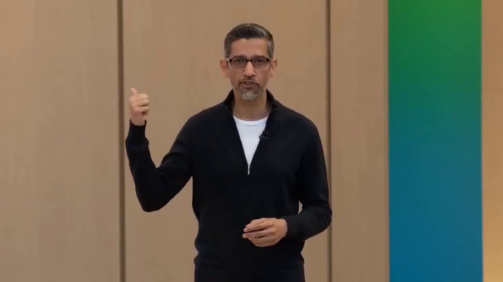
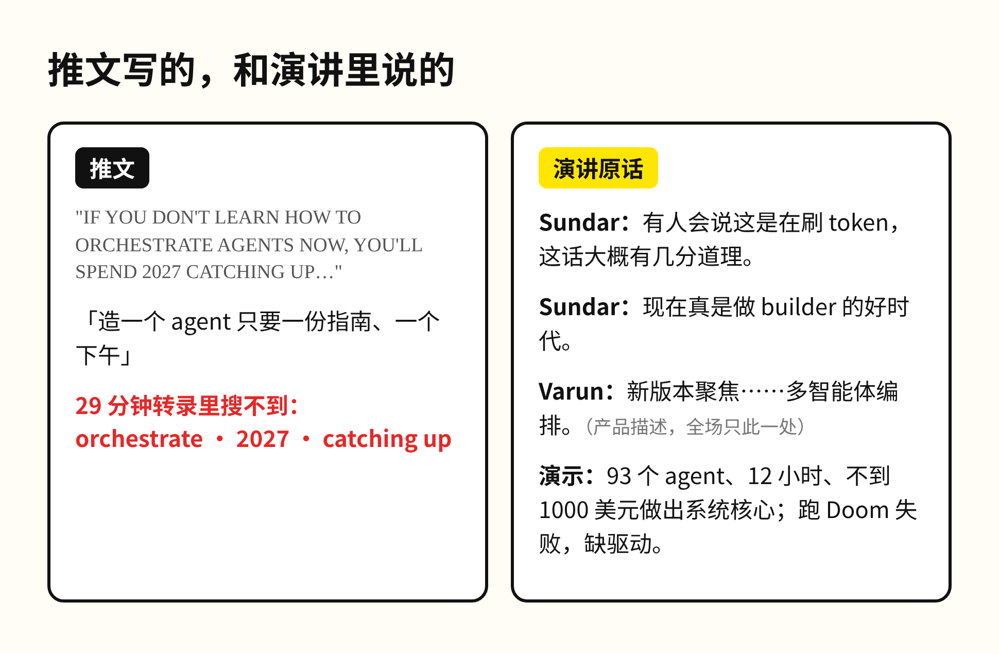

「现在不学会编排 agent，2027 年你就要追赶今天起步的人。」这句话挂在谷歌 CEO 的名下，可他没说过。

这位 CEO 是 Sundar Pichai。话出自 X 上的一条推文，标题全用大写字母，下面配着一段 29 分钟的 Google I/O 2026 主题演讲剪辑。推文正文接着写，大多数人以为造一个 agent 需要工程学位，其实只需要一份指南和一个下午。

我把这段演讲的英文转录从头到尾搜了一遍。orchestrate、2027、catching up，三个词一次都没有出现。整场只有一处提到「编排」，是 Antigravity 负责人 Varun 介绍新版本时的一句产品描述：新版本聚焦智能体对话、智能体产出的成果，以及多智能体编排。Antigravity 是谷歌给开发者做的 AI 编程工具，作用跟 Claude Code 差不多。前阵子聊 a16z 那期播客时，Andreessen 说 AI 带来的差距正以周为单位拉开，那是他自己的原话；这一句，是别人替 Sundar 说的。

台上真实的 Sundar，比那句名言克制得多。他报了一组数：两年前，谷歌所有产品每月处理 9.7 万亿个 token；去年 I/O 时是 480 万亿；今年是 3.2 千万亿。token 可以理解成模型读写文字的计量单位，两年涨了三百多倍。报完这个数，Sundar 自己补了一句：有人会说这是在刷 token，这话大概有几分道理。

讲到 agent，他给的是谷歌内部的数据。今年 3 月，谷歌内部开发者每天消耗 5000 亿个 token，之后每隔几周翻一倍，现在每天超过 3 万亿。Varun 上台后又补了一个细节：Sundar 上周自己用 Antigravity 修了谷歌代码库里的一个 bug。Sundar 把这一段交给 Varun 之前说的是，现在真是做 builder 的好时代。这句话的语气是邀请，听不出催促的意思。

整场最有分量的演示也在 Varun 那一段。谷歌让 93 个子智能体并行工作了 12 小时，发出 1.5 万次模型请求，从一个空项目做出了一个能运行的操作系统核心。调度器、内存管理、文件系统全部由 agent 编写和测试，整个过程的 API 费用不到 1000 美元。在现场，这个系统先跑通了一个小彩蛋程序，屏幕上开过一辆印着 Antigravity 标志的小火车。

接着 Varun 想在上面跑经典游戏 Doom，结果没有跑起来，因为这个系统还缺显卡驱动和键盘驱动。他把一段事先准备好的提示词贴进去，让 agent 去补，剪辑在这里就结束了。

这个失败比成功更值得看。93 个 agent 并行干活，花费不到 1000 美元。这说明「编排」这件事本身已经很便宜，门槛确实在降，Varun 那句「任何人都可以成为 builder，连忙碌的 CEO 也行」并不夸张。但演示里真正决定结果的，是有人知道一个操作系统要跑游戏就离不开驱动，看出它缺了哪一块，再写出那段补救的提示词。所以接下来拉开差距的，是能判断 agent 交上来的东西还差什么的人。先学会同时开 93 个 agent，占不了多久的便宜。那条推文用 2027 年当截止日期，再承诺一个下午就能学会，卖的恰好是最便宜的那一半。

Sundar 修 bug 那件事也是同一个道理。一位对自家产品再熟悉不过的 CEO，用 agent 修好了一个 bug。让 agent 动手已经很容易，难在知道哪个 bug 值得修、修完要怎么验证。

如果你刚刷到「再不学就晚了」、正准备收藏一份 agent 教程，可以先去看 Varun 那段演示，看 Doom 跑不起来之后他做了什么。那一步才是教程里很难教会的部分。

如果谷歌自己的 93 个 agent 都还跑不起一局 Doom，一个下午能学会的，到底是哪一部分？
