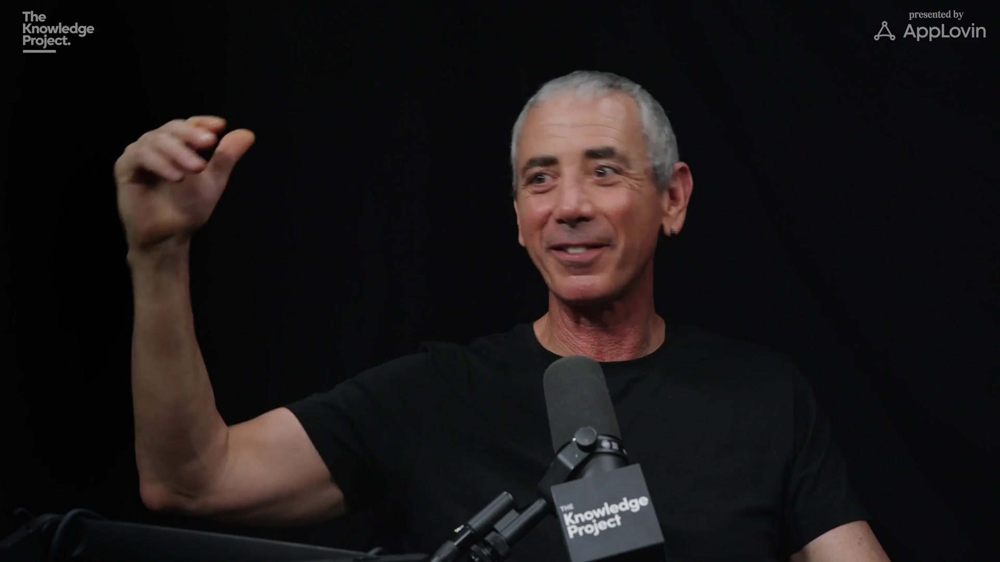
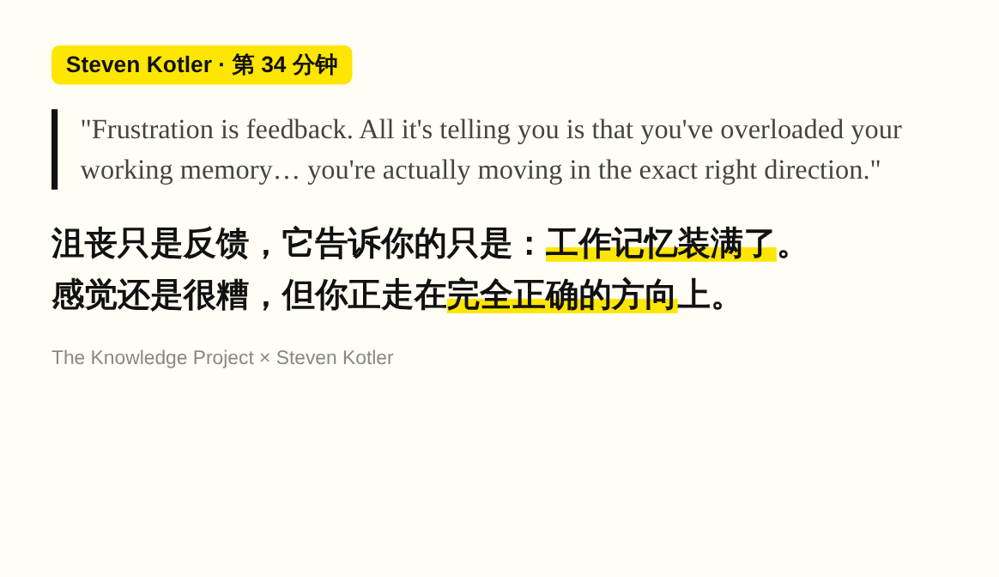
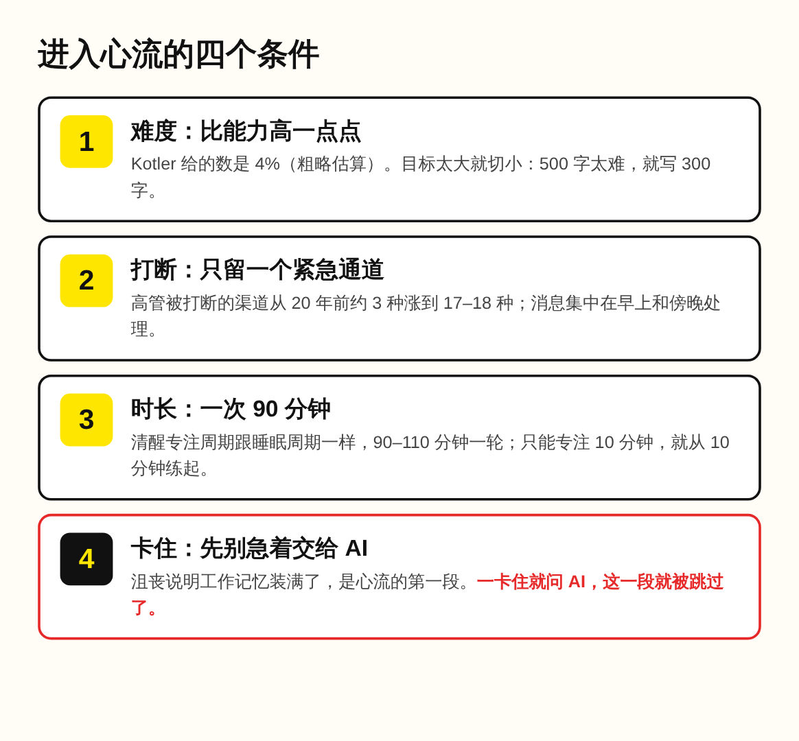

Steven Kotler 卧床的第三年，连穿过一个房间都走不动。一个朋友硬把他拖到了洛杉矶的海边。

那几年 Kotler 得了莱姆病，一种由蜱虫传播的感染，身体功能只剩一成，医生已经说治不了。到了海边，朋友扶着胳膊把他领进浪区。趴上冲浪板不到 30 秒，一道浪涌过来，他用尽全身力气站了起来。时间慢得像要停住，脑子是清楚的，疼痛也消失了。

那天又抓了四道浪，回家后在床上躺了 14 天，连厨房都走不过去。第 15 天能下地了，Kotler 就去敲邻居的门，请对方开车送自己去海边。半年以后，身体功能从一成恢复到了八成。

后来 Kotler 花了很多年去弄清那道浪上发生了什么，这种状态有一个名字：心流。如今他办着一家心流研究和培训机构，前阵子上了 Shane Parrish 的播客，用一个小时讲了普通人怎么进入心流。Shane Parrish 做的是一档长访谈节目，叫 The Knowledge Project。

按 Kotler 的定义，心流是一种极度专注的状态：人完全沉进手上的事，其他一切都淡出去了，体力、脑力和情绪的表现同时往上走。这种状态并不稀有，地球上最常见的心流是阅读。一本书读进去，抬头发现天已经黑了，就是一次。美国国防部一个研究机构还发现，人在心流里学东西比平常快 230%，差不多是平常的三倍多。

进入心流的第一个条件是难度。任务要比现有能力高出一点，Kotler 给的数是 4%。这个数来自心流研究奠基人契克森米哈赖的团队，团队自己说只是一次粗略估算，算不上严格的科学。但方向很清楚：任务太简单会让人走神，难度太高又会让人焦虑，所以只有两者之间那条窄缝里才有心流。山地车手的实验印证了这一点，一直按这个区间安排练习的车手，整个赛季都没有进入平台期。

把难度定得过高的人反而更多。敢冲的创业者常常一上来就接比自己能力高 50%、60% 的挑战，因为那样才觉得有劲。Kotler 的建议是把大目标切小，切到眼前这一步只高出一点点。写稿也是这个道理，一天写 500 字压力太大，就定 300 字。

第二个条件是不被打断。20 年前这项研究刚起步时，一位高管能被打断的渠道只有三种左右，无非是电话、邮件和敲门。现在 Kotler 接触的高管平均有 17 到 18 种，WhatsApp、Slack、Notion 都在里面。他自己的手机常年开着专注模式，只有孩子的电话能打进来。给学员的办法是只留一个紧急通道，其他消息集中在早上和傍晚处理。

我现在用 Claude Code 工作，常常同时开几个 agent 并行。这样一来，能不能专注取决于一个人扛并发的能力。一个 agent 跑完弹回来，我手上正在想的那个念头就丢了。打断我的东西不在那 17 到 18 种渠道里，是我自己开的 agent。

如果你也是一下午同时开着几个 agent，到晚上发现没有一件事是从头想完的，问题多半不在 agent 身上，而在那些被打断的念头上。

第三个条件是时长。人睡觉时有 90 到 110 分钟一轮的周期，清醒时也有一个同样长的专注周期，因此大脑天生适合一次专注 90 分钟左右。刚开始只能专注 10 分钟也没关系，就从 10 分钟练起。不少学员练着练着，某一天突然发现自己已经连续专注了 90 分钟。

最反直觉的是第四条：卡住的时候，沮丧是好事。按 Kotler 的说法，心流是一个四个阶段的循环，第一段叫挣扎期，所有东西都还要有意识地去想。密歇根大学 Colleen Seifert 的研究也发现了这一点。学一样东西时越沮丧，说明工作记忆装得越满。装满之后，人越可能突然想通，也越容易进入心流。

这一条放到今天，分量变了。卡住的那一刻，现在只要把问题丢给 AI，几秒钟答案就回来了。但挣扎期被跳了过去，工作记忆还没装满，后面那次突然想通也就不会发生。我在几个 agent 之间来回切换时丢掉的那个念头，是同一件事：挣扎期刚开头就被打断了。所以答案来得越快，人越难进入心流，学到的东西也越浅。即使 AI 能把答案给你，想通之前那段卡住的时间，现在也得靠自己留出来。

Kotler 给自己留时间的办法是早起。每天凌晨三点半到四点起床写作，因为四点到七点没有人找，他管这段叫「不属于任何人的时间」。有时一个句子要磨一两个小时，放在白天要管公司的时候根本做不到。

这期播客一个多小时，讲沮丧的那段在第 33 分钟前后，冲浪那段从第 54 分钟开始，这两段都值得听一遍原声。
