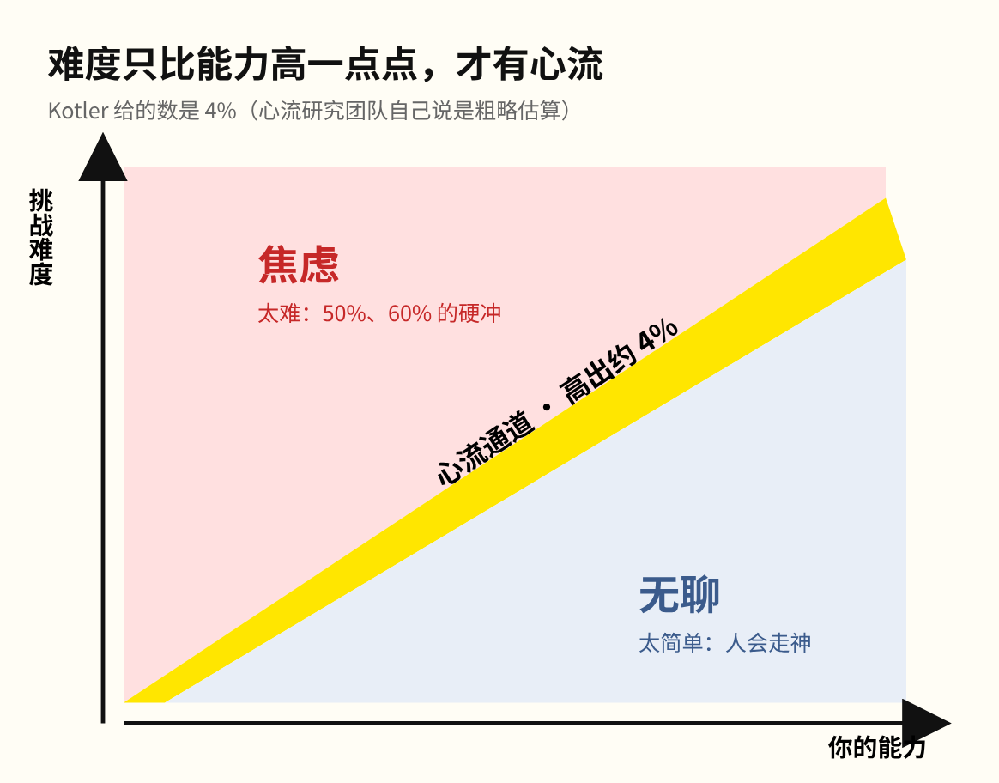
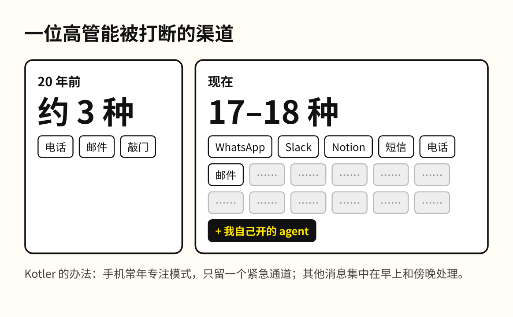

卧床三年的 Steven Kotler，被朋友拖去冲浪，站上第一道浪的那一刻，疼痛消失了。

那种状态叫心流。Kotler 后来研究了它很多年，前阵子在 Shane Parrish 的播客里讲了普通人怎么进入心流。最反直觉的一条是：卡住的时候越沮丧，离答案越近。

心流是一种极度专注的状态，人完全沉进手上的事，其他一切都淡出去了。它并不稀有，地球上最常见的心流是阅读。美国国防部一个研究机构还发现，人在心流里学东西比平常快 230%，差不多是平常的三倍多。

Kotler 把进入心流拆成了四个条件。

第一个条件是难度。任务要比现有能力高出一点，Kotler 给的数是 4%，心流研究团队自己也说这只是粗略估算。任务太简单会让人走神，难度太高又会让人焦虑，所以只有两者之间那条窄缝里才有心流。

把难度定得过高的人反而更多。敢冲的创业者常常一上来就接比自己能力高 50%、60% 的挑战，因为那样才觉得有劲。Kotler 的建议是把大目标切小，一天写 500 字压力太大，就定 300 字。

第二个条件是不被打断。20 年前，一位高管能被打断的渠道只有三种左右，现在 Kotler 接触的高管平均有 17 到 18 种。他自己的手机常年开着专注模式，只有孩子的电话能打进来。

我现在用 Claude Code 工作，常常同时开几个 agent 并行。这样一来，能不能专注取决于一个人扛并发的能力。一个 agent 跑完弹回来，我手上正在想的那个念头就丢了。打断我的东西不在那 17 到 18 种渠道里，是我自己开的 agent。

如果你也是一下午同时开着几个 agent，到晚上发现没有一件事是从头想完的，问题多半不在 agent 身上，而在那些被打断的念头上。

第三个条件是时长。人睡觉时有 90 到 110 分钟一轮的周期，清醒时也有一个同样长的专注周期，因此大脑天生适合一次专注 90 分钟左右。刚开始只能专注 10 分钟也没关系，就从 10 分钟练起。

第四个条件最反直觉：卡住的时候，沮丧是好事。按 Kotler 的说法，心流是一个四个阶段的循环，第一段叫挣扎期，所有东西都还要有意识地去想。密歇根大学 Colleen Seifert 的研究也发现，学一样东西时越沮丧，说明工作记忆装得越满。装满之后，人越可能突然想通，也越容易进入心流。

这一条放到今天，分量变了。卡住的那一刻，现在只要把问题丢给 AI，几秒钟答案就回来了。但挣扎期被跳了过去，工作记忆还没装满，后面那次突然想通也就不会发生。我在几个 agent 之间来回切换时丢掉的那个念头，是同一件事：挣扎期刚开头就被打断了。所以答案来得越快，人越难进入心流，学到的东西也越浅。即使 AI 能把答案给你，想通之前那段卡住的时间，现在也得靠自己留出来。

Kotler 给自己留时间的办法是早起。他每天凌晨三点半到四点起床写作，因为四点到七点没有人找，他管这段叫「不属于任何人的时间」。

这期播客一个多小时，讲沮丧的那段在第 33 分钟前后，冲浪那段从第 54 分钟开始，这两段都值得听一遍原声。
