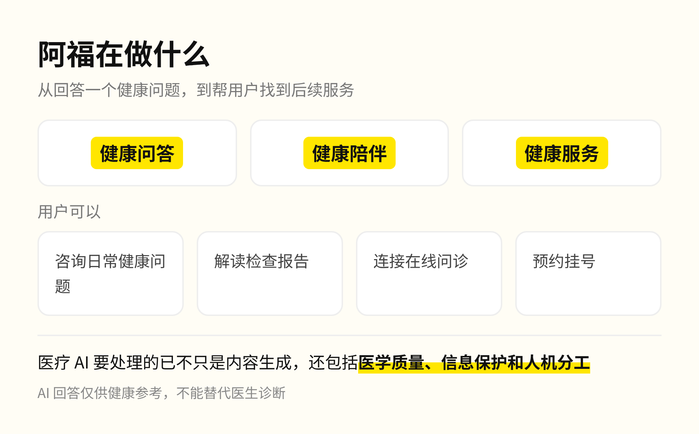

今天刷到一个新闻，讲的不是AI又发展了什么能力，讲的是现在AI进入到专业领域，安全治理要管到哪一步？蚂蚁集团资深副总裁周志峰分享的观察入口就是阿福。

周志峰的观点是，大模型正从聊天交互走向医疗、金融等专业领域，从提供通用建议走向满足个体需求。专业场景出错的代价高得多。在他看来，医疗健康是事关生命的严谨行业，治理体系是行稳致远的基石，所以围绕以阿福为核心载体的医疗健康业务，蚂蚁已经初步建立起四层治理体系。

均衡普惠、生命至上和尊重用户自主，是统领性的价值原则；医学专业性、安全性和医学伦理，构成专业能力与规则；模型与智能体治理、数据治理，是通用底座；组织保障则确保这些机制在业务中真正落实。

为什么要搭这么多层，看阿福在做什么就明白了。它推出了健康问答、健康陪伴和健康服务功能，用户可以咨询日常健康问题、解读检查报告，也可以连接在线问诊、预约挂号。从回答一个问题到帮用户找到后续服务，医疗 AI 要处理的已经不只是内容生成。

先看模型与智能体。模型输出要准确、安全；智能体还要动手执行任务，所以多了三条要求：行为可控、权限可管、运行环境可信。为此，安全防范从模型训练阶段就开始，运行中通过持续评测识别风险，再按风险类别和等级采取相应措施。蚂蚁此前也公开披露过，科技伦理与安全机制已经嵌入研发、测试和部署全流程。

专业能力同样需要持续把关。医疗模型在训练中融入医学知识、临床指南和诊疗规范，再借助医生的专业经验提升临床推理能力；医学巡检、质量控制和专家合作机制，负责发现疑难问题、推动模型改进。

随着智能体能力增强，人机协作的方式也可能演化。在任务范围明确、有限授权、风险可控且责任清晰的低风险场景，未来可以分类探索由医生监督 AI 运行，医生始终保留及时干预和接管的权限。

我把工作交给 AI 两年，现在大部分任务是整个交出去，只看结果。但我交出去的是写代码和做数据分析，错了改一版就行。医疗的错误代价是一个人的身体，所以每往外放一步，都要先有医生复核、有清晰的责任边界。这些规矩也不是一家公司能定完的：医疗健康 AI 仍处于起步阶段，医学伦理、标准规范和临床应用需要更多行业共识。蚂蚁已成立医疗健康专家咨询委员会，参与医疗人工智能中试基地共建，并与医院合作探索 AI 在临床专科场景中的应用。

这也是AI从通用能力走向专业应用必须补上的一课：技术能力决定AI能做什么，而治理体系需要回答它应该如何做，以及在什么边界内做。
