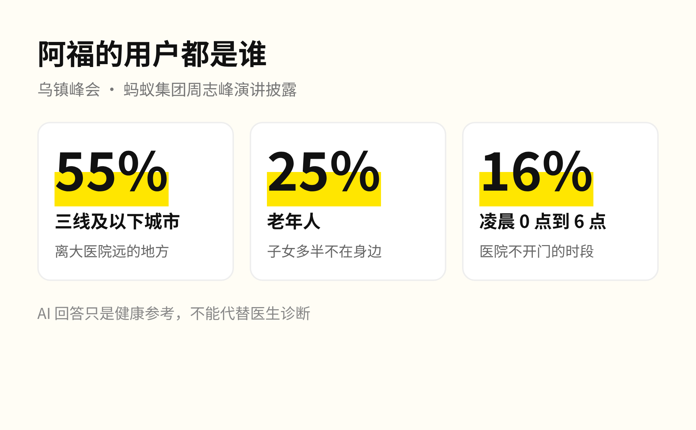
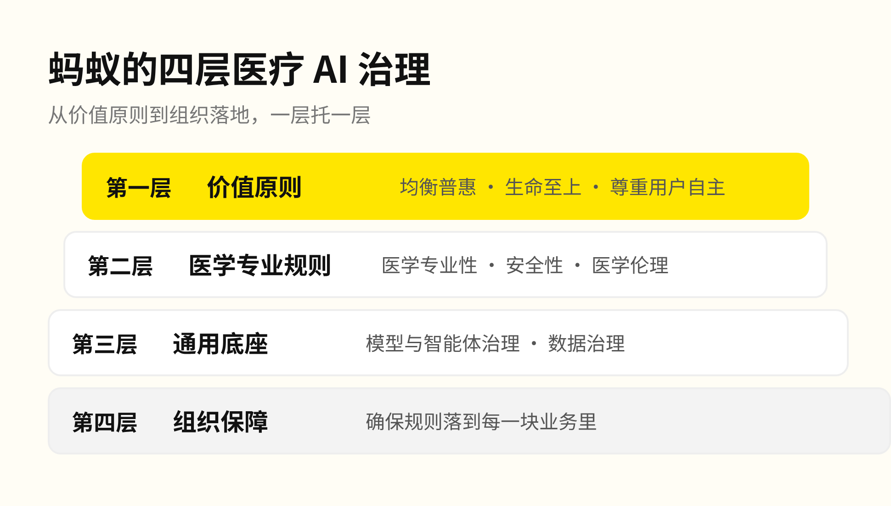
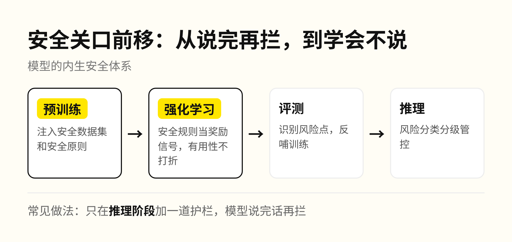
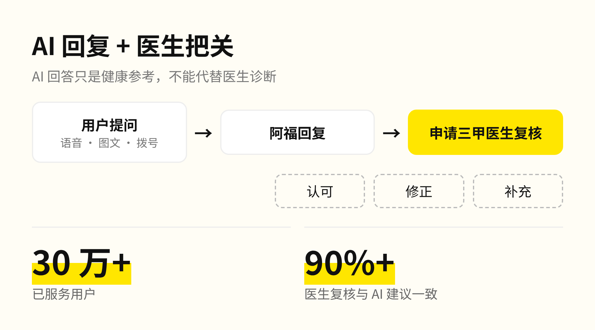
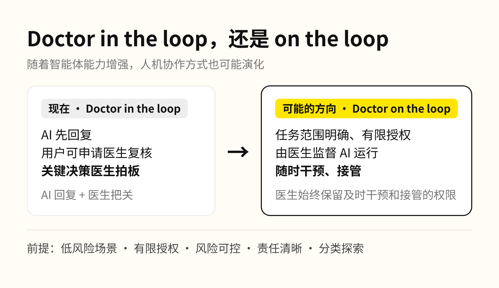

前几天给家里打电话，听老人说胳膊麻了，一直在家硬挨着，被我说了一顿。

其实老人先用蚂蚁阿福查过，第二天去了医院，医生说可能是颈椎压迫了神经。我人在香港，家人在三线小城，这种时候一点也照顾不上。

今天乌镇峰会上，蚂蚁集团资深副总裁周志峰讲的就是这款应用：1.5 亿用户，日均咨询超过 2000 万次，AI 回复后还能申请三甲医生复核。

演讲里报的一组数字，说的正是这种情况。半夜身体不舒服、子女又在外地，老人手边能问的只有手机，AI 回的那句话靠不靠得住，已经关系到安全。

周志峰开场讲的是一个大方向：大模型正从聊天交互走向医疗、金融这些专业领域，从提供通用建议走向满足每个人的具体需求。专业场景容错空间小，所以演讲的重心放在治理上，原话是：「医疗健康是事关生命的严谨行业，治理体系是行稳致远的基石。」围绕阿福，蚂蚁已经初步搭起四层治理体系。

阿福能回答健康问题、解读检查报告，也能连接在线问诊、预约挂号，所以医疗 AI 要处理的已经不只是内容生成，还包括医学质量、信息保护和人机分工。

模型输出要准确、安全；智能体还要动手执行任务，所以多了三条要求：行为可控、权限可管、运行环境可信。蚂蚁把安全防范前移到训练阶段，运行中靠持续评测识别风险，按类别和等级分别处理，科技伦理和安全机制嵌进了研发、测试、部署全流程。

数据上，健康数据不出健康域、专用数据专数专用、底层数据隔离存储；医学能力则借了医院培养医生的办法，由巡检、质控、专家三级机制持续把关。

这些要求最终落到用户能感知的服务里，就是「AI 回复 + 医生把关」：用户拿到回复后可以申请三甲医生复核，医生能认可、修正或补充。十次复核里九次以上医生认同 AI，剩下那一小部分，就是这道由人把关的环节存在的理由。

人机协作的方式还会变。阿福现在是 Doctor in the loop，关键决策由医生拍板。在任务明确、授权有限、风险可控、责任清晰的低风险场景里，未来可以探索由医生监督 AI 运行、随时干预和接管，也就是 Doctor on the loop。周志峰的比方是处方药转非处方药：安全性足够、风险可控，才能一类一类地放开。

我把工作交给 AI 两年，现在大部分任务是整个交出去，只看结果。但我交出去的是写代码和做数据分析，错了改一版就行。医疗的错误代价是一个人的身体，所以每往外放一步，都要先有复核数据、有医生兜底、有人担责任。这些规矩也不是一家公司能定完的，蚂蚁成立了医疗健康专家咨询委员会，参与医疗人工智能中试基地共建，也在和医院合作探索临床专科应用。

对家里的长辈来说，on the loop 还是以后的事。眼下需要的，是半夜不舒服时有个地方能问，第二天还有医生把回答再看一遍。我在香港够不着的那一段，至少有一部分，现在有人兜底了。
