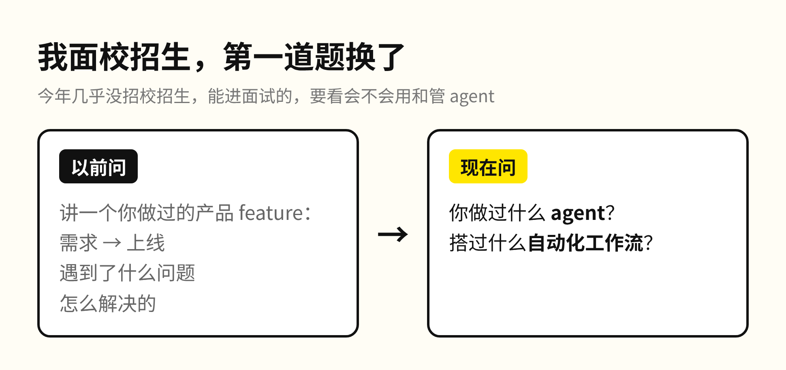
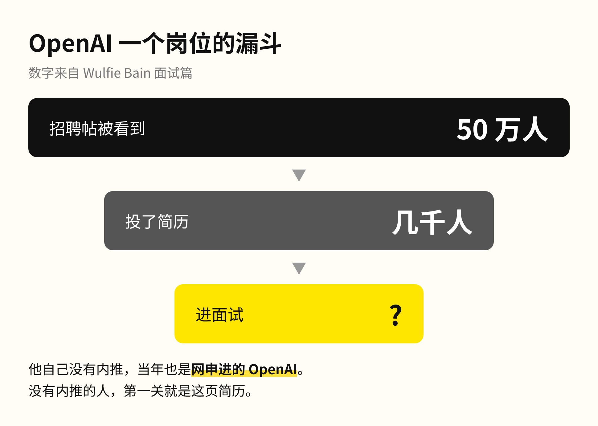
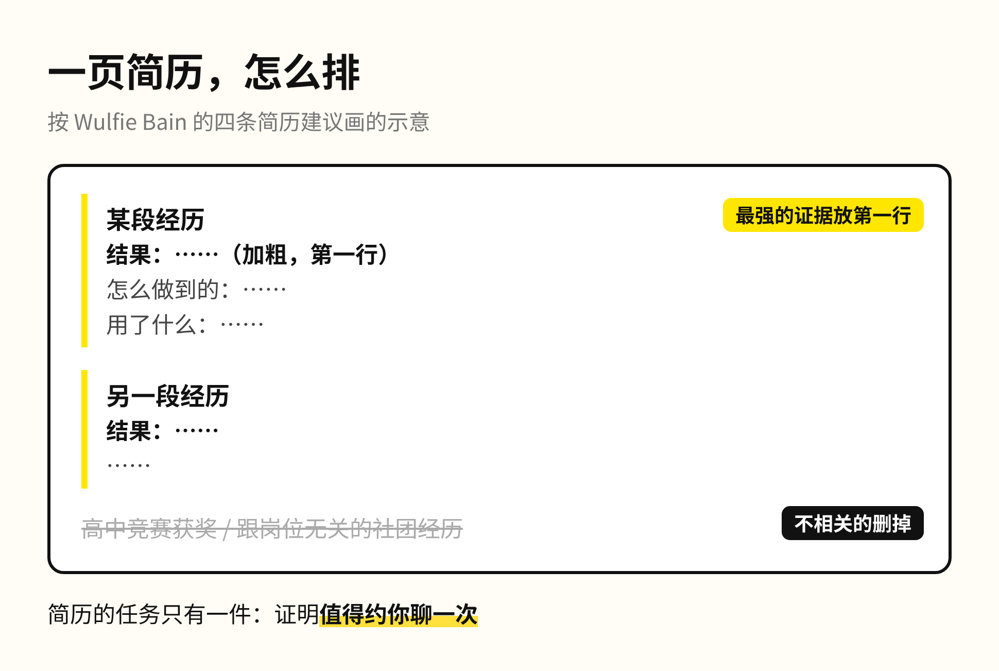
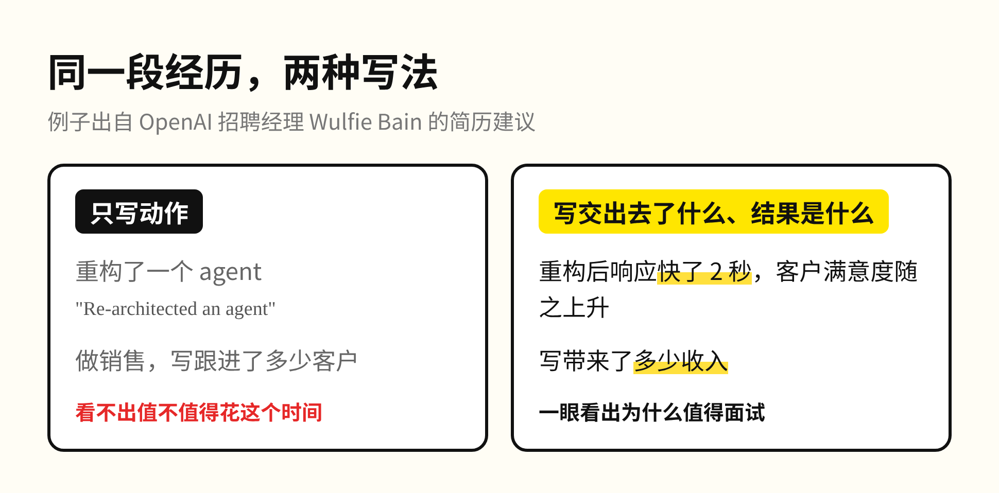
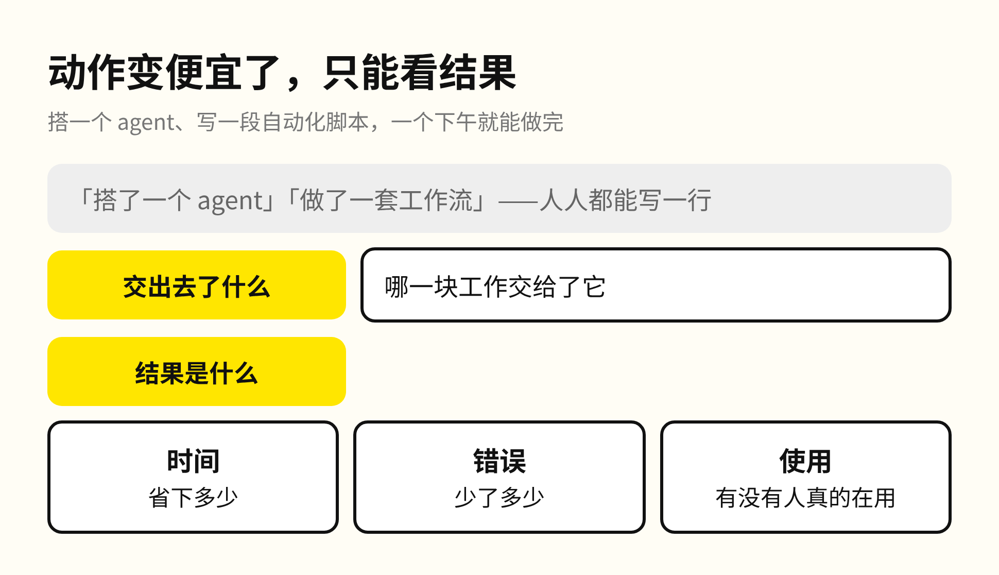
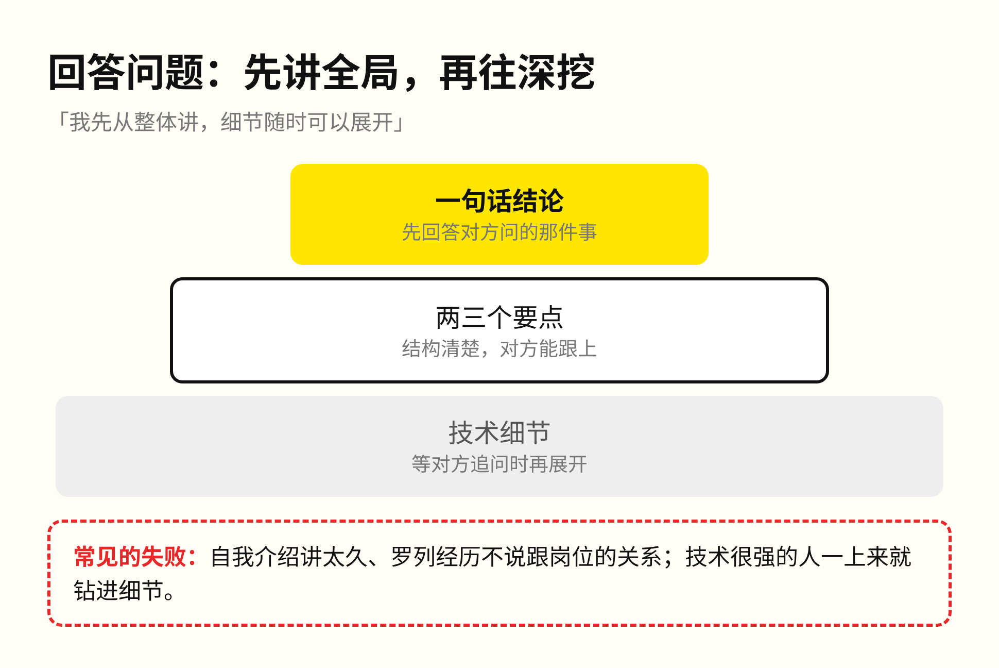
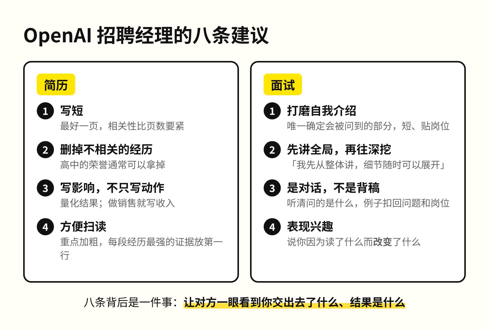
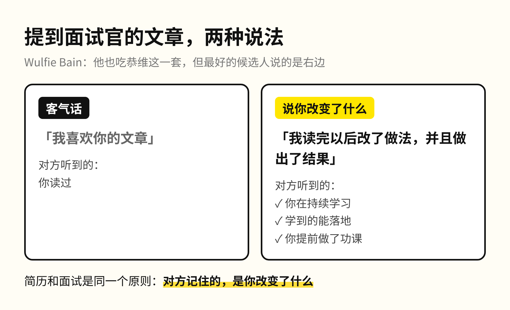

今年坐在校招面试官的位置上，我问的第一道题换了。

以前我会请候选人讲一个自己做过的产品 feature，从需求到上线，遇到了什么问题，又是怎么解决的。现在我问的是：你做过什么 agent，搭过什么自动化工作流。

前阵子聊 Anthropic 就业报告时提过，今年我们几乎没有招校招生。初级岗位越来越少，能走到面试这一轮的人，我要看的是会不会使用和管理 agent。

这两周，OpenAI 的一位招聘经理在 X 上连发了几篇求职建议，讲的是同一张面试桌的另一头。

这位招聘经理叫 Wulfie Bain，在 OpenAI 带团队招人，之前在 BCG（波士顿咨询）做过招聘，自己也创过业，前后看过几千份简历。简历篇发出一天多，浏览 24 万次、收藏 2583 次；面试篇的收藏也有 1925 次。

背景交代得很直接。一条招聘帖发出去，有 50 万人看到，几千人投了简历。Wulfie 自己当年没有内推，是在网上投简历进的 OpenAI，所以这几篇写给的是同样没有内推的人，想让好的候选人别在简历和面试这两关被埋没。

简历的建议只有四条。第一条是写得简洁，最好控制在一页，但相关性比页数更要紧。第二条是删掉不相关的经历，他自己高中拿过的荣誉现在也不往上写。第三条是写影响，不只写动作。第四条是让人方便扫读，把重点加粗，每段经历最有说服力的证据放在第一行。

在这四条之前，Wulfie 先泼了一盆冷水。原话是简历这种自我描述「简化得可怕」，装不下一个完整的人；它要完成的任务只有一件，就是证明「值得约你聊一次」。

四条里分量最重的是第三条，例子也选得很有意思，写的正是 agent。「重构了一个 agent」只说明你做了这件事，看不出这件事值不值得花时间。如果重构以后响应快了 2 秒，客户满意度跟着上升，这才算影响。做销售的，就写收入。

我问校招生做过什么 agent，问的也是这件事。

在 AI 时代，这条建议的分量比以前更重。搭一个 agent、写一段自动化脚本，现在一个下午就能做完，动作本身已经很便宜，写在简历上人人都有一行。因为动作变得便宜，招聘的人只能从结果里分辨候选人：你把哪一块工作交给了它，交出去以后省下了多少时间、错误少了多少、有没有人真的在用。所以简历上的每一段经历，都值得改写成「交出去了什么，结果是什么」。

面试篇同样是四条。第一条是打磨自我介绍。整场面试里，能确定会被问到的只有这一段，所以要讲得短，要贴着岗位。他见得最多的失败，是讲得太长，罗列经历却不说跟岗位有什么关系。

第二条是先讲全局，再往细节里走。Wulfie 给的句式是「我先从整体讲，细节随时可以展开」。技术很强的人最容易犯的错误，就是一上来就钻进细节。

第三条是把面试当成一场对话，准备好的例子要扣回对方真正在问的问题。第四条是表现出对这份工作的兴趣，提前研究面试官和岗位。

第四条里有一个细节最值得记。有些候选人会提到 Wulfie 写过的文章，最好的候选人不只说喜欢，还会说读完之后自己改变了什么。前一种只是客气话，后一种同时证明了你在持续学习、能把学到的东西落地，还提前做了功课。

你这个周末要是正在改简历，先看每段经历的第一行：写的是做了什么，还是交出去以后发生了什么。

回到我问校招生的那道题：做过什么 agent 只是开头，值得讲的是它接手了哪一块工作、接手以后发生了什么。
