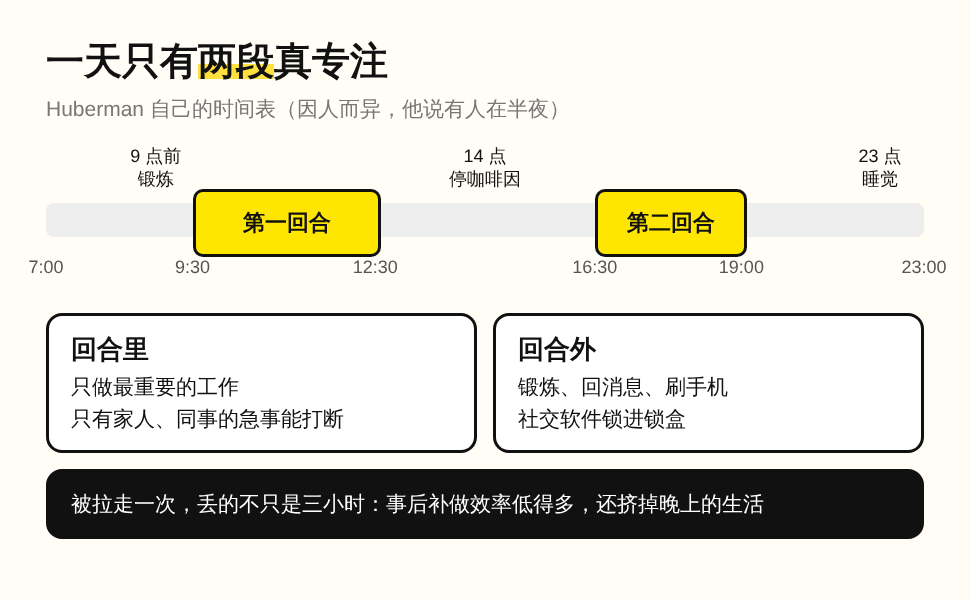
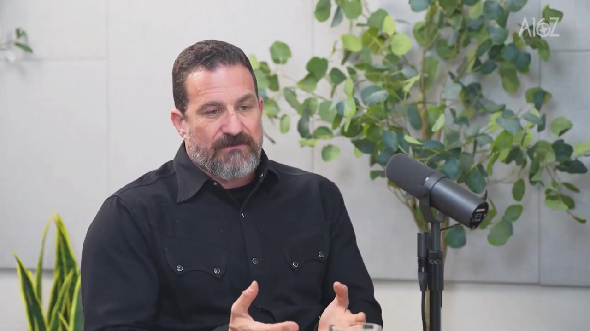
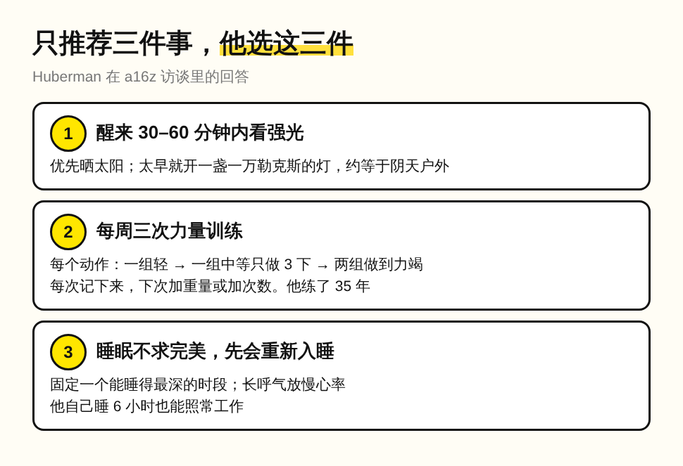
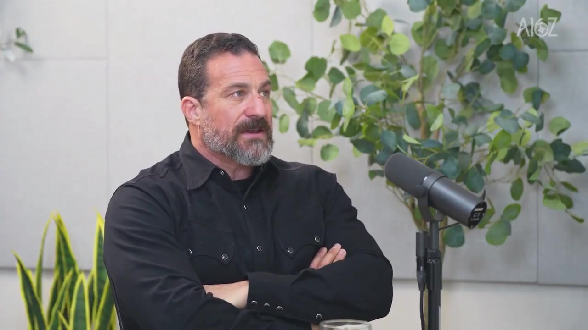

一位斯坦福神经科学家，把社交软件装进另一部手机，再把这部手机锁进一个锁盒。

锁盒是「超级监狱级别」的，每天到点开一小时，用完放回去，中途连本人也打不开。说到这里，这位科学家有点不好意思：「我们本该管得住自己，为什么我需要一个锁盒？」

讲这件事的是 Andrew Huberman。他的播客把健康研究翻译成每天能照做的步骤，几百万人跟着改了作息。这周他坐进 a16z 的访谈，a16z 是硅谷那家知名风投。主持人开场就提到，连他们的创始人都因为 Huberman 戒了酒。

锁盒的理由很具体。算法已经好到让人停不下来，本人又常在上面跟人来回解释，一聊就是半天。更关键的是一项研究：手机关机放在包里或椅子下面，人照样能专注，但要额外花一部分认知资源去维持；手机放到另一个房间，这部分资源才会腾出来。锁盒只是把「另一个房间」做到了头。

可是 Huberman 要守的不是手机，是一天里的两段时间。上午 9 点半到 12 点半，下午 4 点半到 7 点左右，是他脑子最清楚的时候。这两段有个名字叫 bouts，拳赛里的回合，原话是：「我真的把真正的工作当成一场打斗。」这两段里，只有家人和同事的紧急情况可以打断他。

这样安排的理由，Huberman 也讲到了结果。这几个小时里做出来的东西，比事后补做要多得多。所以注意力被一件无关的事拉走，丢掉的不只是三个小时，补做还会挤掉晚上的生活。至于连续专注八九个小时、第二天还不报废，Huberman 不相信有人做得到。

连锻炼都要给这两段时间让路。锻炼放在 9 点前，因为早上练完一整个上午精力更好；9 点半到 12 点半之间绝不练，原话是：「我和大多数创始人一样，没人付钱让我锻炼。」健康习惯在这里是为工作服务的，塞进太多反而会把人耗空。

换句话说，一天里真正值钱的就是这五六个小时，其余的安排都围着它转。

被问到只能推荐三件事时，答案也很短。醒来 30 到 60 分钟内看强光，太阳没出来就开一盏一万勒克斯的灯，差不多是阴天户外的亮度。按他的方法练力量，每个动作热身两组，再做两组到力竭，这套练法坚持了 35 年。睡眠不求完美，先学会怎么重新入睡，本人睡 6 个小时也能照常工作。

同一个问题，我的解法是交给 agent。推特上的信息每天都要跟，现在由一个 Grok bot 定时去抓感兴趣的内容，整理好再推过来。Huberman 用一把物理的锁挡住信息流，我让一个 agent 替我去刷，两种办法守的是同一样东西：最清醒的那几个小时，不让推荐算法拿走。

访谈后半段，Huberman 讲到了 AI。期待的是一个用你自己声音说话的 AI 教练，知道你哪里强、哪里弱，帮你把注意力安排好。还试过一款控制眼球运动的助眠眼罩，自己 6 分钟就睡着了。但入睡和醒来会最先被技术解决，Huberman 的理由是大家清楚这两种状态需要什么。坐下来专注做一件事时，大脑该处在什么状态，现在还说不清。太兴奋会分心，太放松会犯困，中间那个点因人而异。

这一点在高尔夫上也看得到。最近我和老婆沉迷高尔夫，顺手做了一个高尔夫动作 AI 教练，用视觉识别看挥杆。挥杆有标准动作可以对照，AI 教练已经能用；一天里的注意力该放在哪件事上，没有标准答案，所以还交不出去。

这正是 AI 带来的变化。写代码、做表、查资料都能交给 agent，执行越来越便宜，一个人一天里最稀缺的东西就从工时变成了那两三段清醒的时间。能交出去的都应该交出去，包括刷信息流；这几个小时只留给只有自己能拍板的事，定义问题、选方向、为结果负责。一个人如果在最清醒的三个小时里回消息、刷推荐、做 AI 也能做的执行，让出去的恰好是自己最值钱的那部分。

Huberman 用一个锁盒守住了上午 9 点半到 12 点半。你一天里最清醒的那三个小时，现在交给了谁？
