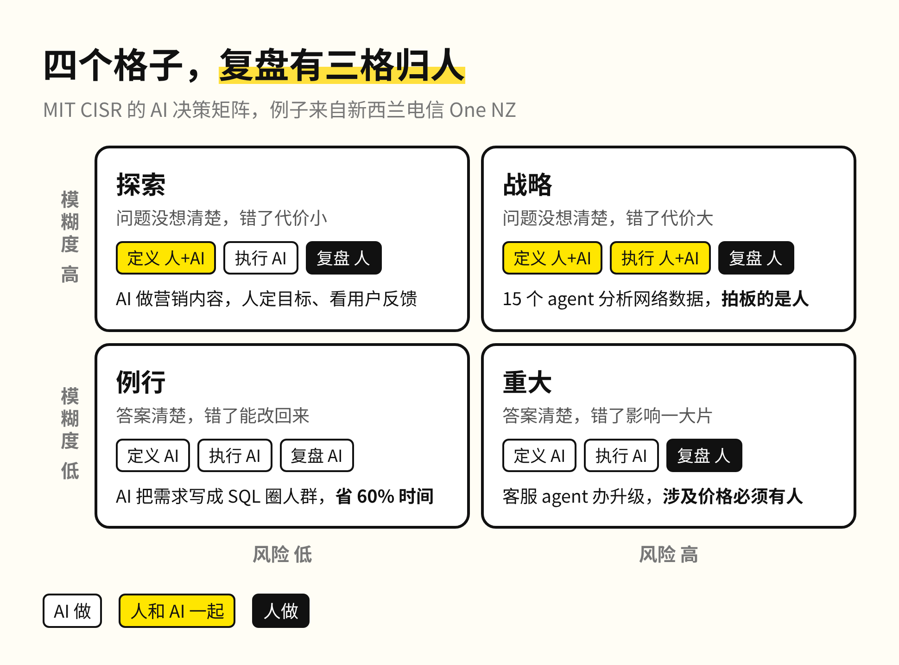
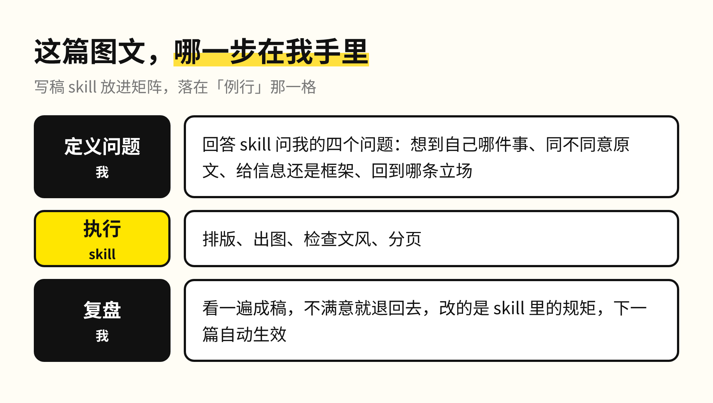

这篇图文从排版、出图到检查文风，都是一个 skill 跑出来的。我做的只有两件事：回答它问我的四个问题，最后看一遍成稿。

这是我给自己定的规矩：一件事需要我重复做第二次，就把它写成 skill 或者工作流。这个账号背后现在有十几个 skills，写稿、出图、剪视频各有一套。

MIT 斯隆管理学院 9 月发了一篇文章，讲的正是这条线该怎么划。MIT 信息系统研究中心的四位研究者访谈了 30 位高管，画出一张「AI 决策矩阵」，用来判断一个决定该由人做、由 AI 做，还是两者一起做。

矩阵只看两件事。第一件是模糊度：数据能不能直接给出答案，大家对答案有没有共识。第二件是风险：错了以后后果有多大，能不能改回来。两条轴一交叉，所有决策落进四个格子，分别叫例行、重大、探索、战略。

原文还把每个决策拆成三步：先定义问题，再执行，最后复盘并对结果负责。每个格子里，这三步分别由人做、由 AI 做，或者人和 AI 一起做。

例子全部来自新西兰电信 One NZ。这家公司到今年初已经跑着 50 多个 AI agent，四个格子里都有。

例行格里的决策答案清楚、错了能改回来。一个 agent 把营销人员的需求翻译成 SQL 查询、圈出投放人群，分群的时间省下 60%。上线前营销团队仍要审一遍，AI 的权限随着信心一点点放开。

重大格的答案同样清楚，但错了会影响一大片客户。客服 agent 帮用户升级套餐、处理工单，公司却把报价出错定成不可谈判的底线，凡是涉及价格的决策都要有人在回路里。新的 agent 逐步上线，结果验证过以后才铺开。前两天聊蚂蚁阿福时提过，医疗 AI 也在这一格，错一次的代价太大，所以每一步都要有专业的人把关。

探索格的问题本身还没想清楚，但错了代价不大。营销团队用 agent 生成内容，人负责定目标、从用户反馈里总结经验。团队正在拿这些经验，搭 agent 主导的端到端营销活动。

战略格的问题模糊，代价又大。15 个任务型 agent 分析网络数据，再由一组编排 agent 统筹它们，把分析结果交给人。最后的决定仍由人来做，因为它要在服务可靠性、客户体验、成本和基础设施之间取舍。

把四个格子摆在一起看，最值得记住的是复盘那一步。只有例行格把它交给了 AI，其余三格都归人。One NZ 还规定，每个上线的 agent 都要有一位具名的人类负责人，盯表现、修数据、测准确率，出了问题找的就是这个人。

拿我自己的写稿 skill 对一遍，它落在例行格：同样的流程每天都在重复，一篇稿子写坏了可以重写。照矩阵的说法，三步都可以交出去，但我实际交出去的只有执行。那四个问题问的是我想到自己哪件事、同不同意原文、给信息还是框架、回到哪条立场，这一步就是定义问题。看完成稿不满意，我会退回去改 skill 里的规矩，下一篇自动生效。这一步就是复盘。

所以我对这张矩阵的判断是，重复的工作会越来越快地整段交给 AI，例行格只会越变越大。但格子再怎么挪，战略格的拍板、每一格的定义问题和复盘，都还留在人手里。最先被替代的，是只负责执行的那部分工作，它既不定义问题，也不为结果负责。

这篇图文也一样，排版和出图早就交出去了，那四个问题和最后一遍，我还留着。
