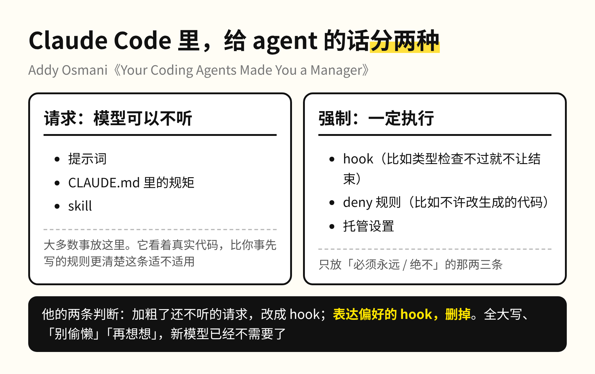
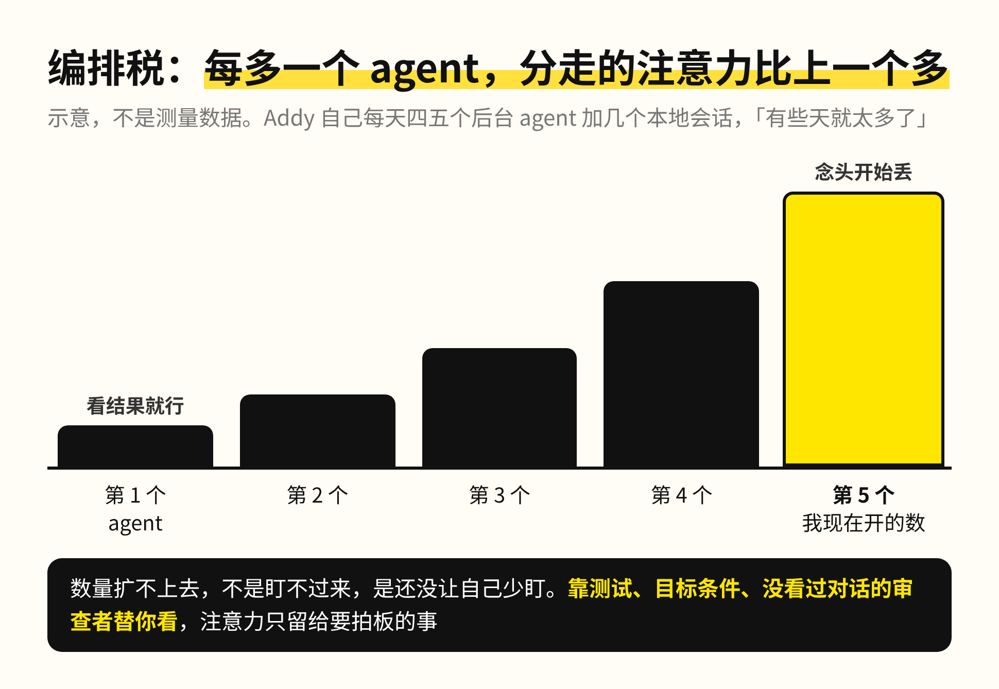

Addy Osmani 差点合并了 600 行代码：测试全绿，变量名看着都合理，是他让 agent 去调研竞品差距之后写出来的。合并前多看了一眼，加的全是用户用不上的复杂度。

Addy 在 Anthropic 做 Claude Code。这件事写进了今天发的一篇长文，标题是「你的 coding agent 把你变成了经理」，一天不到 3400 多人收藏。

意思是，整天带 agent 干活的人，每天都在选任务、写交代、分派、跟进、验收、拍板，这就是管理。用得好的人不是提示词写得最好的人，是学会了管理的人。我每天开着四五个 Claude Code 窗口并行，看到这句心里一紧😅。这篇把管理的老规矩和 Claude Code 团队这一年的做法对了一遍，排在前面的几条，我一条一条对着自己看。

1、先给它一个自己能跑的验收

管理里最有经验的做法是先立护栏，CI、代码审查、看板，这样不用读完每一行也知道团队做得对不对。不立护栏的新经理只能自己挨个验收，一个季度之后他本人就是瓶颈。agent 一模一样：它在「看起来做完了」的时候就会停，如果没有别的验收，「看起来做完了」就是它仅有的标准，你自己变成了它的测试套件。

所以第一件事是给它一个能自己跑的检查：测试、构建的退出码、lint、一张截图，什么都行，只要能给出明确的过或不过。改 UI 就让它自己打开页面检查，不对再改。团队的说法是，CLAUDE.md 里最有用的一行，就是那条跑验证的命令。有了这个，它会自己跑、自己看到失败、自己改，你只需要看它验不了的那部分。

2、只说它看不到的

agent 接到任务第一件事是读代码，目录结构、命名习惯、测试怎么跑，它读得比你描述得还要快。所以交代任务之前先想一下，哪些它自己能查到。能查到的一个字别写，把话留给代码里没有的东西：会上定的决定、部署的内部流程、这件事为什么重要、这次做到什么算完成。Netflix 管这叫给上下文不给控制，军队里叫指挥官意图。

3、纠正第二次就写下来，但只锁死不能变的

同一件事改过两遍，就进 CLAUDE.md 或者做成 skill，不然它只存在你一台机器的默契里。这条我早就在做，一件事重复第二次我就写成 skill。

紧接着的一条我以前没想明白。Claude Code 把两类东西分得很清楚：提示词、CLAUDE.md、skill 是请求，模型可以参考也可以不听；hook 和 deny 规则是强制，一定执行。大多数时候应该让模型自己判断，因为它看着真实代码，比你事先写的规则更清楚这条适不适用。全大写喊话、「别偷懒」「再想想」这些老习惯，新模型已经不需要了。原话是，对 agent 来说，流程过多就是新的微观管理。

我给 Claude Code 写的规则文件，这两个月哪里歪了就加一条，越写越长，产出反倒越来越不稳定。按他这个分法，我写的几十条里，真正该锁死的也就两三条，剩下的都是我替模型做了它本来能自己做的判断。

4、交出任务，不交判断

开头那 600 行就是这一条。没有一个经理能讲「那是我下属上线的，不是我」，agent 也一样。审一个大改动的时候，测试绿了、命名合理就点通过，这不叫代码审查，叫盖章。分工写得很具体：样式、lint、改审查意见、常规 bug 和单元测试交给 agent，安全边界、合规、产品决策留给人。每一个 diff 都当成半夜会因为它被叫起来那样去看。

5、能扩的是验收，不是注意力

经理很快会学到自己的管理半径，直接下属超过一个数，每个人分到的时间都变少，质量跟着下滑。agent 也有这个账，Addy 叫它编排税：过了头几个，每多一个 agent 分走的注意力比上一个更多。Addy 自己每天跑四五个后台 agent 加几个本地会话，有些天就已经太多了。

这一条我体会特别强烈。几个 agent 并行的时候，一个跑完弹回来，我手上正在想的那个念头就丢了。打断我的不是别人，是我自己开的窗口。解法不是盯得更紧，是把监控交出去：让测试、目标条件、没看过对话的新审查者替你看，注意力只留给要拍板的事。agent 的数量扩不上去，不是因为盯不过来，是因为还没有让自己少盯一点。

文章末尾也划了类比不成立的地方：跑过五个 agent，不等于你能管五个人，管人要处理动机、冲突和几个月才建起来的信任。反过来，agent 又太听话，你让一个好工程师做错事他会顶回来，agent 多半照做，然后你会越来越相信它。Addy 的办法是让它反驳自己的答案。

这篇我看完的判断是，带 agent 的人之间拉开差距的，不是谁的提示词写得漂亮，是谁先给它一个自己能跑的验收。注意力是扩不了的，我开到第五个窗口的时候已经在丢念头了，能扩的只有检查。

你现在同时开着几个 agent？其中哪一个，有一条它自己能跑的验收？我数了一下，我的五个里只有两个有。
