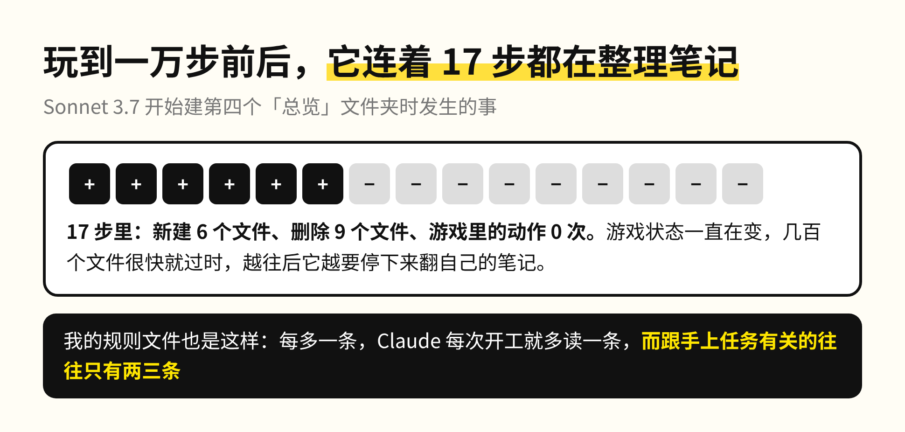
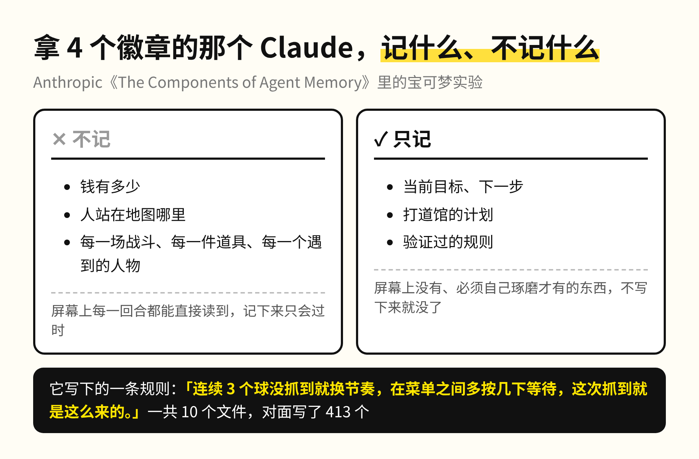
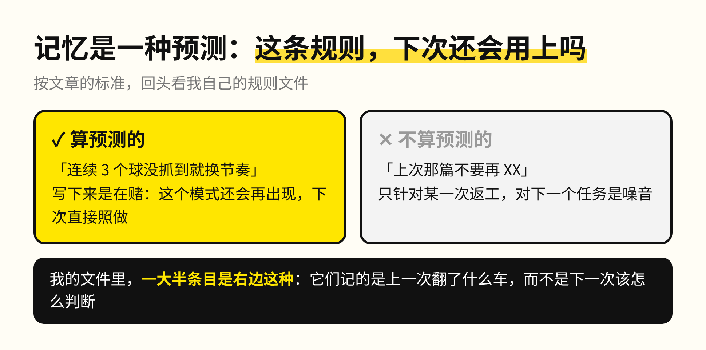
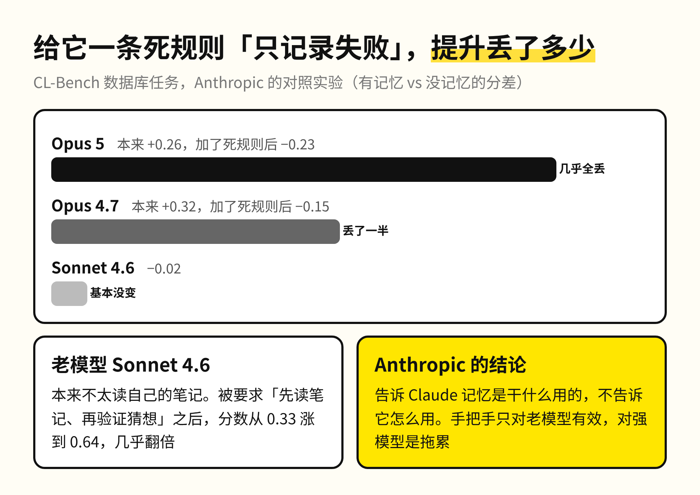
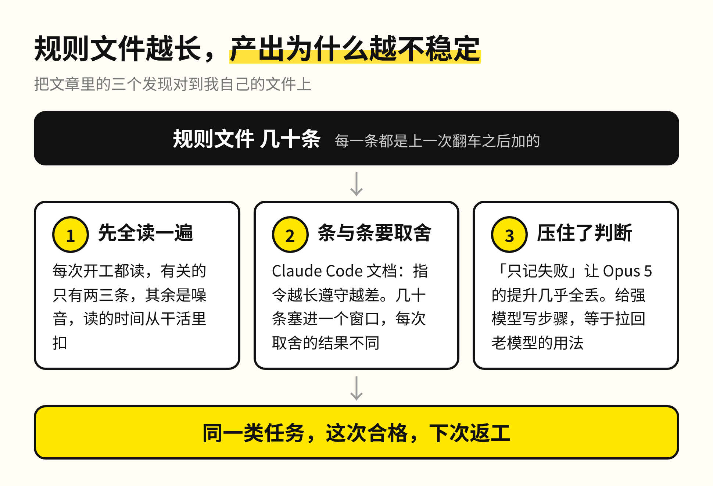
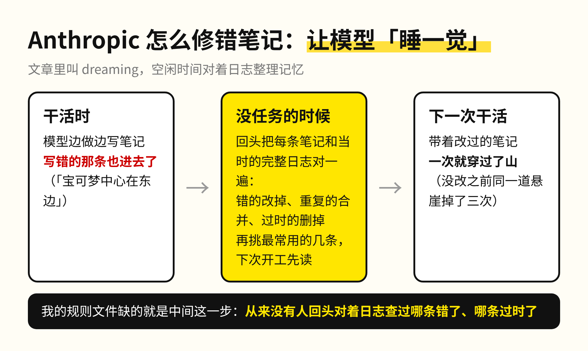
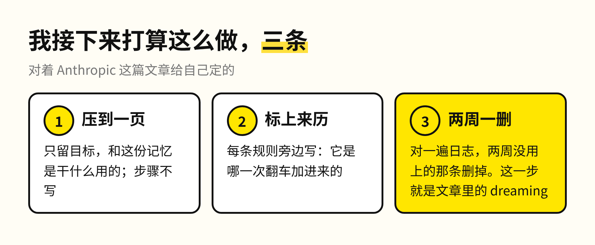

我给 Claude Code 写的规则文件，这两个月改了几十次，每次都是它哪里做歪了就加一条。文件越来越长，产出反倒越来越不稳定，同一类任务这次合格，下次照样返工。

Anthropic 两天前发了一篇讲 agent 记忆的文章，里面有一场宝可梦实验，正好把这件事讲明白了。两个版本的 Claude 各玩一局，一个写了 413 个记忆文件，只拿到 1 个徽章；另一个只写了 10 个文件，拿到 4 个。

1. 记得多的那个，输在读上

写 413 个文件的是老一代的 Sonnet 3.7。它认定什么都可能有用，每打一场、捡一件东西、遇到一个人物，都单独存一个文件，一共开了 225 个文件夹。游戏状态一直在变，这些记录很快就过时了，所以越往后它越要花时间翻自己的笔记。玩到一万步前后，它连着 17 步都在新建和删除「总览」文件，游戏里一步没走。

记下来的东西要先被读一遍才有用，读的时间是从干活里扣出来的。我那份规则文件也一样。每多一条，Claude 每次开工就要多读一条，但这几十条里跟手上任务有关的往往只有两三条。

2. 记忆到底是用来做什么的

写 10 个文件的 Fable 5 回答了这个问题。钱有多少、人站在地图哪里，这些屏幕上每一回合都能直接读到，它一概不记。它只记屏幕上没有、必须自己琢磨才有的东西：当前目标、打道馆的计划、验证过的规则。连续 7 个精灵球没抓到一只鲤鱼王之后，它写下一条：「连续 3 个球没抓到就换节奏，在菜单之间多按几下等待，这次抓到就是这么来的。」

文章里有一句话我一直记着：记忆有时候是一种预测。写下一条规则，等于在赌这个模式还会再出现。按这个标准回头看我的文件，一大半条目都是某一次返工之后留下的禁令。它们只对那一次有效，到了下一个任务就成了噪音，所以算不上预测。

3. 规矩定得越死，模型越差

Anthropic 还做了一组对照。给模型一条死规则「只记录失败」，结果 Opus 5 从记忆里得到的提升几乎全丢了，Opus 4.7 丢了一半。他们的结论是：告诉 Claude 记忆是干什么用的就够了，不要告诉它怎么用。手把手的提醒只对老模型管用，Sonnet 4.6 本来不太读自己的记忆，被要求「先读笔记、再验证猜想」之后，分数几乎翻了一倍。

这就是我那份文件越长越不稳定的原因。Claude Code 自己的文档也写着，指令文件越长，模型遵守得越差。所以它给自动记忆定了一个上限：每次只加载前 200 行，剩下的当索引，要用再去翻。几十条规则塞进同一个窗口，模型每次都要在它们之间自己取舍，取舍的结果每次不一样，产出自然就不稳定。给一个够强的模型写步骤，等于把它拉回老模型的用法。

4. 写错的一条，会被一直相信

还有一件事比变长更麻烦：笔记里错的那条，它每次都会相信。游戏里有一段要穿过月见山，入口旁边有一道单向的悬崖，掉下去就回到来时的路。Claude 把地标记错了方向，写下「月见山已通过」，随后走下悬崖，还判断自己「走过头了」。同一道悬崖它掉了三次，第三次之后它写道，我打算停下来，不再循环了。

Anthropic 的修法叫 dreaming，可以理解成让模型睡一觉：在没有任务的空闲时间，回头把笔记和当时的完整日志对一遍，错的改掉，重复的合并。做过这一步之后，Claude 一次就穿过了山。

我的规则文件从来没有被这样对过日志。哪一条当时就判断错了、哪一条早就过时了，没有人回头查过，它们就一直留在那里，每次开工都被读一遍。

这篇文章最后把三个问题留给了人：什么时候该记、记多少、谁来清理。模型判断什么值得记的能力已经在变强，人留在回路里要做的事也跟着变了。写下一条「以后不许这样」是最省力的动作，也是最没用的那种。该由人维护的只有两样：告诉它这份记忆是为了什么，然后定期替它做一次 dreaming，对着日志把错的和过时的删掉。

我接下来打算这么做：把规则文件压到一页，只留目标和这份记忆是干什么用的；每一条规则旁边标上它是哪一次翻车加进来的；每两周对一遍日志，两周没用上的那条删掉。

你给 AI 写的规矩里，上一次删掉一条，是什么时候？
