Ryo Lu 站在台上，让 AI 做一个记下生活的工具。两分钟后，它交回一个日记应用，还多加了心情分数、连续天数、每日提醒、每周报告。

每个功能都配了很完整的理由，他说自己多半会回一句「哦，那好吧，就这样」。可是话到嘴边他停住了，问台下：我真的想过，我的生活为什么需要被打分吗？

Ryo Lu 是 AI 编程工具 Cursor 的设计负责人，之前做过 Notion 的设计。这场演讲用中文讲了 22 分钟，题目叫《当我们什么都能做，还知道自己想做什么吗》。开场第一段就是，看到别人用新模型做出点什么，第一反应是「哇好厉害」，第二个反应却是「我是不是又落后了」。

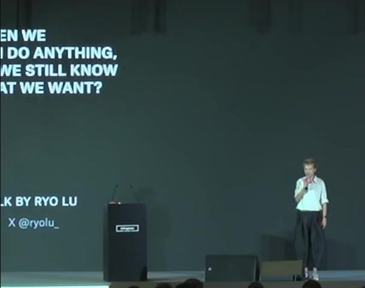

我用 Claude 干活，碰到的是同一件事。它给的方案常常很完善，完善到我找不到反对的理由；可如果当时没有认真想过里面的合理性，等方案落地的时候，反噬的是我自己。所以这场演讲里的四条，我是对照自己的用法一条一条看的。

1、完整的答案，会盖住还没形成的问题

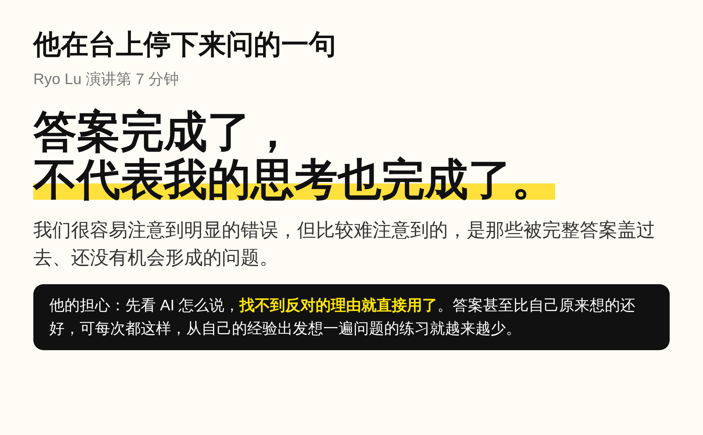

Ryo Lu 担心的是顺序反了：本该先有自己的想法，再请工具帮忙；现在常常是先看它怎么说，因为找不到反对的理由，就直接用了。那个答案不一定错，甚至比自己原来想的还好。

问题在于每次都这样，人会越来越擅长判断一句话听起来合不合理，却越来越少从自己的经验出发把问题想一遍。说白了，你照单全收，往往不是因为它对，而是因为你还没找到理由反对它。

2、先挑一样你想去掉的

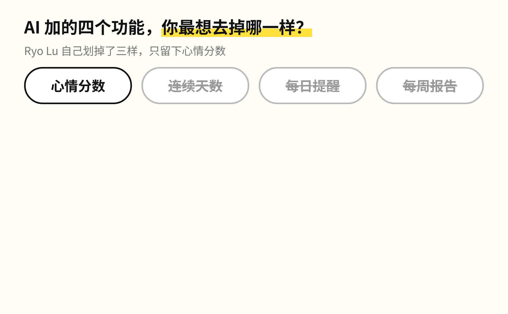

现场还有一个小游戏：先不问这个日记还缺什么功能，问四样里你最想去掉哪一样，举手。Ryo Lu 自己拿掉了连续天数、每日提醒和每周报告，理由是「我不想有一天没写，觉得自己欠了点什么。我想留下生活，不是替生活添加一份作业」。

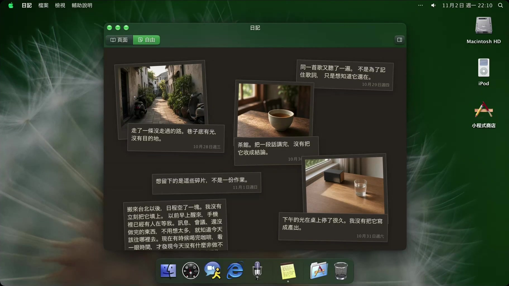

你可能恰好相反，最需要的就是那个提醒；也可能觉得整个方向都不对，想要的是一块无尽的画布。这里没有标准答案。刚才只是停了一下，但台下已经挑出了一个决定，发现自己对它有感觉，还开始说得出为什么。「我想记录生活」这句模糊的话，到这里才有了一点自己的形状。所以知道自己想要什么，不一定是动手的前提，也可以是动手之后慢慢出现的结果。

3、服务窗口和工作台

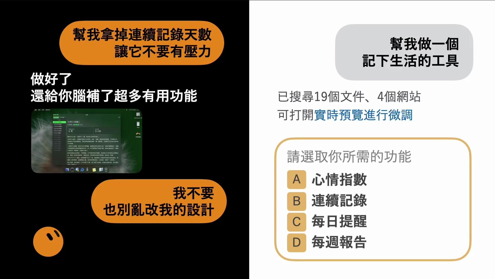

同一句「帮我做一个记下生活的工具」，演讲里放了两个画面。服务窗口处理完直接交给你一个新版本，刚好合适就用；它要是拿掉了你喜欢的提醒，你就得再解释一遍哪里要留、哪里不要。面前只有成品的时候，人能做的只剩接受、拒绝、再说一次。

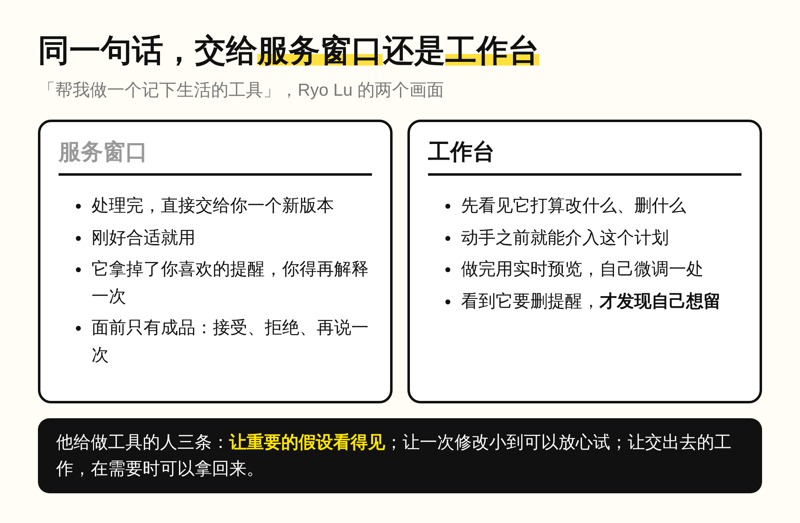

工作台不一样。你能先看见它打算改什么、删掉什么，在它动手之前就介入这个计划，做完再用实时预览自己调一处。有时候正是看到它准备删掉提醒，你才发现自己想留。原话是：工具让我更容易碰到自己的想法，而不是要求我一开始就把想法说得完美。

这一条我现在每天都在用。低复杂度的任务，我直接交给 AI 闭环落地。复杂度高的内容，我先让它走 Plan Mode 拆解给我看；确认逻辑没有问题，才让它执行，因为方案越完善，我越容易跳过判断。Plan Mode 那一步就是我的工作台，它要删什么、先做哪一步，都摆在动手之前。

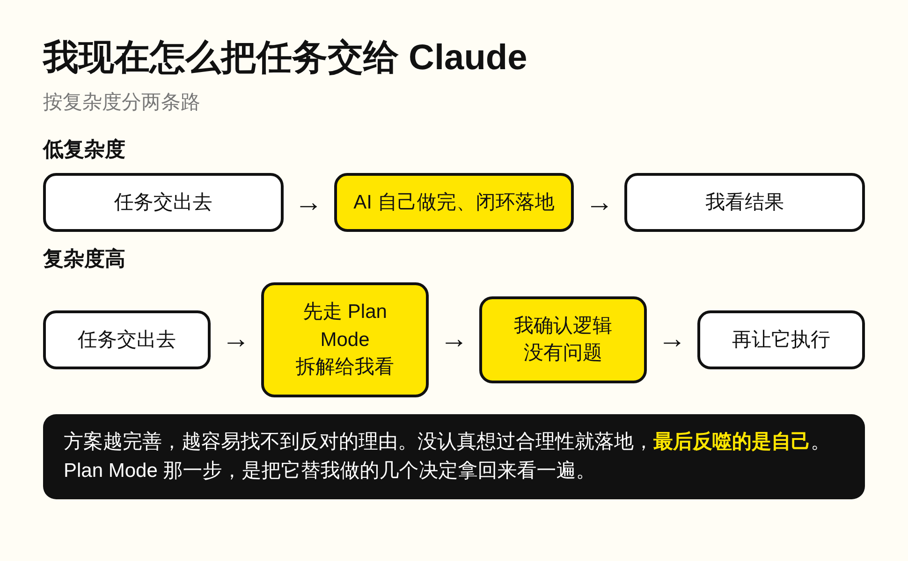

4、工具一直在那里，不代表一直要用

Ryo Lu 拿 email 打比方：有了 email，不代表任何时间、任何事情都要寄一封信。AI 也一样。有时候就是要它快一点，把复杂的工作整理好；有时候想先自己写几句，看看脑子里还剩下什么；有时候需要的不是再多一份分析，而是去茶馆跟那个人真正聊一次天。

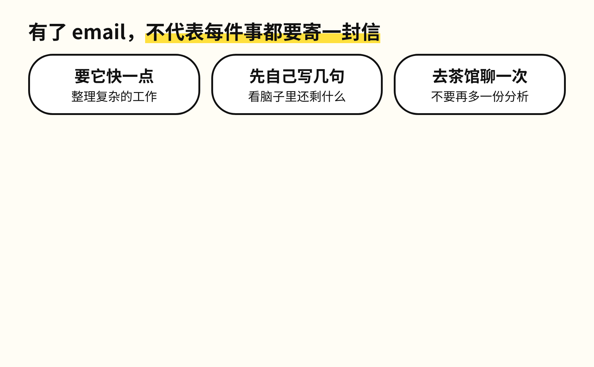

后来 Ryo Lu 离开旧金山，搬到了台北。日程空下来之后，反而每天都要自己回答「今天想做什么」。小时候在加拿大买不起 Mac，他就把自己的电脑改得像它：换图标、换字体，研究那些按钮是怎么做的。那时候没想过要当设计师，只是喜欢。所以他说，生活不是创作的竞争对手，把生活压缩掉，创作并不会留下来。

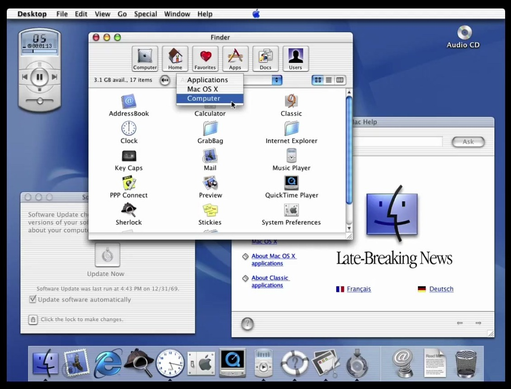

在我看来，AI 会把方案写得越来越完整，完整到大多数人挑不出毛病。交出去的分界不在任务大小，在于里面那几个关键的决定，我自己有没有想过：决定都很明显的任务，交给它闭环落地；方案里藏着几个它替我做的决定，就先让它拆开给我看。一路点同意的人，迟早会在落地那天，替一个自己没想过的决定买单。

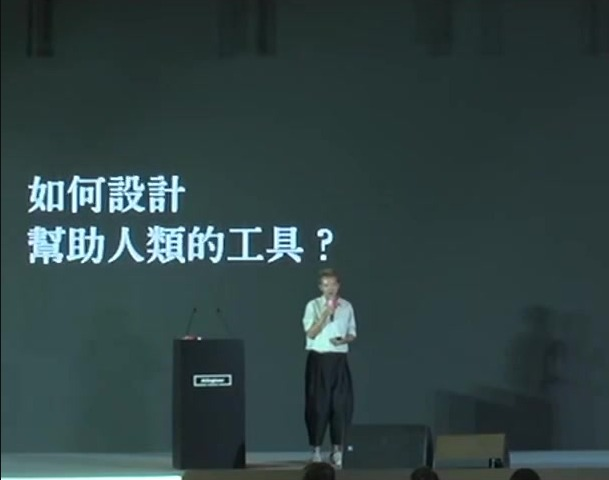

演讲最后留的建议很小：下次看到一个很完整的答案，先给自己留一点时间，问一句「这里面哪个决定，我自己还没有想过」，挑一个你在乎的地方改一小处，有机会再拿给另一个人看看。

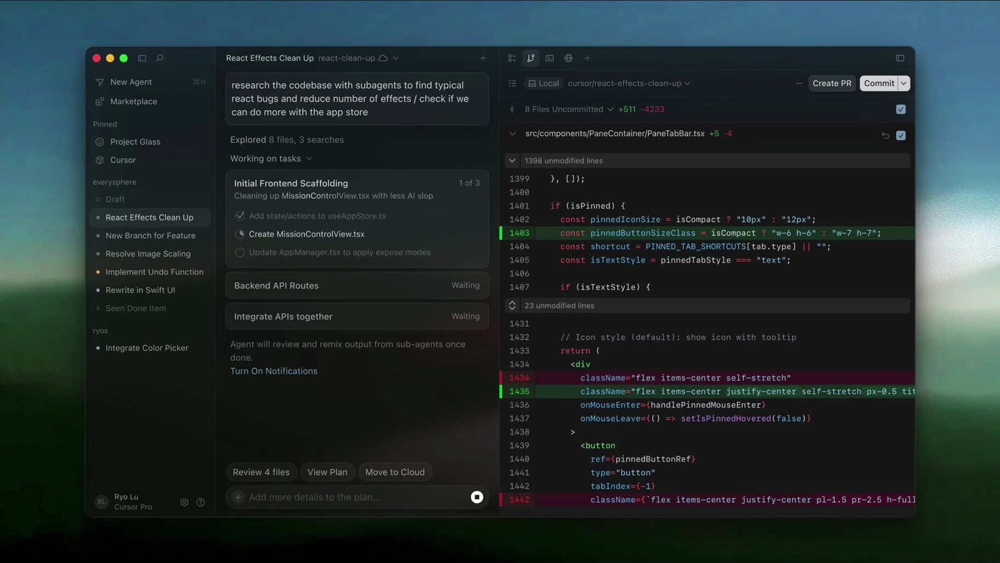

你最近一次照单全收的 AI 方案，里面哪个决定是它替你做的？
