现在面试校招生，我会多看一样东西：他对 AI 模型敏不敏感。新模型出来，他有没有自己上手试过，能不能说出这一版好在哪、又差在哪。

谷歌 Gemini 的产品负责人 Tulsee Doshi 招 PM，看的也是这个。她上了 Lenny 的播客，聊到前一阵推特上流行「AI 时代不需要产品经理了」，现在风向反过来了：什么都能做出来以后，判断什么值得做的人反而更值钱。

Tulsee 管的不只是 Gemini，谷歌的图像、视频和开源模型也都归她管。来这个岗位之前，她在谷歌做负责任 AI 的产品，做了好几年。

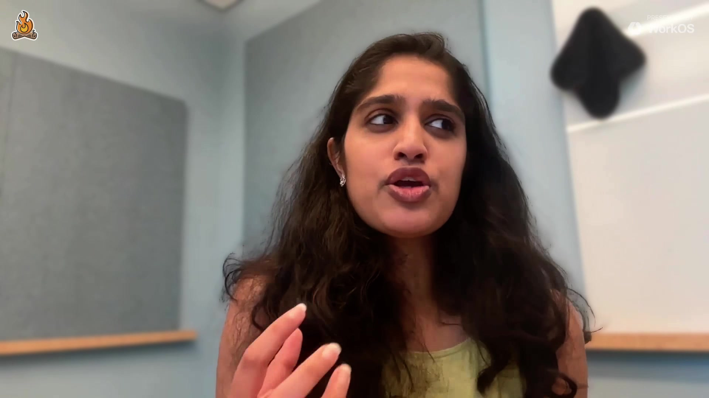

她形容训练模型像《哈利·波特》里斯内普的魔药课：配料都按计划放进去了，出锅的东西总带一点意料之外的魔法。因为结果没法完全预测，PM 的工作有一半在模型出炉之后，要去找它在哪里格外出彩。这期聊了一个多小时，我挑出四条跟每个人都有关的。

**1. 招人：先看你每天玩不玩模型**

她要的 PM 懂模型的脾气：每天都在用，有一套自己判断模型好坏的任务，也肯自己看数据、自己搭评测。她还看重能不能跟上变化，因为这个领域两周一变，两个月前写的路线图，现在多半要重写。

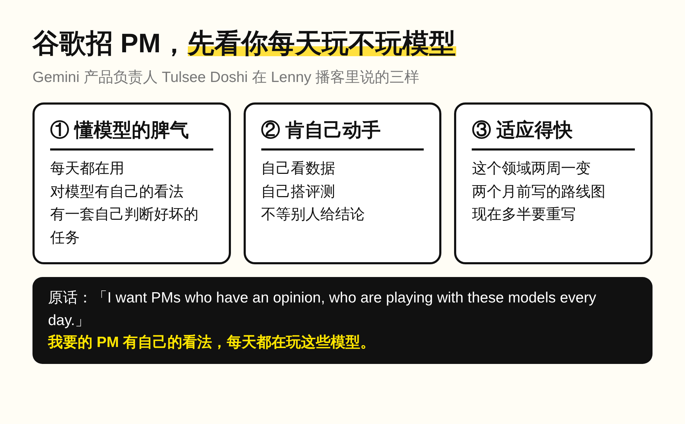

我这边的面试题也换过一轮。以前让校招生讲一个做过的 feature 全流程，现在问他做过什么 agent、什么自动化工作流。看模型敏感度是同一件事：每天在用的人，说得出这一版模型哪里变了；只在简历上写「熟练使用 AI 工具」的人，往往说不出来。

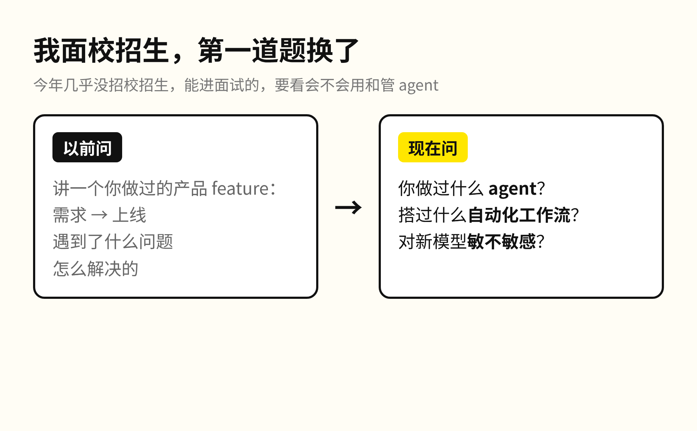

**2. 第一个评测，从 5 条提示词开始**

评测就是一组固定的题，拿来比两个模型谁做得好。很多人以为要先搭一个很大的基准。她的建议是从 5 条提示词起步，自己当评分员；加到 20 条左右，就已经能看出模型 A 和 B 的差别。

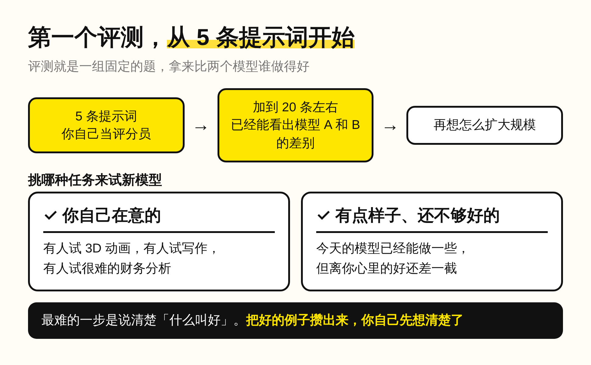

最难的一步是说清楚什么叫「好」，尤其是要跑好几步的长任务。把好的例子攒出来，你自己先想清楚了，之后再考虑怎么扩大规模。

连主持人 Lenny 都承认，每次拿到新模型，他常常只会打个招呼、试几件以前做过的事，然后说「不错，好像更好了」。如果你也是这样，就挑自己在意、今天的模型已经有点样子但还不够好的任务去试。这类任务上，两个模型的差别最容易显出来。

**3. 60-20-20：做一部分今天还做不到的东西**

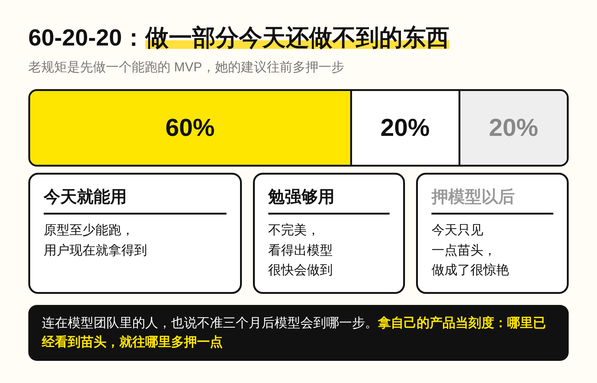

创业的老规矩是先做一个能跑的 MVP。她的建议往前多押一步：60% 今天就能用，20% 不完美但看得出模型很快会做到。剩下 20% 押在模型以后的能力上，今天只看到一点苗头，做成了体验会很惊艳。

理由很实在：连她这个在模型团队里的人，也说不准三个月后模型会到哪一步，所以只能拿自己的产品当刻度，哪里已经看到苗头，就往哪里多押一点。

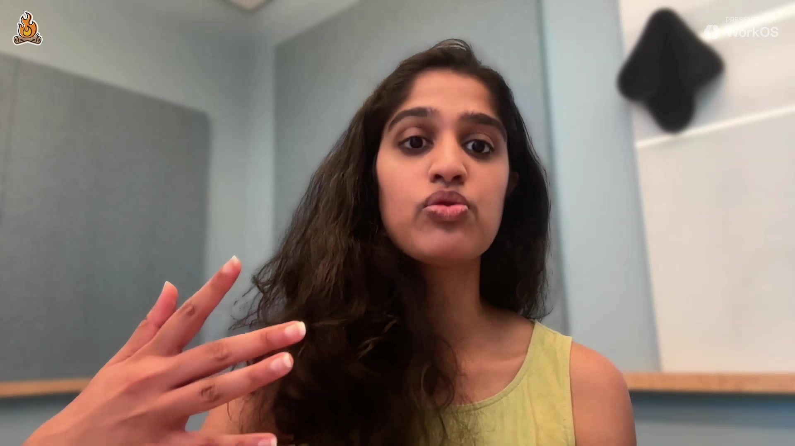

反面的例子是有些客户围着旧模型搭了一套很死的系统，模型变强以后反而用不上。做 Claude Code 的 Boris Cherny 建议更直接：隔一阵把 skills 全删掉试一次，很多时候新模型不靠这些也一样好。

**4. 每件事先问一句：AI 能不能替我做**

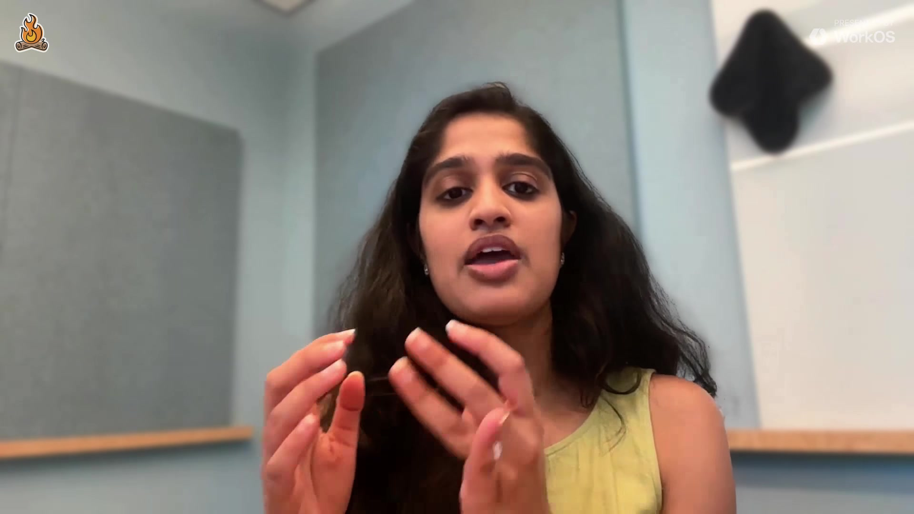

Lenny 说他最近养成一个习惯：接到一件事、动手之前，先问一句 AI 能不能帮我做。Tulsee 的体会是，只要有一次真的好用，心态就变了，之后丢给模型的事会越来越多。

她团队里还有一条规矩：同一件事要做第二次，先问自己还要不要亲手做；但写战略写第二遍，仍然应该自己写。

问她 Gemini 之外最喜欢哪个 AI 产品，她答的是语音输入法 Wispr Flow，因为手腕有伤，打字打不久。这家公司今年 8 月的估值是 20 亿美元。

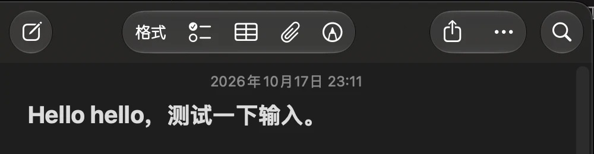

上个月我用的 Typeless 免费额度用完被降速，我没去充钱，周六用 Claude Code 花两个半小时做了一个同类的语音输入法 SayType，本地识别加 DeepSeek 整理口语，之后就没再打开过 Typeless。这件事我在 10 月那篇输入法笔记里写过，现在回头看，它就是一次「先问 AI 能不能做」。

**PM 交出去的东西，要带着分量**

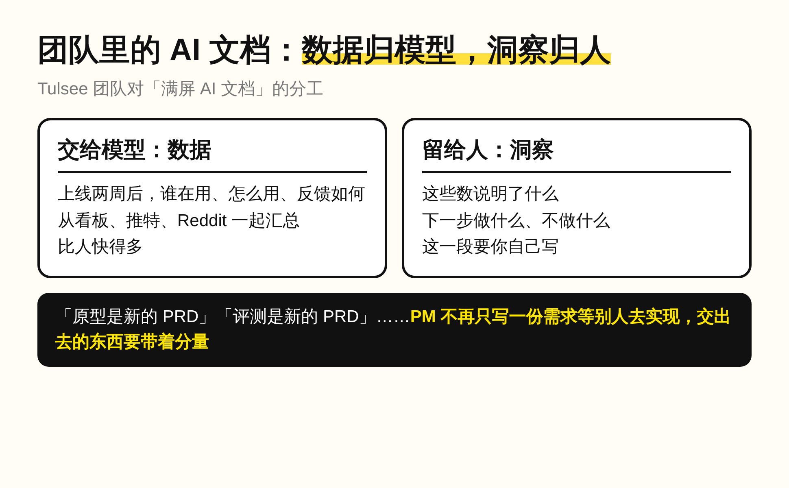

满屏 AI 文档怎么办，Tulsee 团队的分工是数据归模型，洞察归人。上线两周后谁在用、反馈如何，交给 AI 从看板、推特、Reddit 一起汇总；这些数说明了什么、下一步做什么，要自己写。

推特上流行的「原型是新的 PRD」「评测是新的 PRD」，在她看来说的是同一件事：PM 不再只写一份需求、等工程师和设计师去实现，交出去的东西要带着分量。做 SayType 那晚，我一行需求文档都没写。

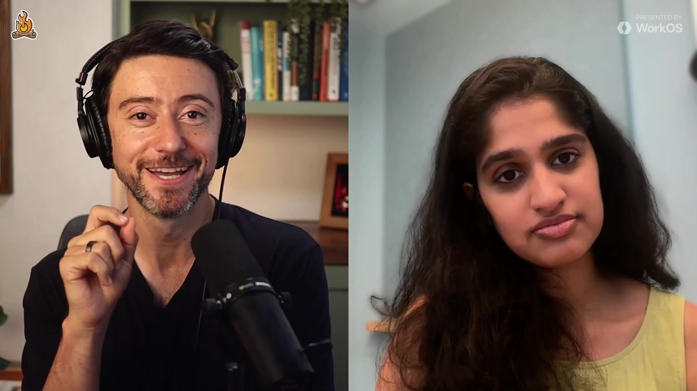

所以 PM 这个岗位不会被 AI 拿掉，会被拿掉的是只写需求、等别人实现、自己不碰模型的那部分工作。写需求这一步，模型几秒钟就能出一版；剩下的是判断：这个模型哪里好，这件事值不值得做，做到 60% 先上线还是再等等。招人看模型敏感度，看的就是这个人平时有没有在做判断。

如果今天由你来面试一个 PM，你会让他讲一个做过的 feature 全流程，还是问他最近拿新模型试了什么？我现在问的是后一个。

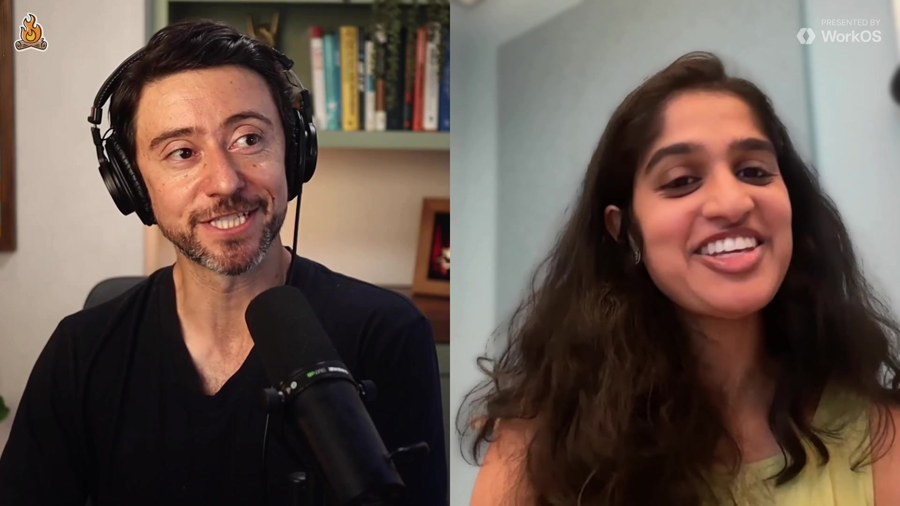
