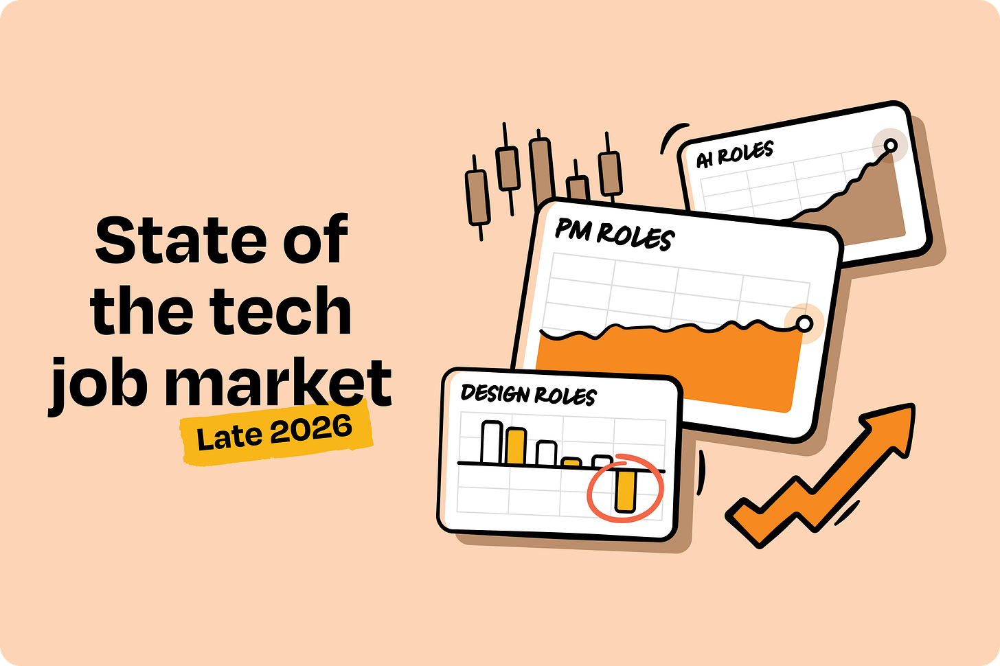
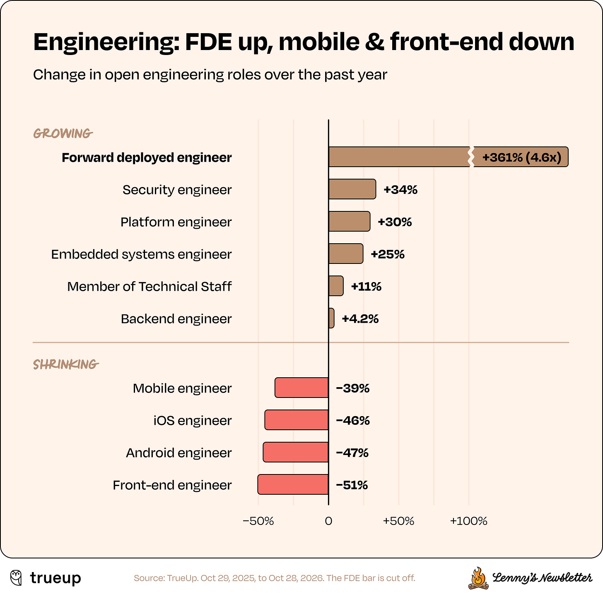
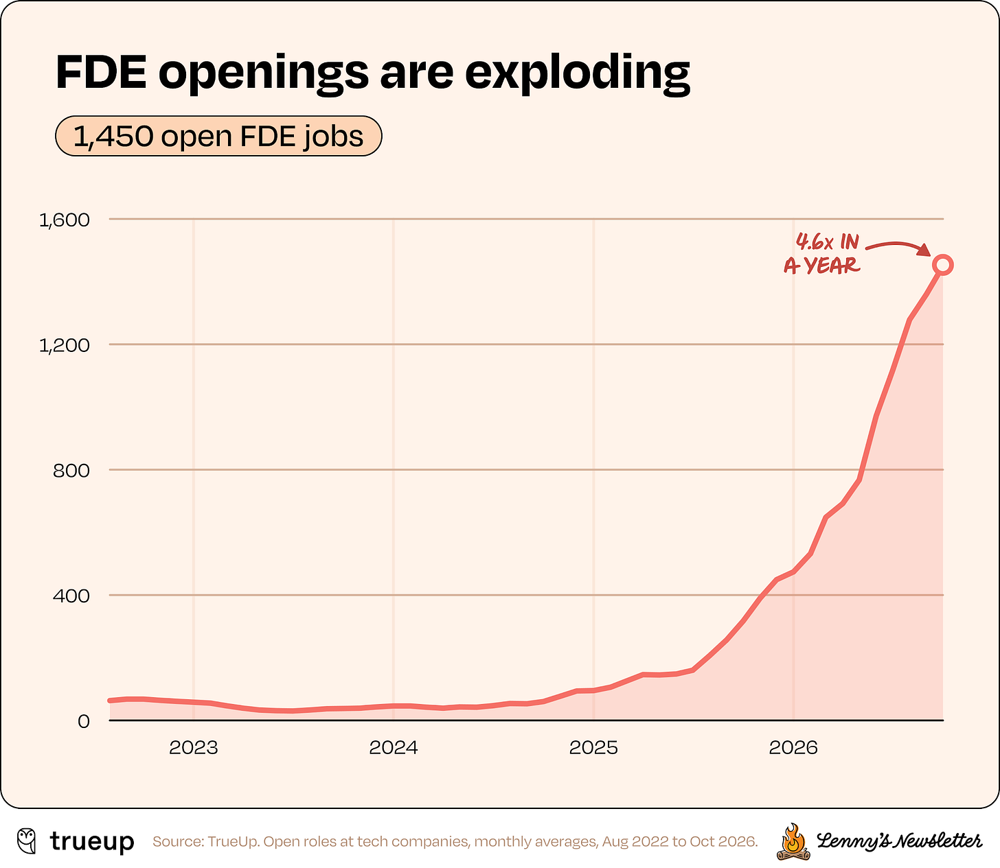
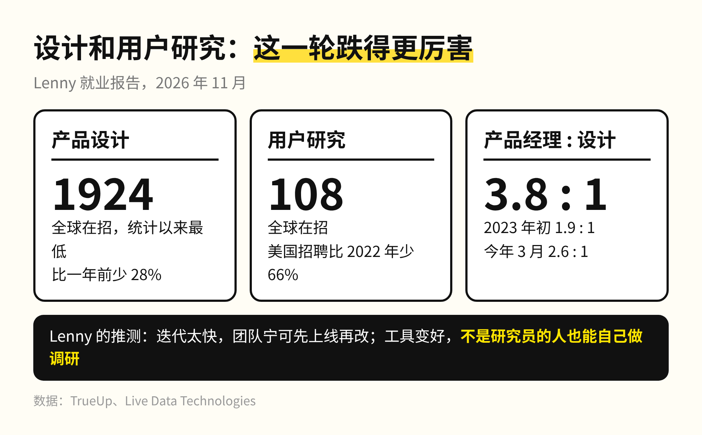
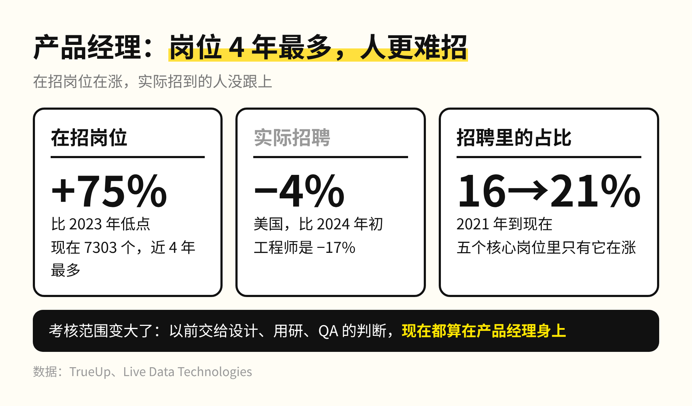
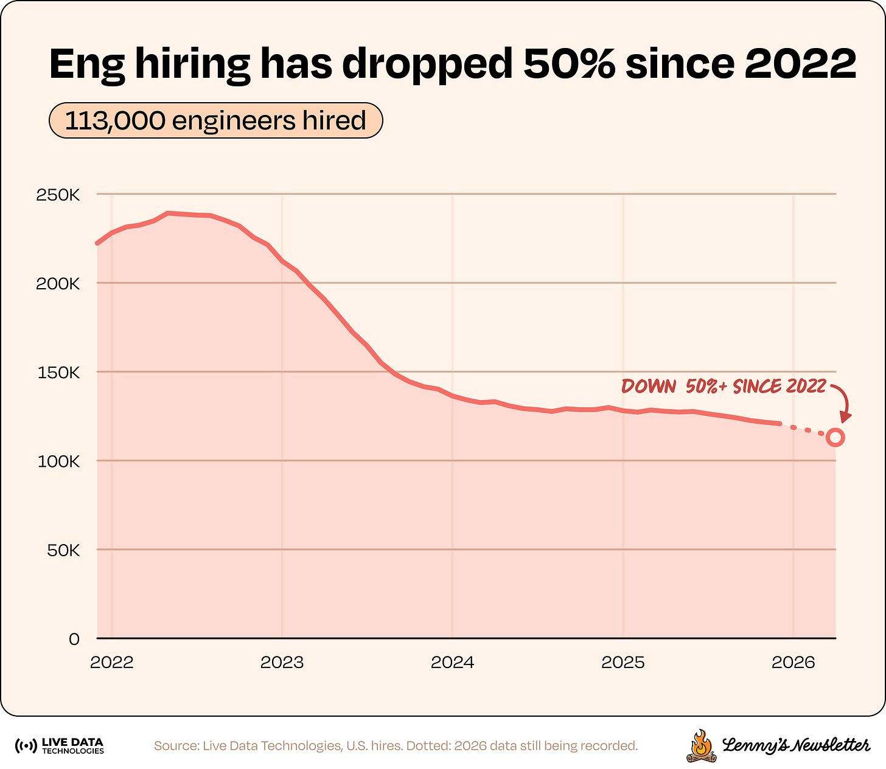
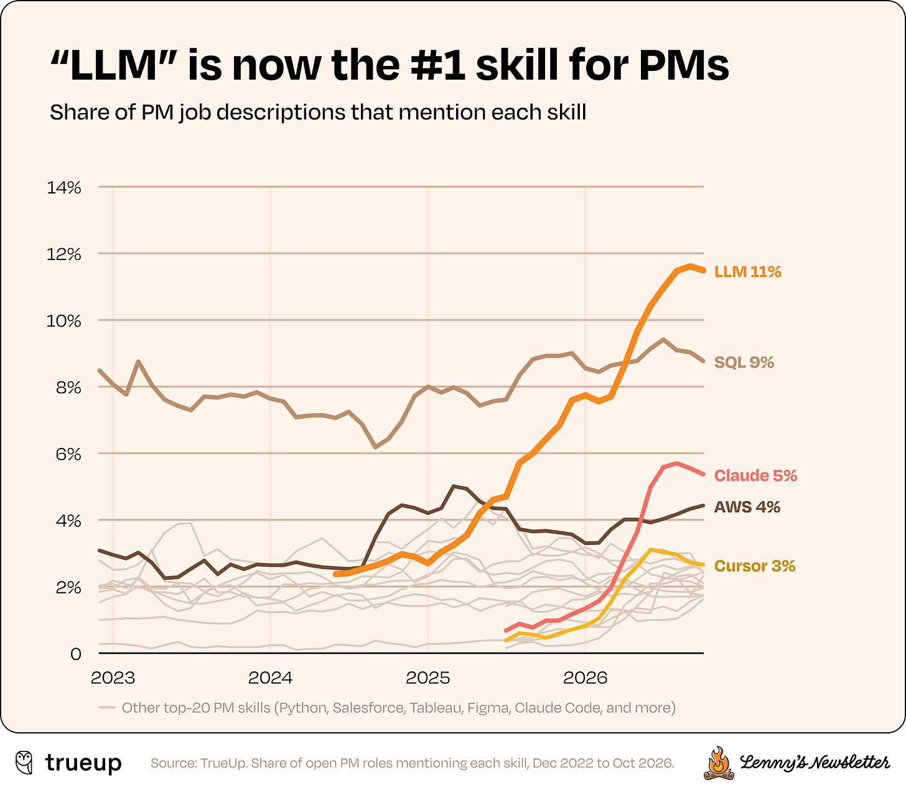
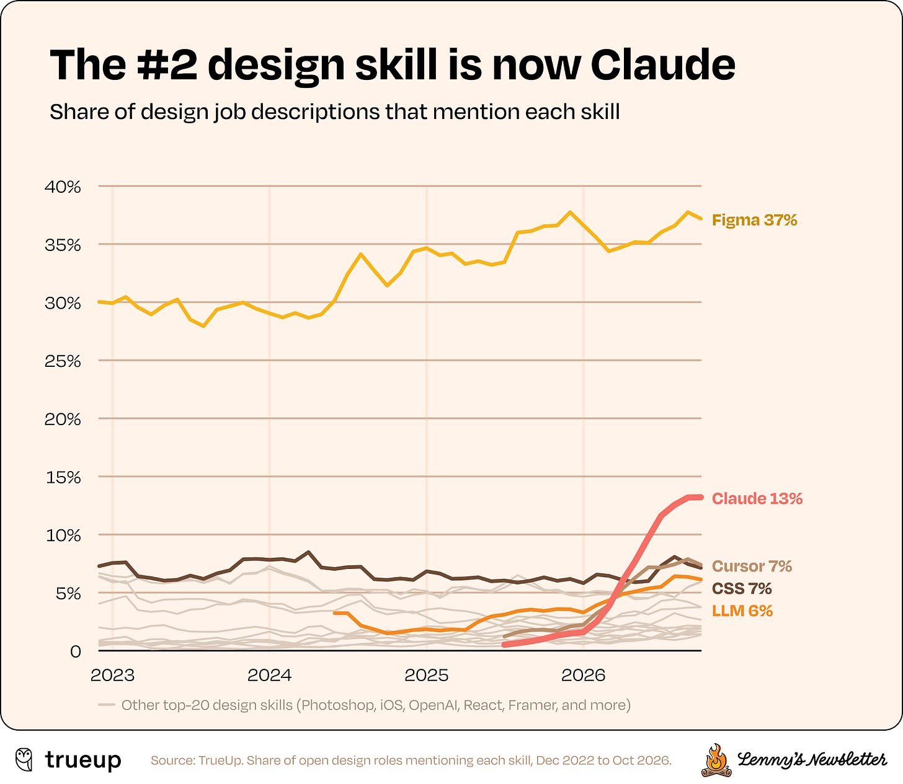
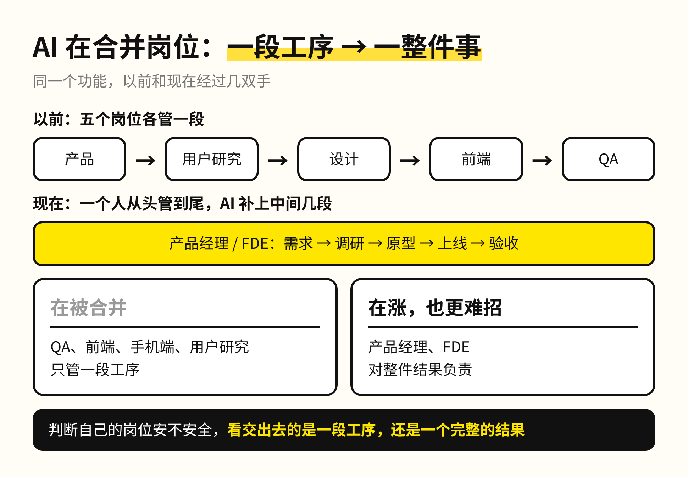
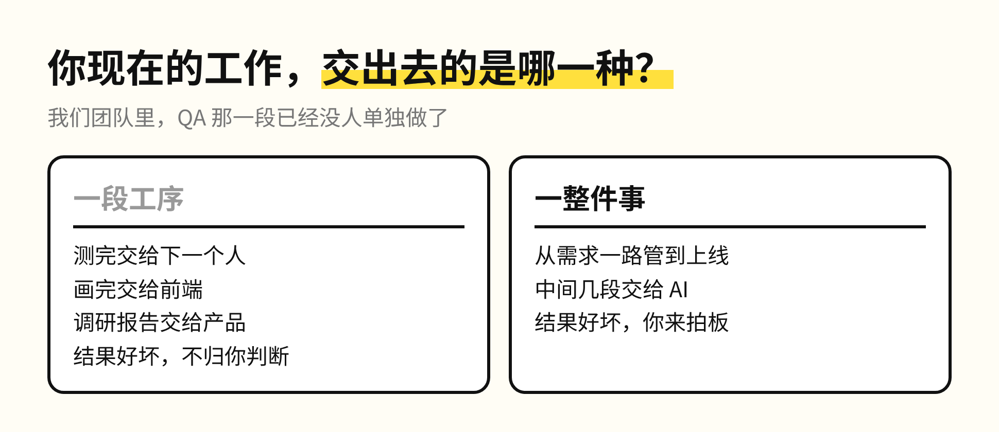

过去一年，科技公司在招的前端岗位少了一半，一个叫 FDE 的岗位却涨了 4.6 倍。

我们团队也在发生同样的事：用户研究和前端少了很多，QA（专门做测试的岗位）整个团队已经没了。

这组数来自 Lenny Rachitsky 11 月 10 日发的就业报告。他是硅谷产品圈很有名的通讯作者，数据用了两份：一份统计 9000 多家科技公司的在招岗位，一份追踪美国 1.24 亿人的入职和离职记录。报告一共七条结论，我挑出四条，它们说的其实是同一件事。

**1. 只管一段的工程岗在缩，管一整件的在涨**

FDE 是驻场工程师，被派到客户公司里，把模型接进对方真实的业务，从需求一路负责到上线。以前全球只有几十个这样的岗位，大多在 Palantir；现在在招的有将近 1500 个。

同一张表的下半截，手机端、iOS、安卓、前端都少了四到五成。Lenny 也提醒，FDE 的涨幅里有一部分是「销售工程师」换了个名字。但他给的解释，跟我们团队看到的一样：分得很细的工程专项正在塌掉，团队变小了，每个人管的范围因为 AI 变宽了。

换成大白话：岗位开始按「谁对结果负责」重新划分，按工序分出来的岗位最先被合并。我们团队的 QA 就是这样没的，测试这道工序还在，只是不再需要一个专门的团队单独做。

**2. 设计和用户研究，这一轮跌得更厉害**

全球科技公司在招的产品设计岗只有 1924 个，比一年前少了 28%，是报告开始统计以来的最低点。现在每 1 个设计岗，对应 3.8 个产品经理岗，2023 年初这个比例还是 1.9。

用户研究的处境更艰难。过去一年美国只招了大约 1800 个用户研究员，比 2022 年少了 66%，全球在招的只剩 108 个。Lenny 的推测有两层：产品迭代速度太快，团队宁可先上线、上线后再改，没时间走一轮完整的调研；调研工具也变好了，不是研究员的人也能自己做。他自己都在问，用户研究作为一个独立岗位，会不会就此消失。

调研本身还在做，只是不再单独交给一个岗位，这跟 QA 的情况一样。

**3. 产品经理岗位 4 年最多，但更难招了**

产品经理在招岗位是近 4 年最多的，比 2023 年的低点多了 75%；在美国科技公司的招聘里，产品经理的占比从 2021 年的 16% 升到了 21%，五个核心岗位里只有它在涨。

但实际招到的人没有跟着涨，过去两年还小幅下降了。Lenny 的解读是需求在涨，好的产品经理越来越难招。这一点在我这里是确定的：现在考核一个产品经理的范围比以前大得多，以前交给设计、用研、QA 的判断，现在都算在他身上，难度自然更高。

工程师这边也一样：在招岗位比 2024 年初多了 44%，实际招聘却少了 17%。岗位挂得出来，人很难招满。

**4. 招聘要求里，排前面的已经是 LLM 和 Claude**

两年前，产品经理招聘要求里出现最多的技能是 SQL、Jira、AWS 和 Python。现在排第一的是「LLM」，Claude 排第三，Cursor、OpenAI 和 MCP（让模型连接外部工具的协议）也进了前八。

设计师那边，「Claude」今年春天成了招聘要求里排第二的技能，越过了 CSS，Cursor 也越过了 CSS。工程师的招聘要求里，「LLM」刚刚超过 Java。

招聘要求换了词，说明各个岗位都被期待自己用 AI 把原来分给别人的那一段做掉。设计师写得了代码，产品经理搭得了评测，前端和 QA 那一段就被吸收了。

这跟我 10 月那篇 Anthropic 就业报告里写过的是同一件事：我面试校招生的题目，已经从讲一个 feature 的全流程换成了问他做过什么 agent、什么自动化工作流。招聘要求换了词，面试题也跟着换了。

所以判断自己的岗位安不安全，要看交出去的东西是一段工序还是一个完整的结果，岗位名称在不在涨反倒次要。AI 让一个人能管的范围变宽，被合并掉的是只管一段的岗位，涨起来的是对整件事负责的岗位，比如产品经理和 FDE。这些岗位也越来越难招，因为要的是能拍板整件事的人。

你现在的工作，交出去的是一段工序，还是一整件事？

