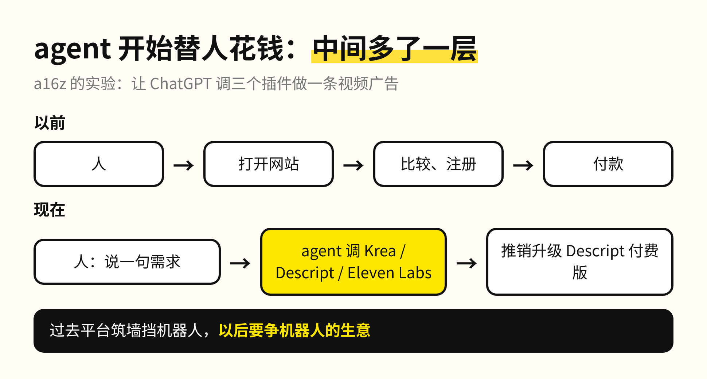
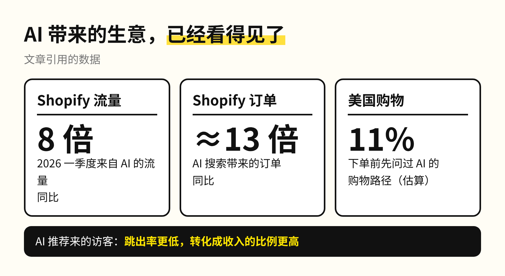
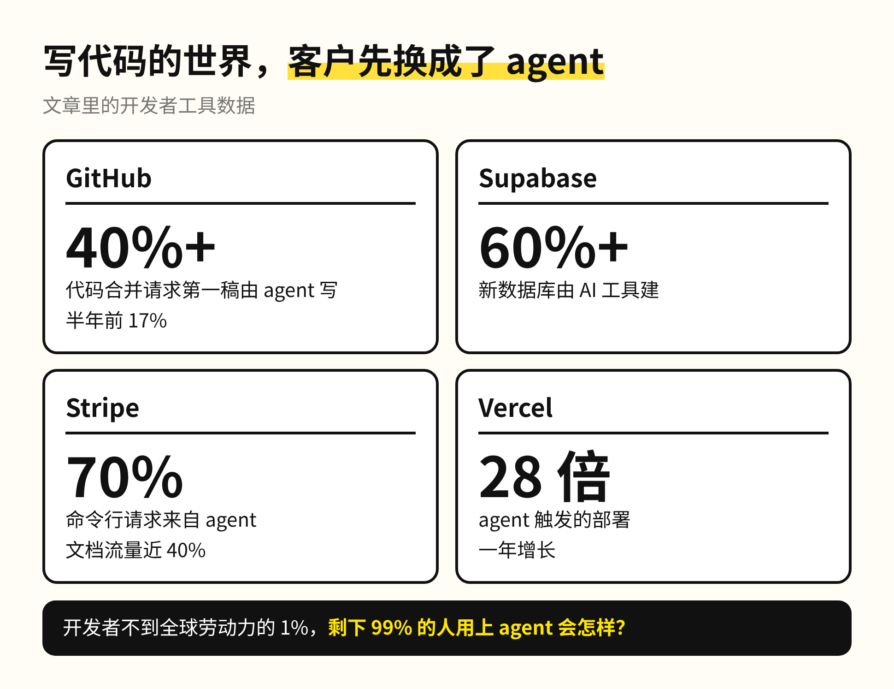
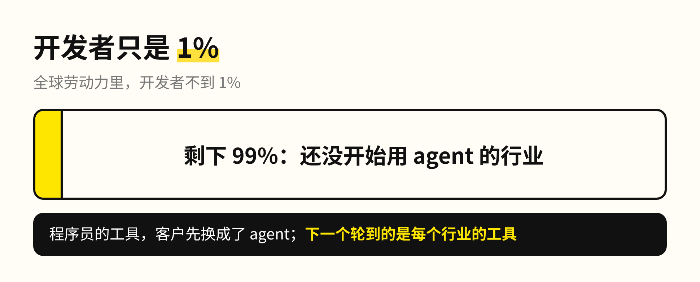
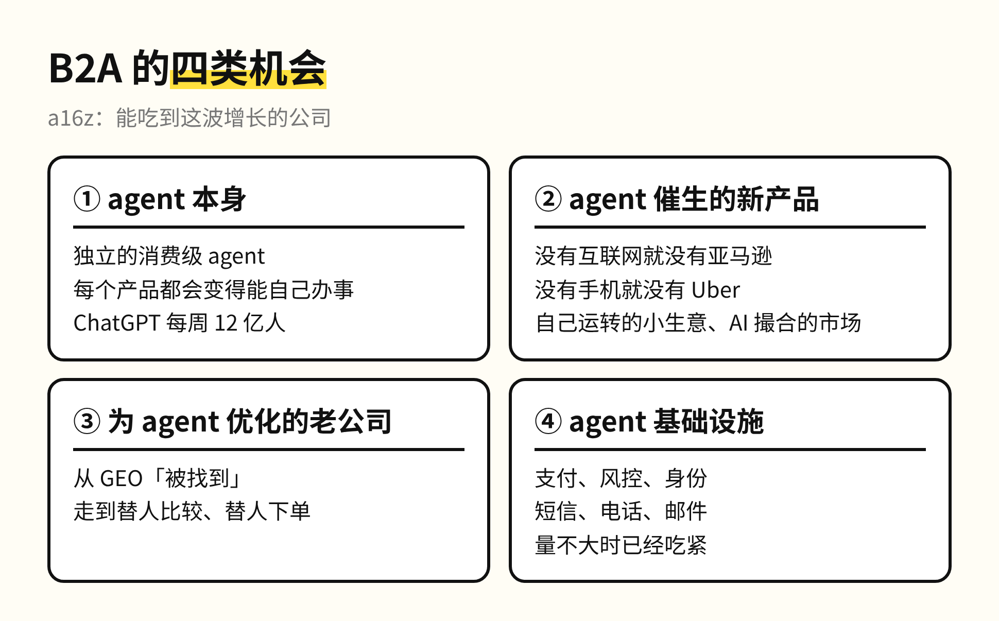
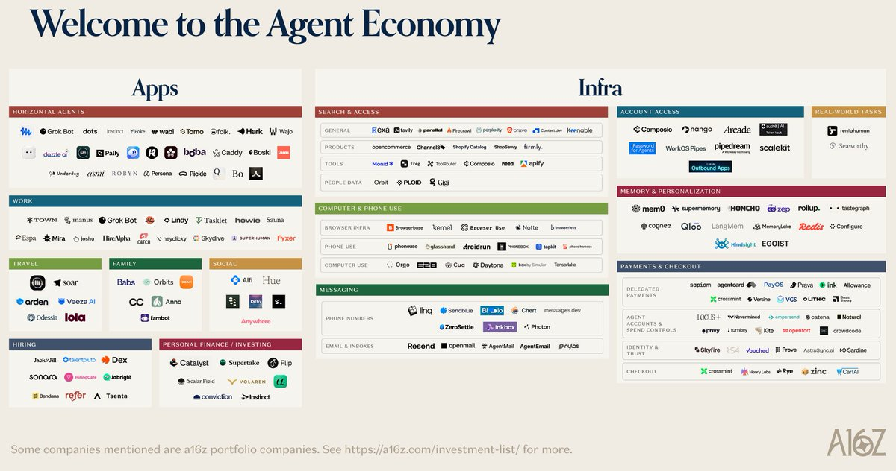
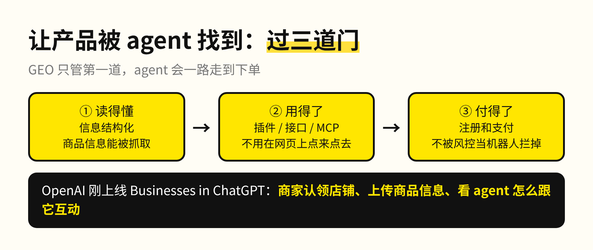
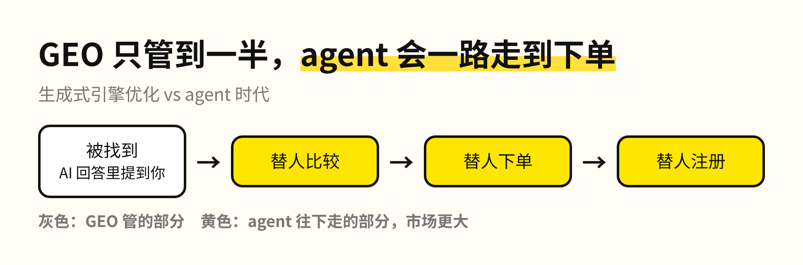
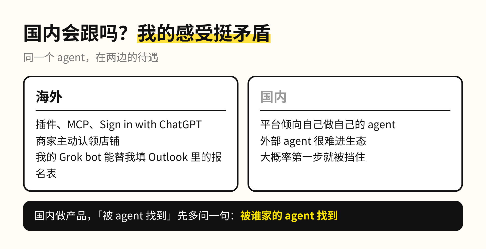
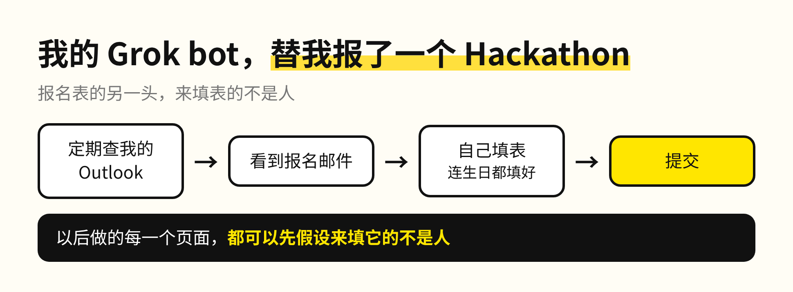

前阵子我想报名一个 Hackathon，没自己动手。Grok bot 定期去翻我的 Outlook，看到报名邮件，自己把表填完提交了，连生日都替我填好了。

那张报名表的另一头，大概没人想过来填表的不是人。a16z 合伙人 Olivia Moore 11 月 11 日和双胞胎姐妹 Justine 发了一篇长文，第一句就是：互联网的主要用户已经不是人了，是 AI agent。

a16z 是硅谷风投，上个月我写过它的创始人说 AI 差距正以周为单位拉开。她们给这件事起了个名字，叫 B2A：企业卖东西的对象，从人（B2C）变成了替人办事的 agent。文章在 X 上有 11 万多次浏览、近 500 次收藏。我把它拆成四条，后两条是框架，可以直接拿去对照自己的产品。

**1. agent 已经开始替人花钱**

文章里有个例子很有意思，是她们自己做的实验：让 ChatGPT 用 Krea、Descript、Eleven Labs 三个插件做一条视频广告。ChatGPT 在三个产品之间来回调度，做到一半，还推销她们升级了 Descript 的付费版才把视频做完。

推销付费版的是 agent，没有销售参与。过去零售商和平台一直在筑墙挡机器人，原文的判断是以后要反过来争机器人的生意。我的体会也是这样：做产品要更多地按机器人的需求去设计，因为来的越来越多是它们。

数据也在往这边走。Shopify 今年一季度来自 AI 的流量涨了 8 倍，AI 搜索带来的订单涨了将近 13 倍；AI 推荐来的访客跳出率更低，转化成收入的比例也更高。

**2. 写代码的世界，已经先走了一遍**

文章说，想看 B2A 以后什么样，看程序员就行。到今年 9 月，GitHub 上四成以上的代码合并请求，第一稿是 agent 写的，半年前这个数是 17%。

跟着涨的不只是 Cursor、Claude Code 这些写代码的 agent。agent 建一个网站，要数据库、托管、登录、发邮件，这些工具的客户也先变成了 agent：Supabase 六成以上的新数据库由 AI 工具建，Stripe 七成的命令行请求来自 agent，Vercel 由 agent 触发的部署一年涨了 28 倍。

开发者还不到全球劳动力的 1%。剩下 99% 的人也开始用 agent 的时候，每个行业的工具都会碰到同样的事：真正下单的那一位，换成了 agent。

**3. B2A 的四类机会**

文章把能吃到这波增长的公司分成四类：agent 本身，包括 ChatGPT 这种每周 12 亿人在用的产品；只有 agent 才能催生的新产品，就像没有手机就没有 Uber；为 agent 优化自己的老公司；还有 agent 的基础设施，支付、风控、身份、发消息打电话，这些在 agent 量还不大的时候已经开始吃紧。

**4. 怎么让产品和内容被 agent 找到**

这一条对普通做产品、做内容的人更实用。过去两年，大模型已经成了不少网站的流量来源，于是有了 GEO，生成式引擎优化，目的是让 AI 回答问题时提到你。文章的判断是，GEO 只管到「被找到」，agent 会继续往下走，替人比较、替人下单、替人注册，这一段的市场更大。

所以要过三道门：agent 读得懂你，信息是结构化的、能被直接抓取；agent 用得了你，有插件、接口或 MCP 让它直接调用，不用像人一样在网页上点来点去；agent 付得了钱，注册和支付不会被风控当成机器人拦掉。OpenAI 前一天刚上线的 Businesses in ChatGPT，让商家认领自己的店、上传商品信息，做的就是第一道门。

说到国内，我的感受挺矛盾的。原文认为企业迟早要拥抱 agent 流量，但国内平台更倾向于自己做自己的 agent，外部 agent 很难进去。我那个 Grok bot 能替我填 Outlook 里的报名表，换到国内的平台，大概率第一步就被挡住。

我的判断是，接下来做产品和内容，要把 agent 当成一类用户来设计。以前防机器人的那套入口，要按机器人的需求重新做一遍：信息给它读，接口给它用，付款给它走通，人只在最后点一下确认。

那张 Hackathon 报名表最后是我的 bot 填完的。以后你做的每一个页面，都可以先假设，来填它的不是人。
