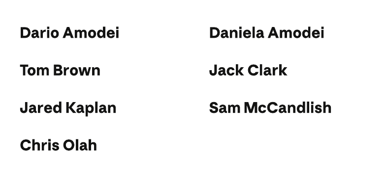
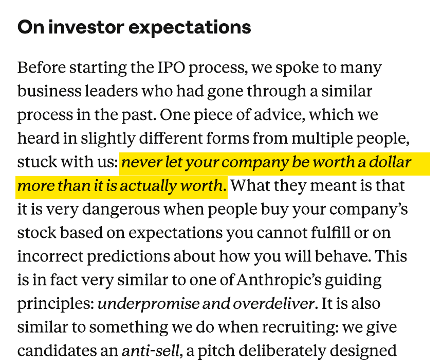
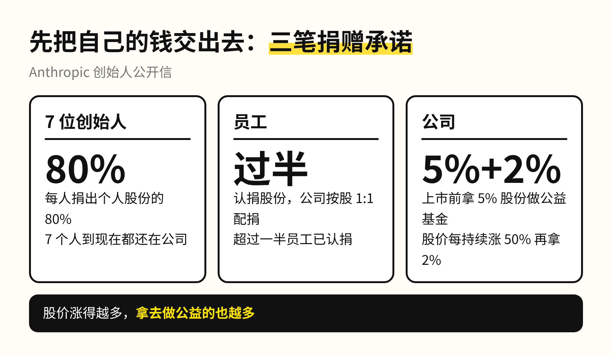
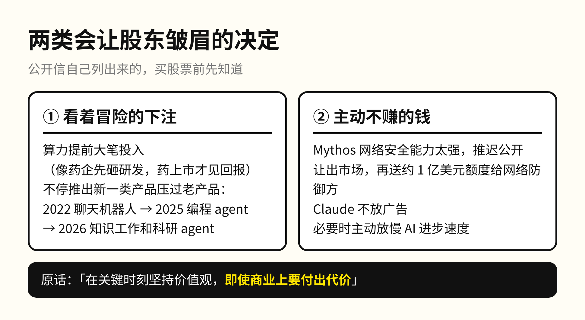
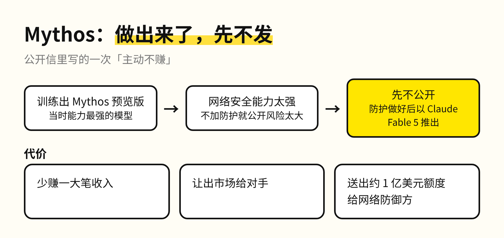
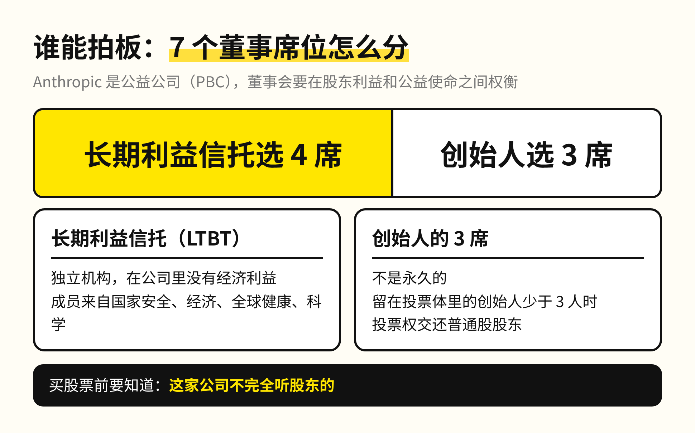
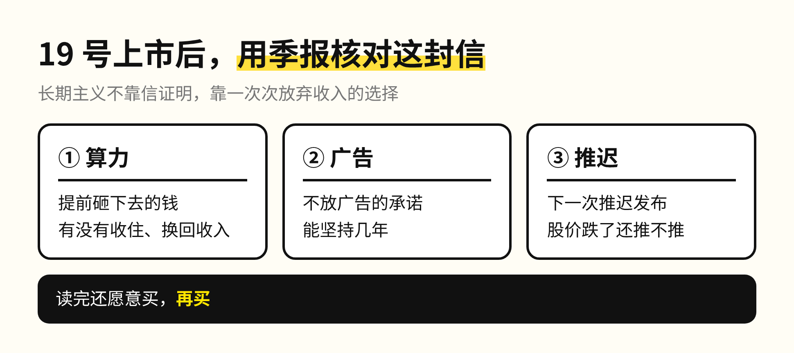

这两周很多人在吵 Anthropic 的价值观。导火索是一件旧事：为了训练模型，它买来几百万本纸质书，拆开扫描，扫完就销毁，被网友说成「烧书」。

拿一件事给一家公司定性，我觉得太早了。11 月 19 日 Anthropic 就要上市，7 位联合创始人在招股书里附了一封写给未来股东的公开信，比吵架更值得花十分钟读一读，尤其是手里有股票的人。

信里有一句话很反常，是他们上市前从好几位过来人那里听到的建议：别让你的公司比它实际的价值多值哪怕一美元。买你股票的人如果冲着你做不到的预期来，迟早会出事，所以他们宁可少承诺、多兑现。

一封上市前写给股东的信，用了大段篇幅讲「哪些时候我们不会按赚钱最多的方式做」。我把它拆成三件事。

**1. 七个创始人，先把自己的股份交出去一大半**

7 位联合创始人到现在都还在公司，每人承诺把个人股份的 80% 捐给公益。员工入职时可以认捐股份，公司按一股配一股，已经有超过一半的员工认捐。上市前，公司再拿出 5% 的股份成立公益基金；股价每持续涨 50%，董事会可以再拿出 2%。

换句话说，股价涨得越多，拿去做公益的也越多。信里也提前回应了担心股份被稀释的投资者：这个规模，跟一些上市公司给高管的薪酬包差不多。

**2. 两类会让股东皱眉的决定**

信里主动列了两类。第一类是看上去很冒险的下注：算力提前大笔投入，他们自己承认第一眼看会觉得不负责任，打的比方是药企，研发先砸钱，回报要等药上市才看得到。他们还会不停推出新一类产品去压过老产品，2022 年聊天机器人变得可行，2025 年写代码的 agent 变得可行，2026 年做知识工作和科研的 agent 正在变得可行。

第二类是主动不赚的钱。他们训练出 Mythos 预览版时，判断它的网络安全能力强到不加新的防护就公开发布风险太大，于是推迟了，等防护做好才以 Claude Fable 5 的名字推出。这一推迟少赚了一大笔收入、让出了市场，还送了大约 1 亿美元的额度给做网络防御的人。

Claude 也承诺不放广告，理由是用户带来的是最重要的工作和最私人的问题，他们希望 Claude 只为给出有用的回答。必要的时候，他们还会主动放慢 AI 进步的速度，哪怕在竞争里吃亏。

我自己也在一个前沿行业。越是新的赛道，越容易出现恶性竞争和合规上的乱象；真坐到头部公司做决定的位置，要放弃眼前的一笔收入，是很难下的决心。所以 Mythos 推迟发布这件事，在我看来比信里任何一句愿景都有分量。

**3. 谁能拍板：这家公司不完全听股东的**

Anthropic 是一家公益公司，董事会要在股东利益和公益使命之间权衡。7 个董事席位里，独立的长期利益信托选 4 席，创始人选 3 席。买到股票的人，话语权没有一家普通科技公司那么多。

我希望他们是真的做到长期主义。但长期主义不靠一封信证明，信里每一条，上市后都会被一份份季报检验。对手里有股票的人，这封信的价值是提前告诉你：这家公司在哪些时候不会按你想要的方式赚钱。读完还愿意买，再买。烧书那件事值得批评，但给一家公司下结论，我更愿意再看几份财报。

