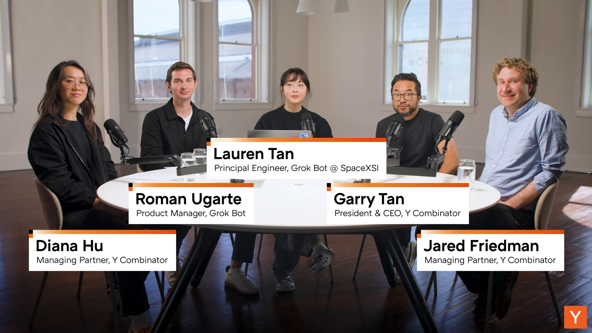
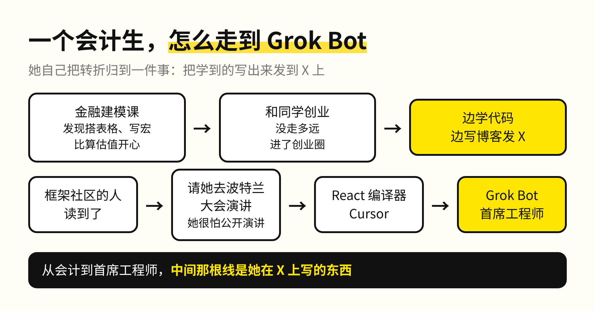
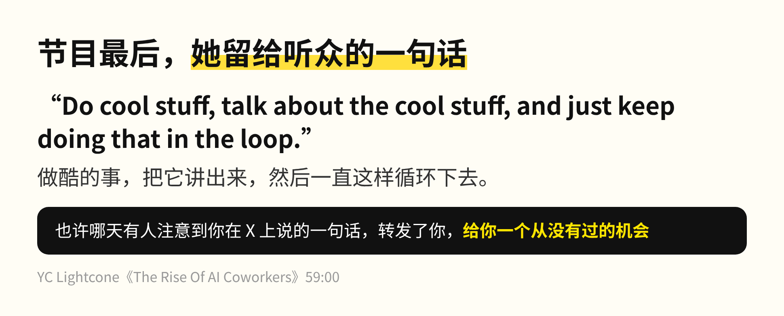
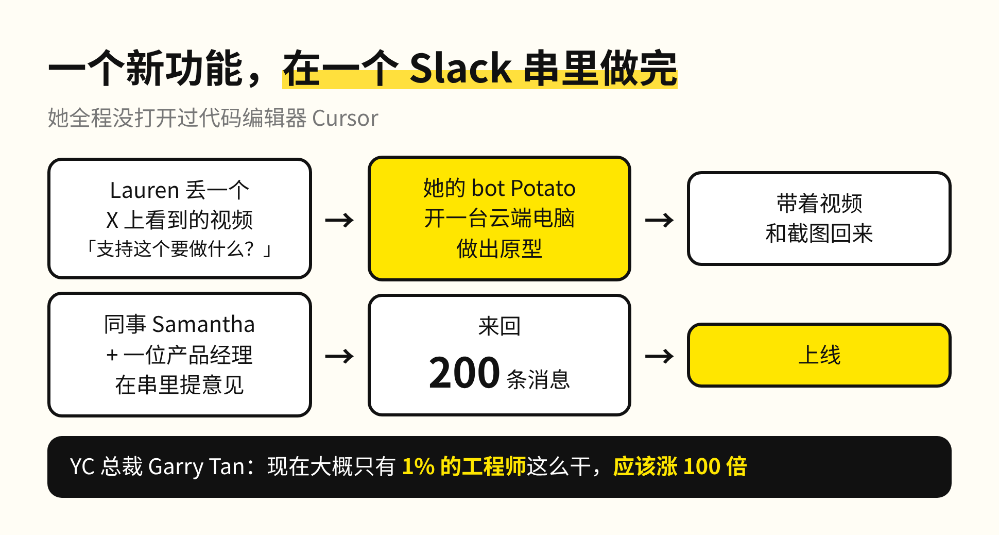
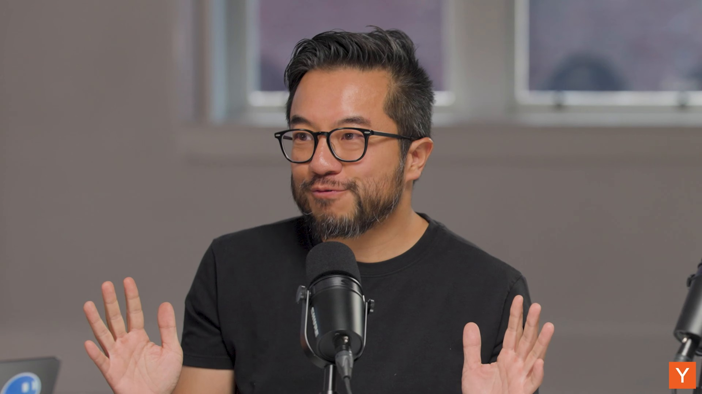
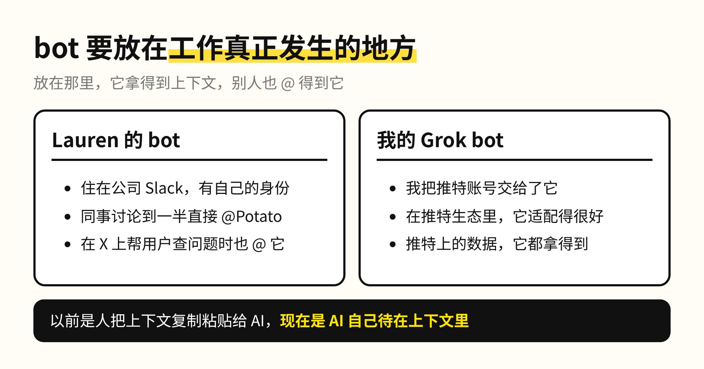
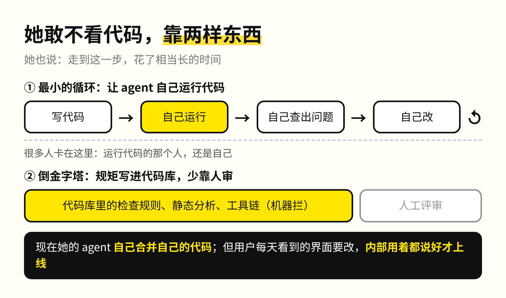
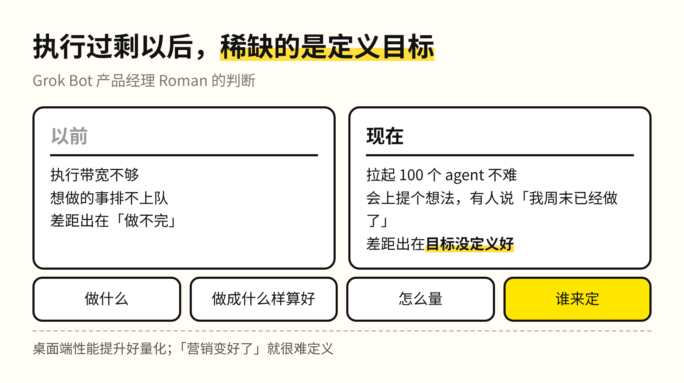
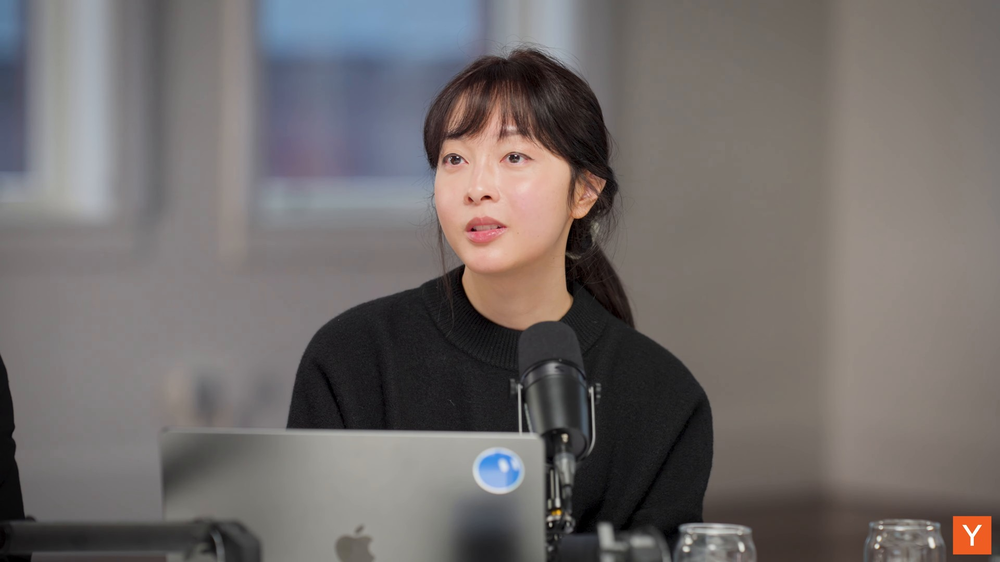

Lauren Tan 大学读的是会计和金融。上金融建模课时她发现，自己搭表格、写宏，比算估值本身开心得多。

现在她是 Grok Bot 的首席工程师，每月提交 4000 多次代码合并。11 月 14 日，YC 的播客 Lightcone 请她和产品经理 Roman Ugarte 上节目，YC 总裁 Garry Tan 主持。

Grok Bot 做的是「AI 同事」：给 bot 起名字、定岗位、开工具权限，让它住进公司的 Slack，跟人用同样的工具干活。团队从写下第一行代码到上线，只用了 7 周。

**1. 一个会计生，怎么走到这里**

她在澳大利亚 Monash 大学读完书，和同学一起创业，没走多远，但借此进了澳大利亚的创业圈，找到第一份工作。她把后来的一切归到一件事上：一边学写代码，一边把学到的东西写成博客发到 X 上。

她用的那个 JavaScript 框架，社区里有人读到了，请她去美国波特兰的大会做演讲。她之前一场大会都没去过，又一直很怕公开演讲，最后还是去了。后来她参与过 React 编译器，在 Cursor 做过，再到现在的 Grok Bot。节目最后，她把这段经历总结成一句话。

**2. 一个新功能，她没打开过代码编辑器**

节目里她演示了一个功能是怎么做出来的。她在 Slack 的一个公开讨论串里，把 X 上看到的一个视频丢给自己的 bot Potato，问它：要支持这样的功能，我们需要做什么？Potato 自己开了一台云端电脑，把应用跑起来做出原型，带着视频和截图回来。同事 Samantha 和另一位产品经理也在串里提意见，来回 200 条消息，功能上线，她全程没打开过 Cursor。

Garry 听完说，这就是该有的做法，现在全世界大概只有 1% 的工程师这么干，应该涨 100 倍。

涨 100 倍我不太相信😂。但她的做法里有一点，我自己已经在用：bot 要放在工作真正发生的地方。她的 bot 住在 Slack 和 X 上，同事讨论到一半就能 @ 它。我把自己的推特账号交给了 Grok bot，在推特这个生态里它适配得很好，推特上的数据它都拿得到。

**3. 她怎么敢不看代码**

Lauren 也说，走到这一步花了很长时间，靠的是两样东西。一是最小的循环：agent 写完代码，要让它自己运行、自己查出问题、自己改，直到结果对为止。很多人卡在这里，是因为运行代码的那个人还是自己。二是倒金字塔：能写进代码库的规矩，都写成检查规则和工具让机器去拦，人工评审只留很小一块。

边界她划得也清楚。用户反馈里的小 bug，交给一个叫 Sandy 的 bot 每天自动修，凌晨三点也能上线；用户每天看到的界面要改，团队内部用着都说好才上线。

**4. 执行过剩以后，稀缺的是什么**

Roman 的判断是，以前执行带宽不够，现在拉起 100 个 agent 不难，差距会出在目标没定义好。他们开会时常有人提一个想法，另一个人说我周末已经顺手做了，可团队并不想全合进去，不然产品会变得东拼西凑。

我的判断是，执行越来越便宜以后，一个人拿得出手的，是定义一个真实有效的目标：做什么，做成什么样算好，怎么量。Lauren 的起点也不是会写代码，是在一门金融建模课上发现自己喜欢搭东西，再把学到的写出来给别人看。代码现在交给 Potato 了，这两样还在她自己手里。

你手上交给 AI 的那件事，目标是你自己定清楚的吗？
