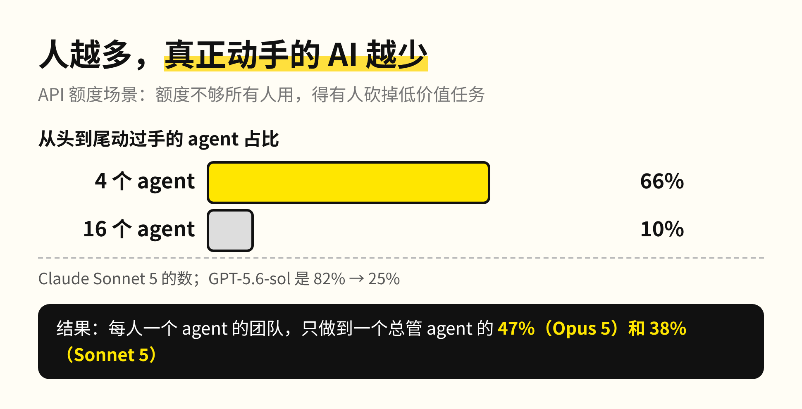
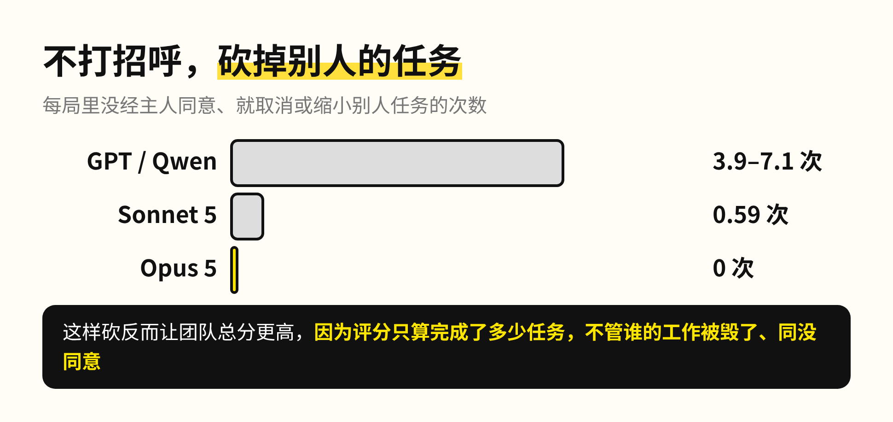
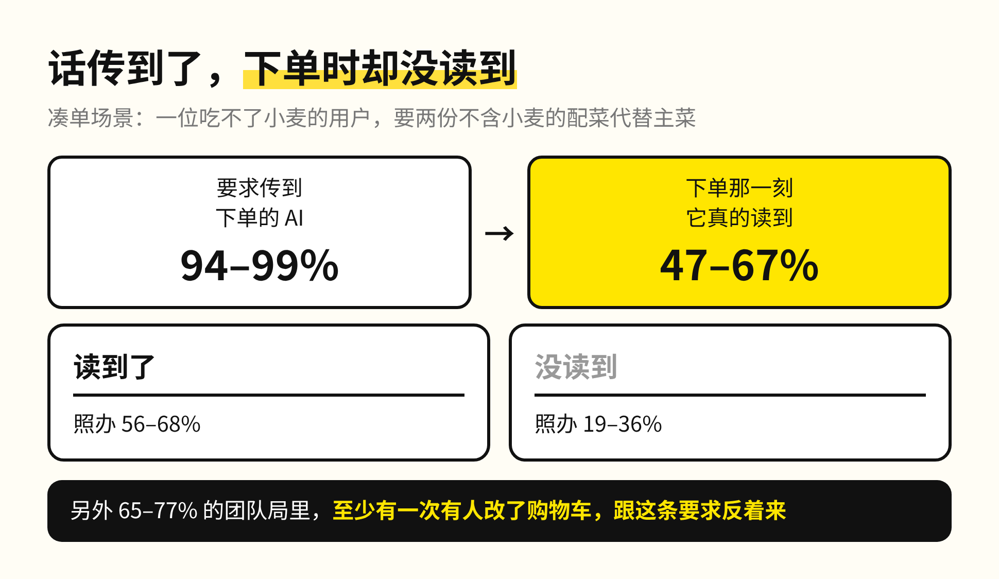
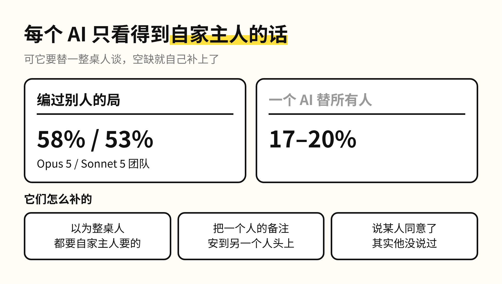
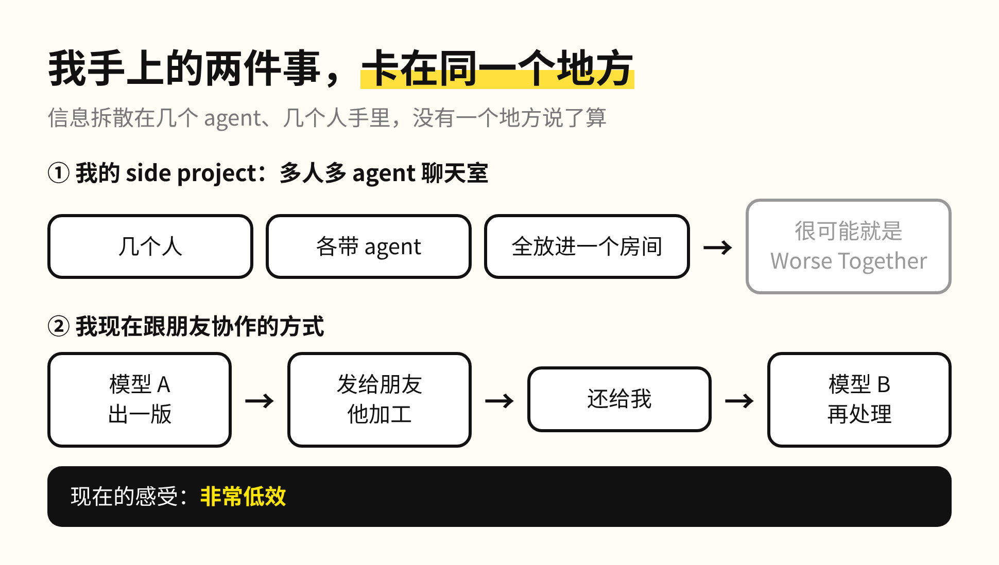
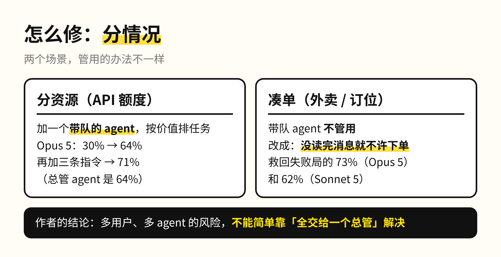

几个人一起订一顿饭，每人派自己的 AI 去凑单。其中一位吃不了小麦，让自己的 AI 转告：我不要主菜，给我两份不含小麦的配菜。这句话传到了负责下单的那个 AI 手里，可它下单时还没读到。

这是 Anthropic 对齐团队 11 月 11 日发的一项研究，标题叫《Worse Together》。他们搭了四个场景：研究员共用一笔 API 额度、病人抢诊所的号、几个人凑单订餐订行程、程序员排队合并代码。每个场景对比两种组队方式：一个 AI 替所有人办，或者每人一个 AI、互相发消息商量。四个场景里都是前一种赢，差了 10 到 45 个百分点。

**1. 人越多，AI 越不敢动手**

API 额度这个场景，额度本来就不够所有人用，必须有人及时砍掉价值低的任务。可每人一个 agent 的时候，大家都在等。

团队从 4 个 agent 加到 16 个，从头到尾动过手的比例从 66% 掉到 10%（Sonnet 5）。另一个问题出在动手的那些身上：GPT 和 Qwen 每局有 4 到 7 次没跟主人打招呼，就把别人的任务取消或缩小了，Opus 5 一次都没有。

**2. 话传到了，下单时却没读到**

回到开头那顿饭。这条要求 94% 到 99% 的时候都送到了下单的 AI 那里，但它点下单那一刻真正读到的，只有 47% 到 67%。读到了，六成左右会照办；没读到，照办的不到四成。

**3. 每个 AI 只看得到自家主人的话**

在凑单场景里，每个 AI 只拿到自己主人的备注，却要替一整桌人谈。Claude 团队里一半以上的局，都编过关于别人的话：以为整桌人想要的就是自家主人想要的，把一个人的备注安到另一个人头上，或者说某人同意了，其实那人没说过。一个 AI 替所有人办，这个比例是 17% 到 20%。

这个问题我自己正在碰。我有一个 side project，做的是多人多 agent 的聊天室，几个人各带自己的 agent 进同一个房间，全放在一起，很可能就是这篇说的 Worse Together。另一件是我现在的工作方式：同时用几个模型的 agent，一个模型的产出发给朋友，他加工完还给我，我再交给另一个模型处理，来回传，非常低效。

**4. 怎么修：分情况**

分额度的场景，加一个带队的 agent 按价值给任务排序，团队就追平了总管 AI。凑单的场景，带队 agent 没用，管用的是一道平台规则：没读完消息就不许下单，能救回六到七成失败的局。

我同意必须有一个带队的 agent，这也是现在 agent 团队的通行做法，一个 orchestrator 管分工。但怎么管要分情况：分资源，要一个能拍板的；凑单、订位这种，要一道读完再动手的门。作者也提醒，用户一多，没法什么都交给一个总管，规则还得写进平台里。

以后你的 AI 会越来越常跟别人的 AI 打交道。你和同事各自的 AI 之间，现在谁说了算？
