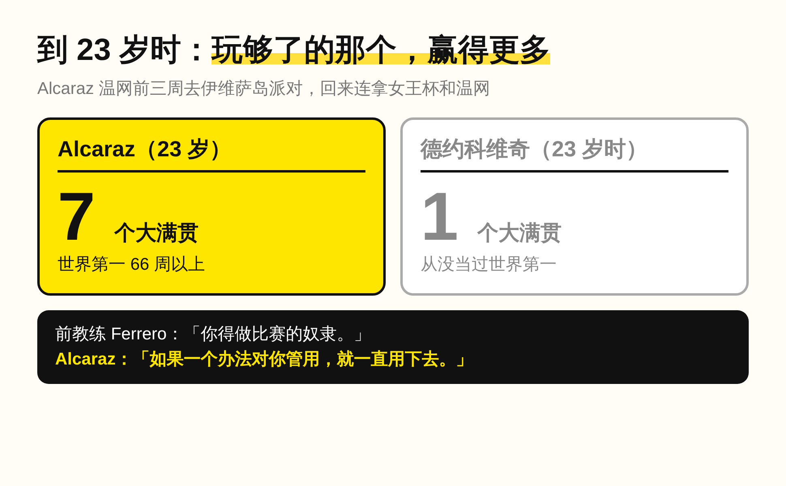
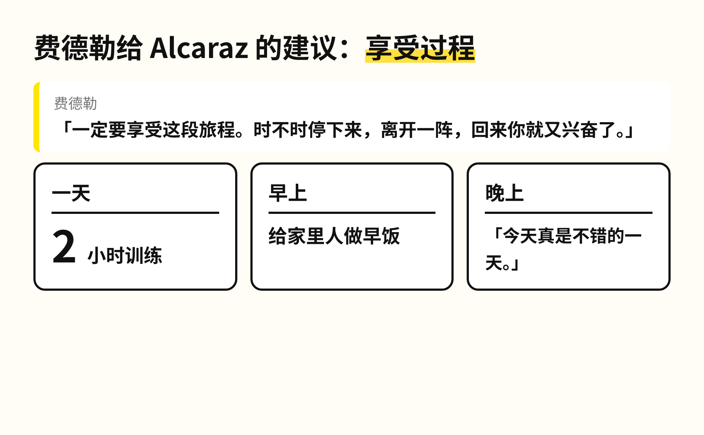
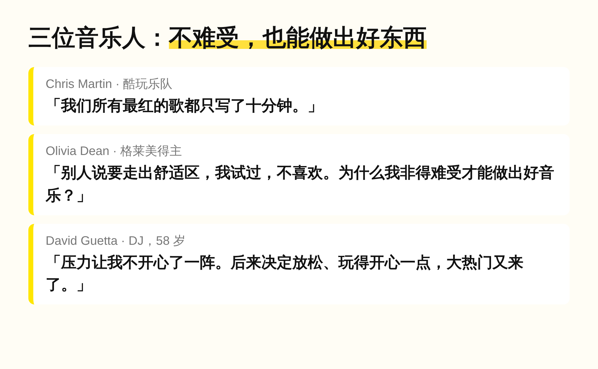
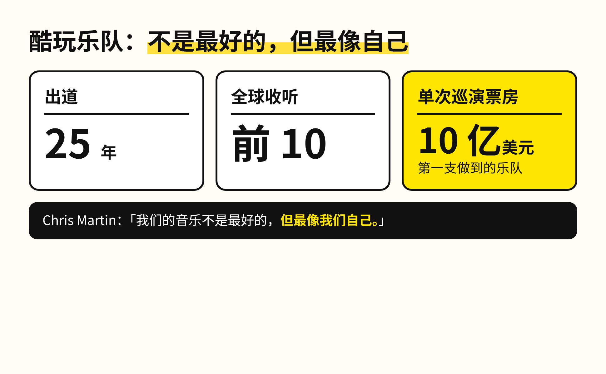
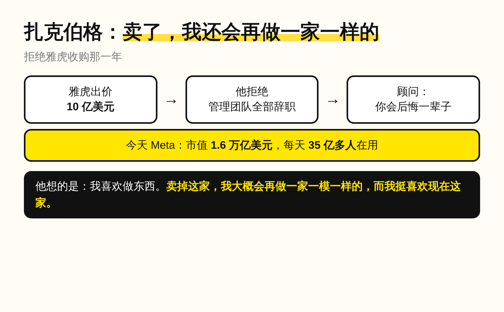
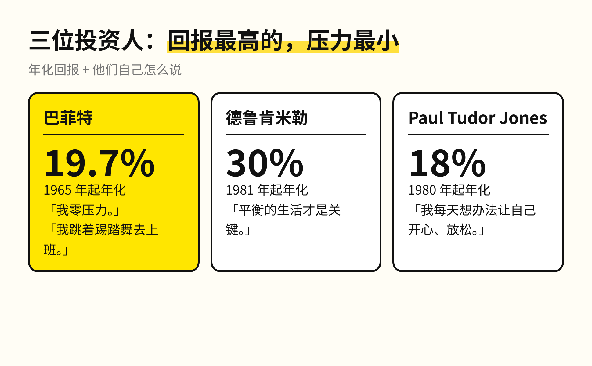
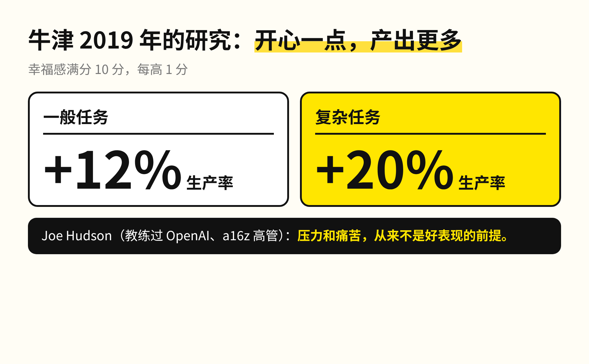
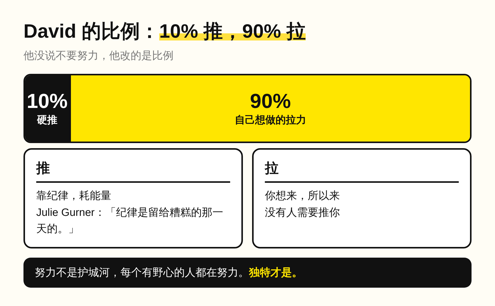
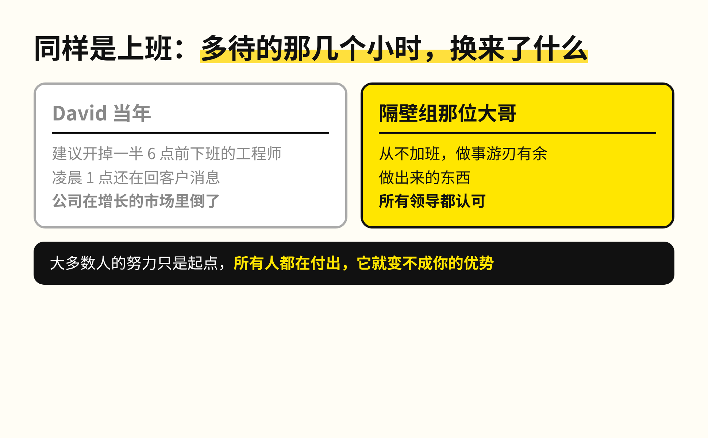
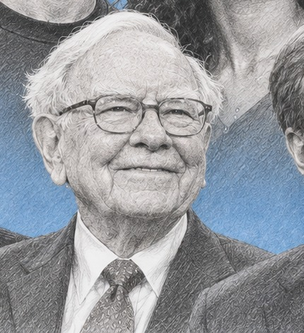

以前公司隔壁组有位大哥，从不加班，每天做事都游刃有余，做出来的东西却是所有领导都认可的那一份。

前几天读到一篇长文，作者 David 当年正好站在大哥的对面：在一家创业公司，他建议创始人开掉一半的工程师，理由是他们每天 6 点前就下班了。公司后来还是倒了，哪怕市场在增长、人人都很拼。

David 28 岁成了欧洲最年轻的 VC 合伙人之一，基金做进了欧洲前 1%，现在自己出来创业。回头看，最好的那些工作恰恰不是在最用力的时候做出来的，所以他找了九个人对照：费德勒、巴菲特、扎克伯格、酷玩乐队的 Chris Martin，还有网球、音乐、投资圈各几位。文章标题就一句话，Working Hard Is Overrated，努力被高估了。

我把这九个人归成四条。

1. 网球：温网前三周，去伊维萨岛开派对

西班牙网球选手 Carlos Alcaraz 今年 23 岁。2023 年，他和当时的教练 Ferrero 起了冲突。教练的原话是「你得做比赛的奴隶」，还拿德约科维奇比：人家牺牲得比你多。

Alcaraz 的回应是温网开打前三周飞去伊维萨岛，痛痛快快玩了四天。回来以后，他连拿女王杯和温网。第二年变本加厉，赛前两周去玩了六天，女王杯输了，温网照样拿下。

后来两人分道扬镳。到 23 岁，德约科维奇手里只有 1 个大满贯，从没当过世界第一；Alcaraz 已经拿了 7 个，当了 66 周以上的世界第一。

Alcaraz 也问过费德勒，怎么保持这么多年的动力。回答是一定要享受过程，时不时离开一阵，回来就又兴奋了。费德勒自己有好多年一天只练 2 小时，早上给家里人做早饭，晚上躺下会想：今天真是不错的一天。

2. 音乐：最红的歌，十分钟写完

Chris Martin 在柯南的播客里说，酷玩所有最红的歌都只写了十分钟。当然，那些没红的歌也花了好几个小时，但那一首来的时候，人只是接住它。这跟前阵子那篇心流专家讲的是同一种状态，因为人沉在里面，所以不觉得费力。

这支乐队出道 25 年，现在仍是全球收听量前十的艺人，也是第一支单次巡演票房过 10 亿美元的乐队。Chris Martin 很早就承认自己唱得不是最好，吉他不是最好，跳舞永远跳不过 Tina Turner，但可以把东西做得「怪怪的很像我自己」。

拿过格莱美的 Olivia Dean 说得更直接：别人都劝你走出舒适区，我试过，不喜欢。为什么非得难受才能做出好音乐？DJ 出身的 David Guetta 也经历过一段。2012 年专辑大火以后，压力突然上来，人不开心了一阵。后来决定放松一点、玩得开心一点，大热门反而又接着来了。

3. 扎克伯格：拒绝雅虎 10 亿美元以后

扎克伯格拒绝雅虎 10 亿美元收购的时候，整个管理团队辞职了，一位顾问对他说，你会后悔一辈子。

当时的考虑很简单：卖掉以后我要做什么？我喜欢做东西，喜欢帮人沟通和表达。卖了这家，我大概会再做一家一模一样的公司，而我挺喜欢现在这家的，那为什么要卖？

今天 Meta 市值 1.6 万亿美元，每天有 35 亿多人在用，地球上每十个人里有四个。扎克伯格到现在还尽量每天早上先训练，练柔术、冲浪、击剑，还在夏威夷养和牛。

4. 投资：年化 19.7% 的人，跳着舞去上班

巴菲特从 1965 年起年化回报 19.7%，自称「零压力」，最开心的时候是坐着看橄榄球，每天「跳着踢踏舞去上班」。德鲁肯米勒 1981 年起年化 30%，说法是平衡的生活才是关键。

这不只是名人的个例。牛津大学 2019 年的一项研究发现，幸福感满分 10 分，每高 1 分，生产率就高 12%。任务越复杂，差距越大，能到 20%。

教练过 OpenAI、a16z 高管的 Joe Hudson 说，越不害怕的人越成功，压力和痛苦从来不是好表现的前提。

说回 David。这篇文章并没有走到另一头，David 仍然相信努力，只是换了一个比例：10% 的时间要硬推，剩下 90% 得是自己想做的拉力，没有人推你也会去。

David 还有一句话：努力不是护城河，我认识的每个有野心的人都在努力，独特才是。这句话放在今天更成立，因为大多数人的努力只是一个起点，所有人都在付出，它就变不成你的优势。AI 把执行的成本越压越低以后，多熬几个小时换来的差距只会更小，能拉开距离的是用自己的方式把事情做成。隔壁组那位大哥，从来没有比别人多待一个小时。

如果你也常在晚上九点还坐在工位上，手上的事两小时前就推不动了，可以先问自己一句：今天这几个小时，属于那 10% 的推，还是只是没走？

David 的结尾借了巴菲特：把事情做得像你自己，96 岁也能跳着舞去上班。

