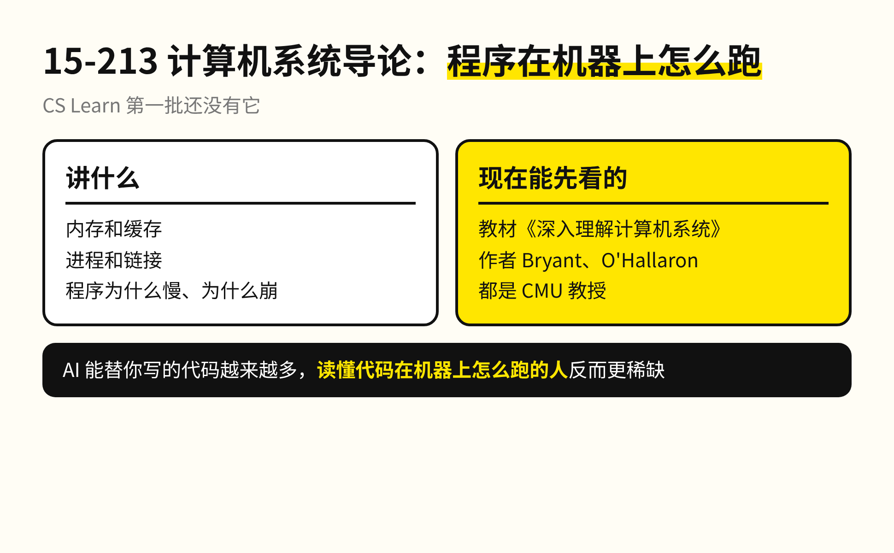
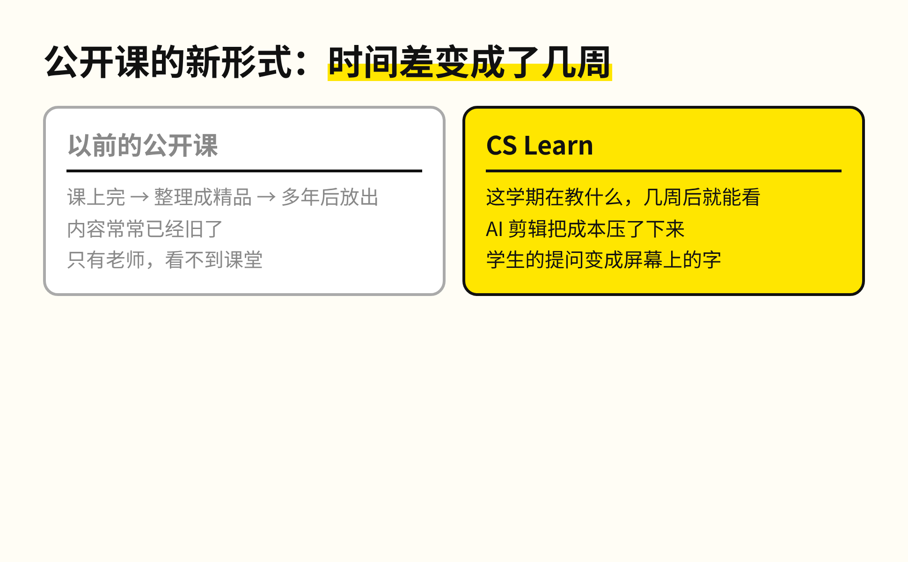
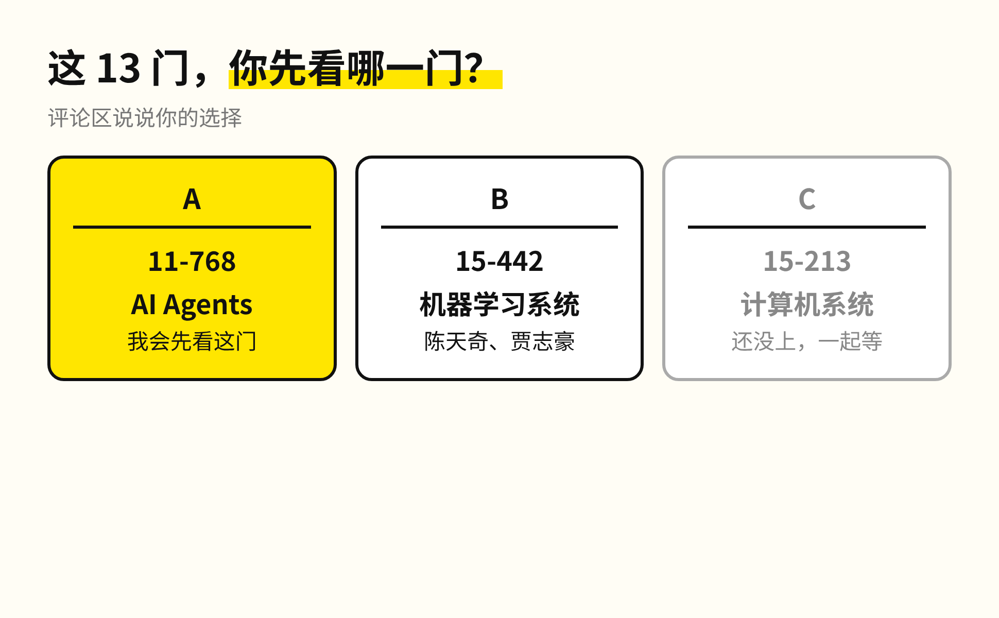

CMU 计算机系最有名的一门课，课号和学校所在地的邮编是同一串数字：15213。

在 CMU 读过书的人都知道这门课，它是入门课，也是王牌课，一门课代表一座城市。11 月 16 日，CMU 计算机学院上线了 CS Learn，开始把自家课堂的录像免费放到 YouTube 上。

学院这次放出来的，是正在上的课。按官方的说法，这些课在别的地方「几乎没人教」，他们准备免费放出来，让从来没有机会来 CMU 的人也能听到。

1. 录像早就有，这次是 AI 把它剪出来了

这些课本来就有人在录，学院软件与社会系统系有一个摄制团队，专门录最受欢迎的几门课，只是以前只有校内能看。

把录像变成公开课的，是学生组织 ScottyLabs。他们做了一套 AI 辅助的剪辑系统：画面只留老师和幻灯片，学生的脸自动打码；学生提问时声音剪掉，问题变成屏幕上的一行字。

==这样一来，这学期 CMU 学生在学什么，几周后网上就能看到==，连课堂上谁问了什么问题都留着。

这个点子最早来自计算机教育创新副院长 Phillip Compeau。他在 CMU 商学院读 MBA 时，在一门课上提了这个想法，目标是让学院的课走出匹兹堡，同学们的反应很热烈。所以 CS Learn 从提出到上线，一直是 CMU 自己人在做：老师讲，摄制团队录，学生写剪辑系统。

2. 第一批有 13 门，11 月先上 8 门

11 月上线 8 门：大数据机器学习、计算原理、软件构建、机器学习系统、软件架构、质量管理、AI Agents、生产环境中的机器学习。明年 1 月再上 5 门，包括概率与计算、多模态机器学习、产品管理基础。

讲机器学习系统的是陈天奇和贾志豪。陈天奇做过 XGBoost 和 TVM，很多人天天在用他写的工具，却没见过他站在讲台上是什么样子。

3. 我会先看 AI Agents

这门课 11 月 19 日开播，老师是 Daniel Fried 和 Graham Neubig。Neubig 也是开源编程 agent OpenHands 背后的人，这门课等于是做 agent 的人在讲 agent 怎么做。

现在讲 agent 的内容很多，大部分是工具教程和发布会。==能听做 agent 的人从头讲一整个学期==，这样的机会不多。

4. 我最想等的 15-213，这一批还没有

开头说的 15-213，全名《计算机系统导论》，讲程序在机器上到底怎么跑：内存、缓存、进程、链接。名单里暂时还没有它（这门课的实验作业在 CMU 是出了名的难熬），我最希望下一批有它。

等不及的可以先看它的教材《深入理解计算机系统》，两位作者 Bryant 和 O'Hallaron 都是 CMU 的教授，这本书就是从这门课里长出来的。AI 能替你写的代码越来越多，代码为什么慢、为什么崩，还得懂这一层的人来看。

后面还有两步：一套带即时反馈的自学课件，做完题能拿徽章；再往后，课件里会接上 AI 辅导，卡住的时候可以直接问。

免费的名校公开课早就有了，MIT 的公开课放了二十多年。CS Learn 不一样的地方在时间：以前的公开课是课上完、整理好、过很多年才放出来，内容常常已经旧了。==现在这学期在教什么，几周后全世界都能看到==，课堂上学生问了什么也在。这是 AI 时代公开课的新形式，剪辑的成本被 AI 压下来以后，学校才敢把正在上的课直接放出来。

如果你的收藏夹里也躺着好几门名校公开课，每门都只看了第一集，这次可以换个看法：不用从头补完一门旧课，挑一门这学期正在讲的，跟着它的进度一周看一两节。因为课是新的，你看到的也是这学期最新的内容，掉队了也只差几周。

这 13 门里，你最想先看哪一门？我会先看 AI Agents，然后接着等 15-213。想要课程链接的，评论区说一声。

