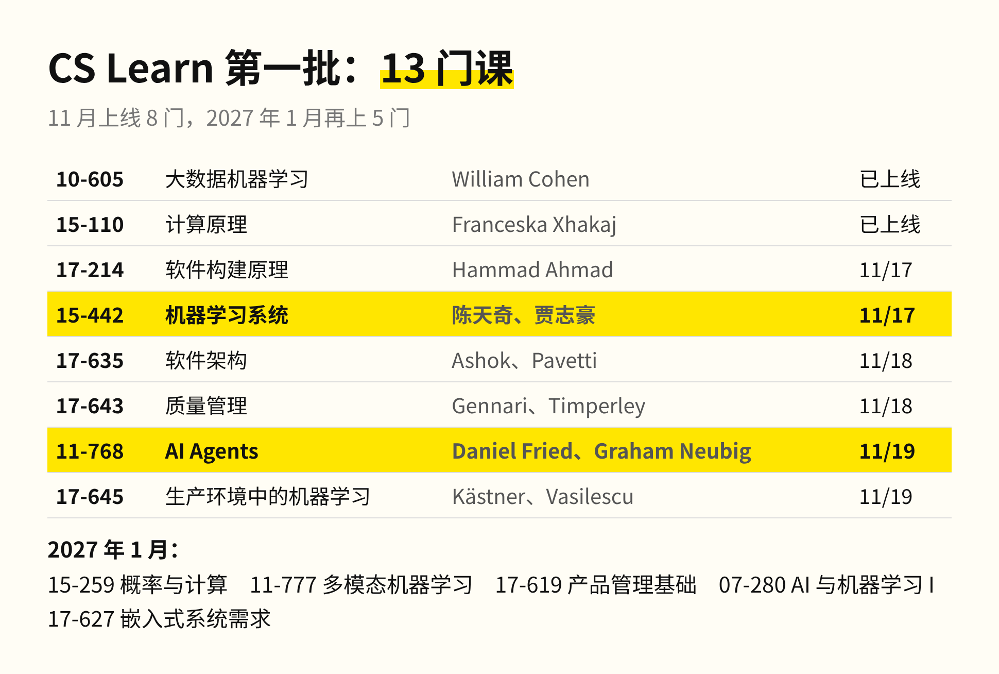
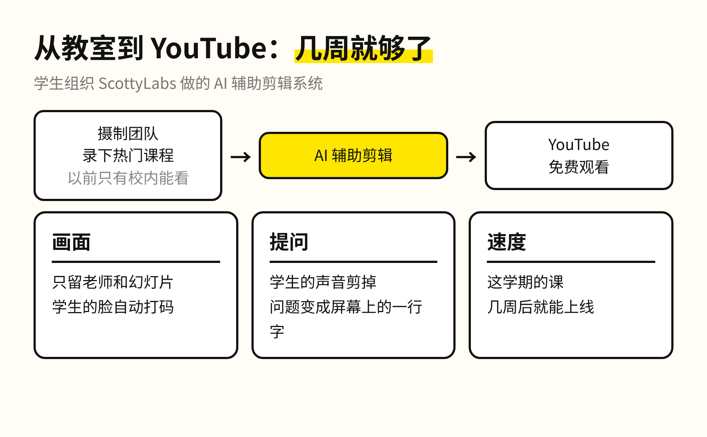
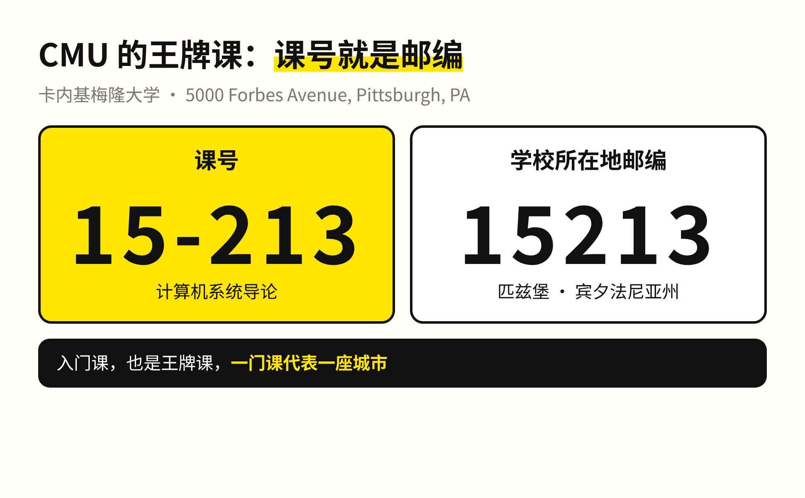
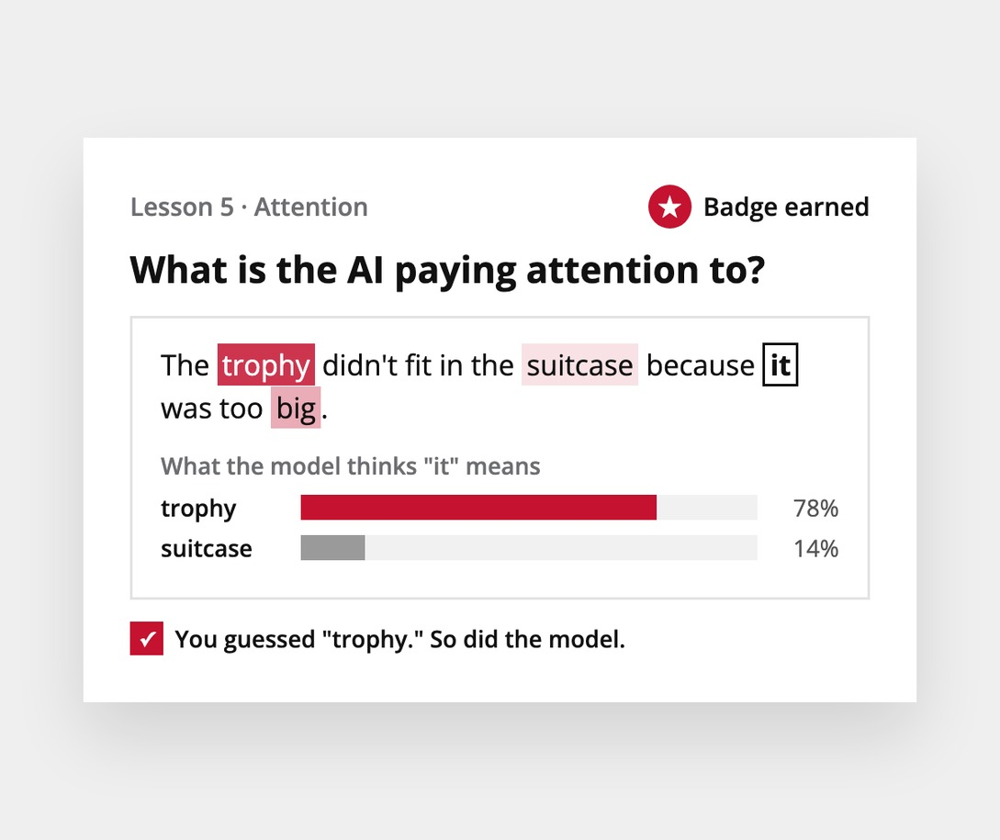

我在 CMU 上过一门课，课号 15-213，跟匹兹堡的邮编一模一样。

当年想坐进那间教室，得先考进 CMU。11 月 16 日，CMU 把这学期正在上的课免费放上了 YouTube，几周就上线，连课堂上学生的提问都留着。我把第一批 13 门课从头翻到尾，偏偏没找到 15-213。

名校公开课以前也有，但多数是课上完、整理好，隔一两年甚至更久才放出来，等你看到时内容常常已经旧了。==CMU 这次放的是正在上的课==，这学期教什么，几周后全世界都能看。

1. 第一批 13 门，11 月先上 8 门

11 月上线的 8 门：大数据机器学习、计算原理、软件构建、机器学习系统、软件架构、质量管理、AI Agents、生产环境中的机器学习。明年 1 月再上 5 门，包括概率与计算、多模态机器学习、产品管理基础。

讲机器学习系统的是陈天奇和贾志豪。陈天奇做过 XGBoost 和 TVM，很多人天天在用他写的工具，却没见过他站在讲台上是什么样子。

2. 我会先看 AI Agents

这门课 11 月 19 日开播，老师是 Daniel Fried 和 Graham Neubig。Neubig 也是开源编程 agent OpenHands 背后的人，这门课等于是做 agent 的人在讲 agent 怎么做。

现在讲 agent 的内容很多，大部分是工具教程和发布会。==能听做 agent 的人从头讲一整个学期==，这样的机会不多。

3. 为什么能这么快：AI 剪辑

这些课本来就有人在录，学院有一个摄制团队专门录最受欢迎的几门课，只是以前只有校内能看。把录像变成公开课的，是学生组织 ScottyLabs 写的一套 AI 辅助剪辑系统：画面只留老师和幻灯片，学生的脸自动打码；学生提问时声音剪掉，问题变成屏幕上的一行字。

剪辑的成本被 AI 压下来，学校才敢把正在上的课直接放出来。这是 AI 时代公开课的新形式。这个点子最早来自计算机教育创新副院长 Phillip Compeau，他在 CMU 商学院读 MBA 时在课上提了出来，从提出到上线，一直是 CMU 自己人在做。

4. 我上过的 15-213，这一批还没有

15-213 全名《计算机系统导论》，讲程序在机器上到底怎么跑：内存、缓存、进程、链接。在 CMU，它是入门课，也是王牌课，一门课代表一座城市。

名单里暂时还没有它，我最希望下一批有它。等不及的可以先看它的教材《深入理解计算机系统》，两位作者 Bryant 和 O'Hallaron 都是 CMU 的教授，这本书就是从这门课里长出来的。AI 能替你写的代码越来越多，代码为什么慢、为什么崩，还得懂这一层的人来看。

后面还有两步：一套带即时反馈的自学课件，做完题能拿徽章；再往后，课件里会接上 AI 辅导，卡住的时候可以直接问。

如果你的收藏夹里也躺着好几门名校公开课，每门都只看了第一集，这次可以换个看法：挑一门这学期正在讲的，跟着它的进度一周看一两节。因为课是新的，掉队了也只差几周。

这 13 门里，你最想先看哪一门？我会先看 AI Agents，然后接着等 15-213。想要课程链接的，评论区说一声。

