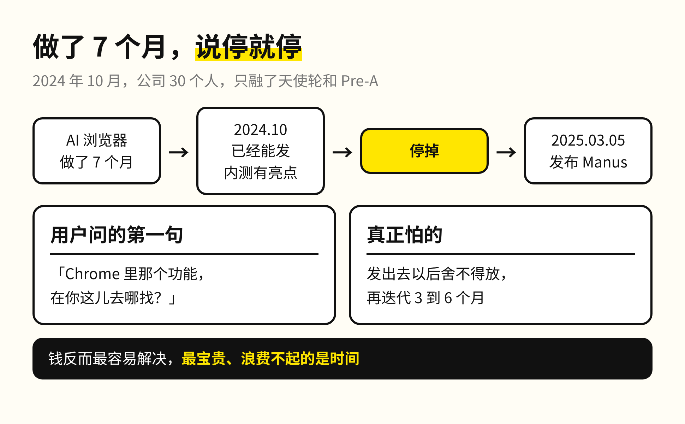
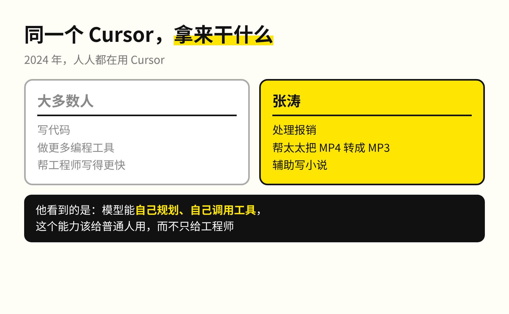
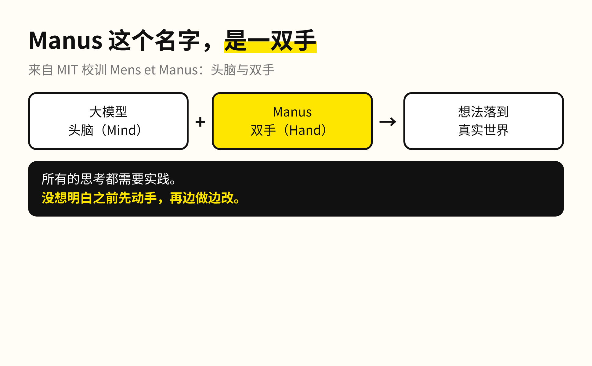
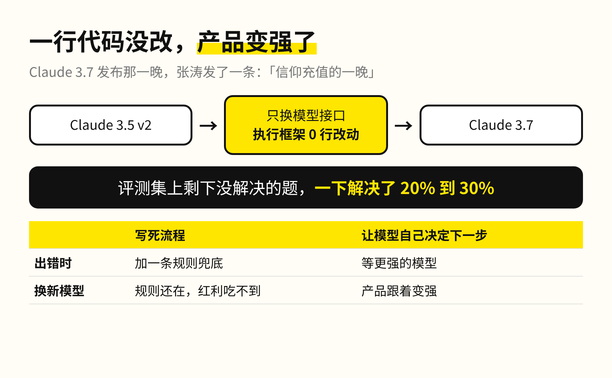
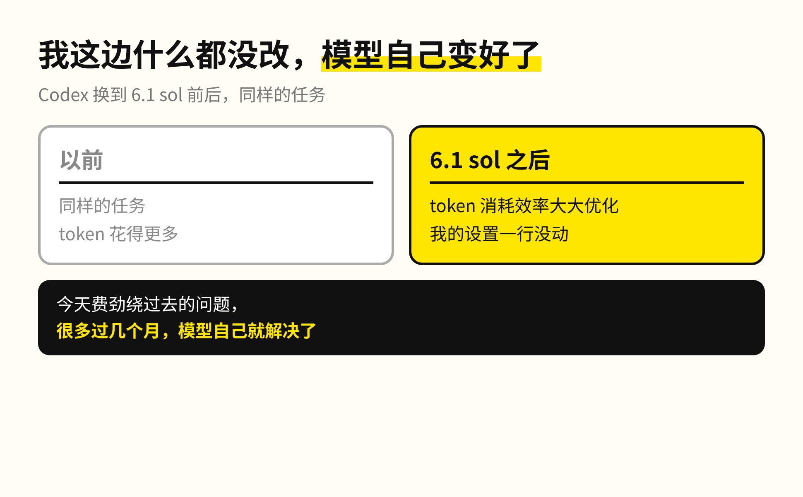
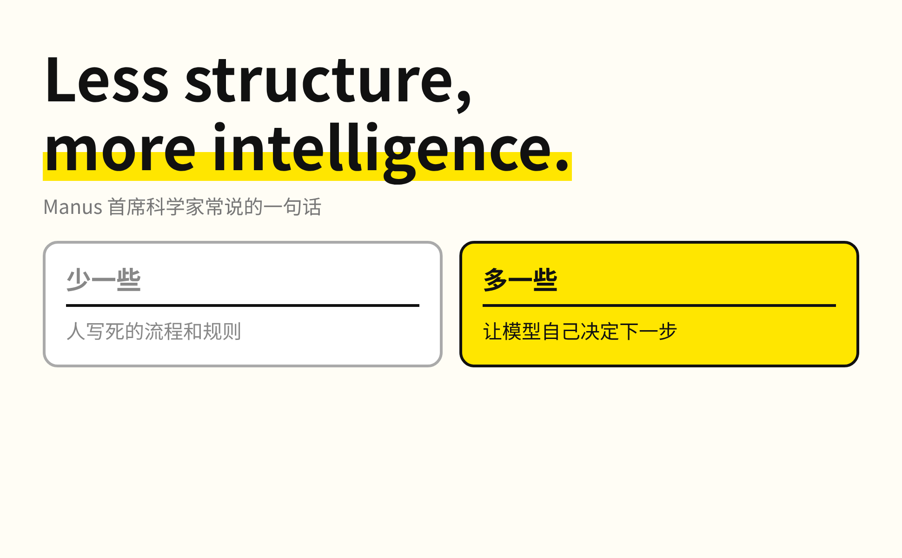
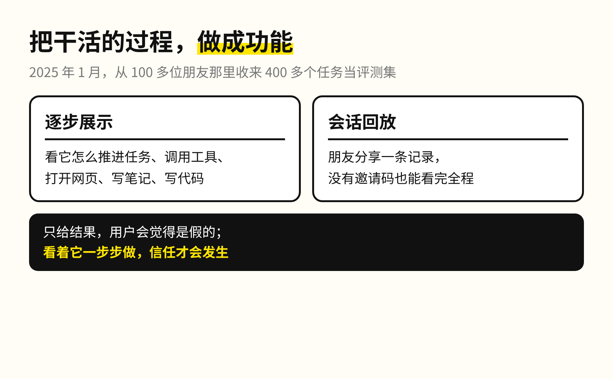
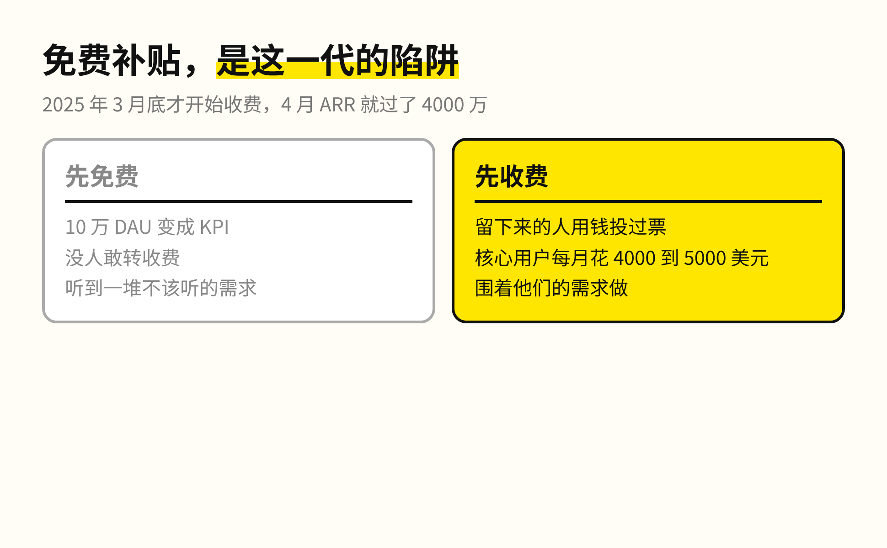
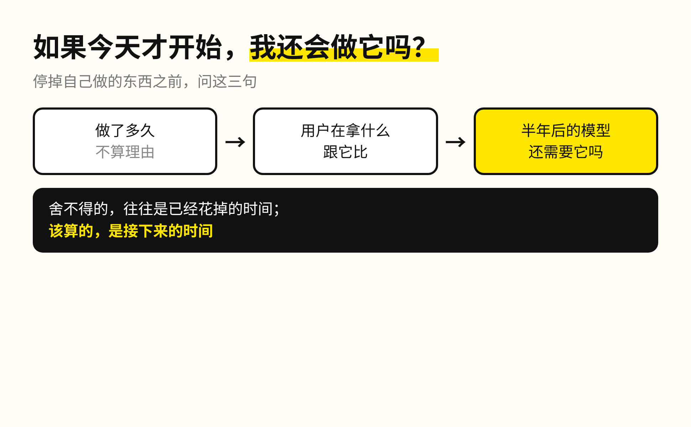
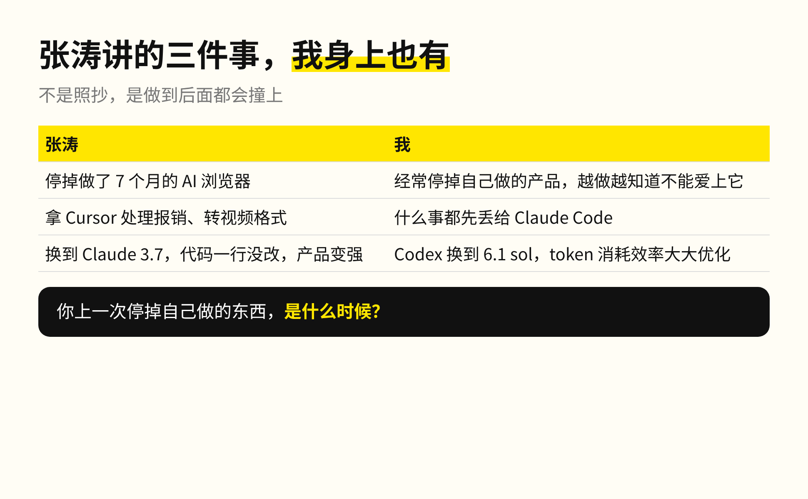

AI 浏览器做了 7 个月，已经可以发布了，创始人 Red 拍板：停掉。

那是 2024 年 10 月，公司只有 30 个人，账上没多少钱。五个月以后，他们发布了 Manus。

这一幕我很熟。我也经常停掉自己做的产品，而且越做到后面越清楚，==做产品的人不能爱上自己的产品==。

这是 Manus 联合创始人、产品负责人张涛在北大分享里讲的第一件事。整场分享讲了 Manus 怎么从一间五个人的小办公室里做出来，我挑了跟我自己对得上的几件。

1. 停掉浏览器：比钱更贵的是时间

浏览器内测有亮点，可用户永远拿 Chrome 当基准，一家 30 人的公司，不可能在基础体验上追平大厂。Red 真正怕的是另一件事，产品一旦发出去，创始人舍不得放，总觉得「再迭代一版就好了」，3 到 6 个月就这么搭进去。张涛的原话是，钱反而是最容易解决的，==最宝贵、浪费不起的是时间==。

2. 别人拿 Cursor 写代码，他拿来报销

2024 年人人都在用 Cursor。张涛不是专业程序员，拿 Cursor 干的是别的事：处理报销、帮太太把 MP4 转成 MP3、辅助写小说。

当时全世界都在押注编程 agent，张涛的判断是：这个世界不需要更多工程师，模型自己规划、自己调用工具的能力，应该给普通人用。这就是 Manus 的起点，名字取自 MIT 校训 Mens et Manus，头脑与双手，Manus 想当大模型的那双手。

我现在也一样，什么事都先丢给 Claude Code，写代码反而只占其中一部分。一个编程工具能干多少编程以外的事，用过的人自己知道。

3. 一行代码没改，产品变强了

Manus 原本打算等 Claude 4.0 再发布，中间先来了 3.7。那天晚上，他们的执行框架一行代码没改，只把模型接口从 3.5 换到 3.7，评测集上剩下没解决的题，==一下解决了 20% 到 30%==。张涛在即刻发了一句：「信仰充值的一晚。」

只换模型、产品就跟着变强，这一点我体会得很直接。Codex 换到 6.1 sol 之后，同样的任务，token 的消耗效率大大优化了，我这边什么都没改。今天费劲绕过去的问题，很多过几个月模型自己就解决了。

他们的首席科学家一直说一句话：Less structure, more intelligence。意思是少用固定流程，让模型自己决定下一步。当时更常见的做法是哪里出错就加一条规则兜底，可规则写得越多，新模型来了越吃不到红利。前几天那篇 Anthropic 讲 AI 记忆的稿子也是这个结论：给 AI 的规矩越长，它越不听。所以张涛劝做 AI 产品的人，不要老为今天模型的短板修修补补，要按六个月后模型的样子去设计。

4. 让用户看见它在干活

2025 年 1 月第一版原型调通后，张涛在朋友圈问：如果你有一个本科水平的实习生，会交代他做什么？100 多位朋友给了 400 多个任务，成了 Manus 最早的评测集。那两个多月，张涛每天在办公室喊，晚上回家嗓子都是哑的。

但效果好得超出预期，只把结果给用户，用户会觉得是假的。所以他们把过程本身做成了功能：一步步展示它怎么调用工具、打开网页、写代码，再加上会话回放。这两样后来几乎成了所有 agent 产品的标配。

5. 免费补贴，是这一代的陷阱

Manus 3 月底才开始收费，4 月的年度经常性收入就超过了 4000 万。张涛的看法是，上一代互联网的免费补贴思维放在 AI 产品上是错的：第一个月做到 10 万日活，它就会变成 KPI，再没人敢转收费；而愿意付钱留下来的人，才是真正感受到价值的人。

张涛还给想做产品的同学一条建议：一定要少看自媒体，所有东西都要自己上手去用。我自己就是写这类图文的人，可张涛说得没错：这篇你读完，最多知道了张涛怎么想，模型的边界在哪，还得自己去用一次才知道。

停掉做了 7 个月的浏览器，和不为今天的模型打补丁，在我看来是同一件事：AI 变化的速度，会让你今天最舍不得的那部分，半年后就变得不值钱。==能及时放手的人，才接得住下一次模型更新==。

如果你手上也有一个做了好几个月、心里明知道不对、却还在一版一版改的东西，可以问自己一句：如果今天才开始，我还会做它吗？

你上一次停掉自己做的东西，是什么时候？

