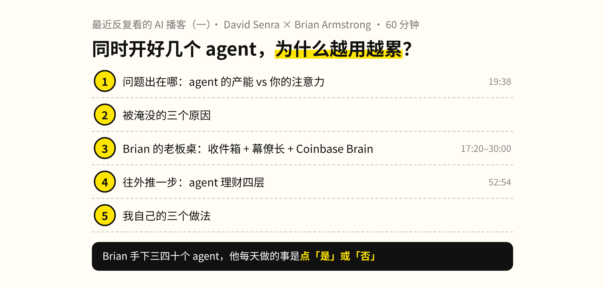
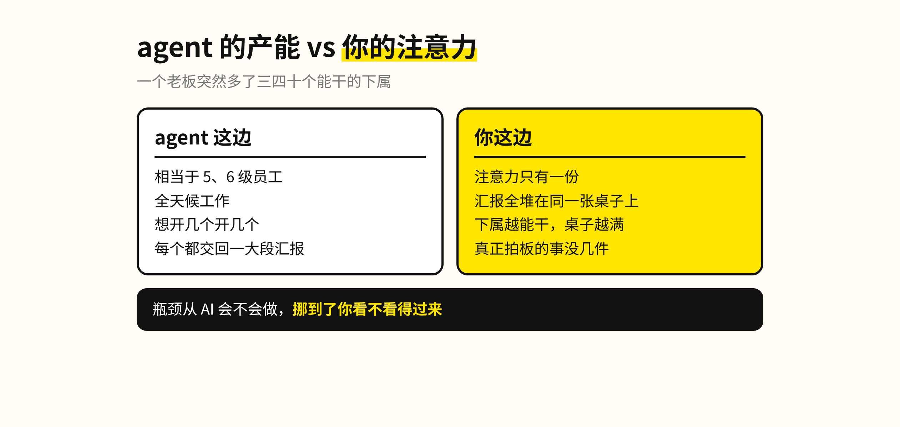
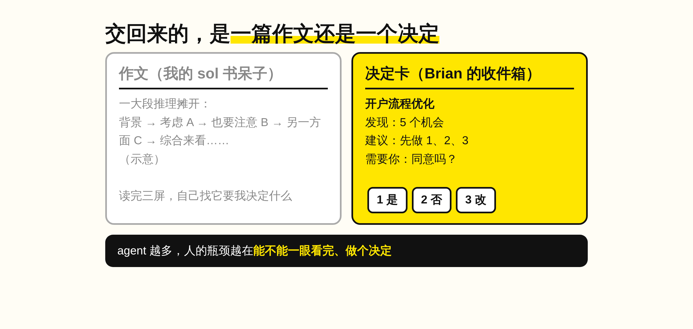
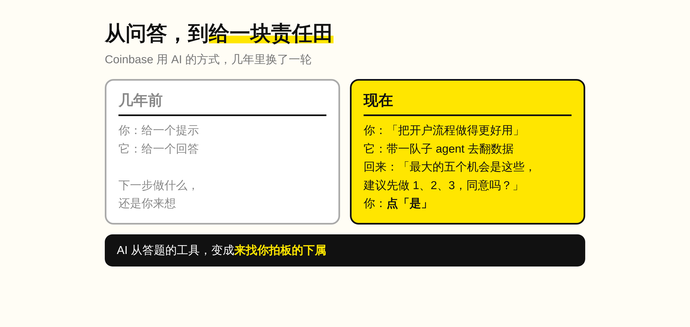
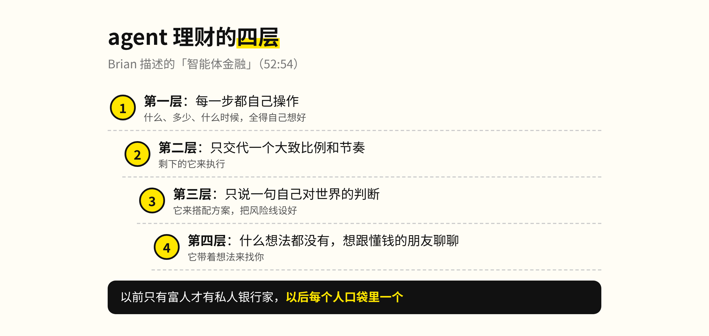
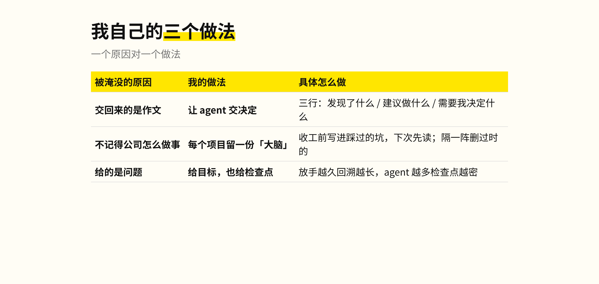

我同时开着好几个 agent 的时候，最怕 Codex 的 sol 模型交回来一大段回复。读到第三屏，已经忘了第一屏它要我决定什么。

一天下来，大半时间花在读 agent 的汇报上，真正拍板的事没几件。

Coinbase 的 CEO Brian Armstrong 手下有 7 到 8 个主 agent，加起来可能三四十个在同时干活，他每天做的事是点「是」或「否」。主持人问他，十年后全球的交易里有多少是 AI 跟 AI 之间完成的，他答 ==99.999%==。

Coinbase 是美股上市公司，这是 Brian 第二次上 David Senra 的播客，60 分钟。我挑了跟自己最对得上的那一部分：同样开着一堆 agent，为什么他不被淹没。

一、问题出在哪

把 agent 想成下属就好理解了。Brian 的判断是，这些 agent 已经轻松相当于大厂 5 级、6 级员工（实习生大约 3 级，VP 大约 11 级），而且想开多少就开多少。

麻烦也在这里。一个老板突然多了三四十个能干的下属，所有汇报都堆在同一张桌子上，下属越能干，桌子越满。Brian 自己也撞上过，原话是要在大段文字里来回切，才搞得清楚发生了什么。

所以==瓶颈从 AI 会不会做，挪到了你看不看得过来==。

二、被淹没，通常是三个原因

1. 交回来的是作文，不是决定

sol 的回复像一个 overthinking 的聪明书呆子在汇报。智商很高，情商不够，推理一大段摊开，就是学不会结构化表达。三屏读下来，还得自己去找它到底要我决定什么。

2. 它不记得你们公司怎么做事

每开一个新任务，背景都要重新讲一遍：上次踩过什么坑，团队习惯怎么做，谁说过什么。agent 记不住，这部分活最后全落回你身上。

3. 你给的是问题，不是一块责任田

你问一句，它答一句，下一步做什么还是你来想。这样用，开再多 agent，也只是多了几个答题的工具。

三、Brian 的老板桌，是这样收拾的

对着这三个原因，Brian 各有一套做法，比喻还是那张老板桌。

第一，桌上只放要签字的文件。Coinbase 内部做了一个「待决收件箱」，所有 agent 要他拍板的事排好优先级，放在同一块屏幕上，按钮位置固定，按 1、2、3 就行，要改的地方用语音口述几句。只有五分钟的时候，先清掉最能推动整支 agent 团队往前走的那几个决定，==像清邮箱一样清决策==。

第二，下属之上有一个幕僚长。Brian 手上 7 到 8 个主 agent 各管一个领域，每个开工后再拉起 3 到 5 个子 agent，上面还有一个「幕僚长 agent」统筹，跟进项目、找谁审批。

第三，公司有一本每晚更新的员工手册。

Coinbase 给每个团队、每个 GitHub 仓库都配了一个「大脑」，叫 Coinbase Brain。每天晚上，它把当天的 A/B 测试、事故复盘、会议纪要、代码评审过一遍，提炼出教训写进去，agent 干活前先读它。大脑里打架的时候，比如十四个月前 David 这么说、Brian 那么说，由人来裁决。

这跟前几天那篇 Anthropic 讲 AI 记忆的稿子是同一个方向：记忆得有人定期去删、去裁决。

Brian 还补了一句，AI 不完全像人，就像潜艇不完全像鱼。它全天候工作、想复制几份就复制几份，可偶尔会看不清大局，交出来的东西有点像外面已有的。所以==最终决定和最终的代码评审，还是人来做==。

把这张老板桌再往外推一步，就是开头那个 99.999%：agent 之间也会互相做生意。落到普通人身上，Brian 描述了 agent 帮你理财的四层：从每一步都自己操作，到只交代一个大致比例，再到只说一句自己对世界的判断，最后什么想法都没有、只想找个懂行的朋友聊聊。以前只有富人才有私人银行家，以后每个人口袋里都有一个。

四、我自己的三个做法

对着三个原因，我现在这样做。

让 agent 交决定，不交作文：每次结束都按「发现了什么 / 建议做什么 / 需要我决定什么」三行交回来，推理放在后面，我想看再点开。

给每个项目留一份「大脑」：收工前让它把这次踩的坑写进项目里的一个文件，下次开工先读；隔一阵我自己去删过时的条目。

给目标，也给检查点。这一条是吃过亏换来的：多线程里我丢过细节的把控，一旦发现问题，回溯的过程很烦，因为可能已经放手太久了，要倒着翻好几层才找到是哪一步歪的。Brian 自己其实也没全靠收件箱，他说一天会去敲三四十个人问进度。所以==agent 开得越多，检查点越要设得密==。

你现在同时开着几个 agent？交回来的是决定，还是作文？

