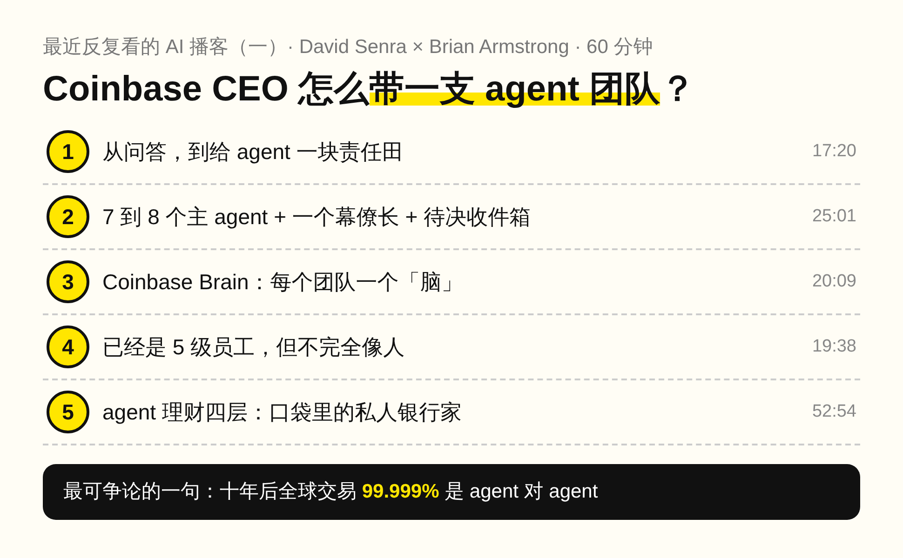
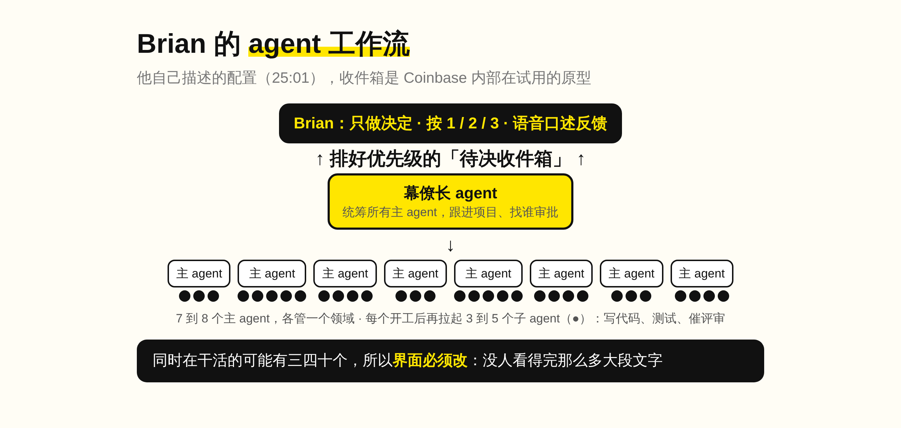
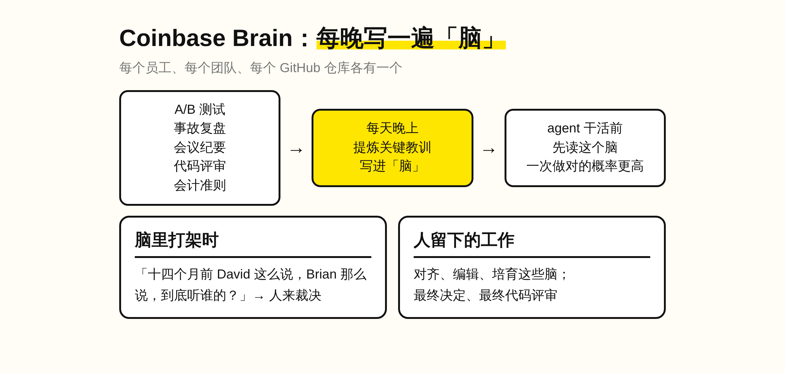
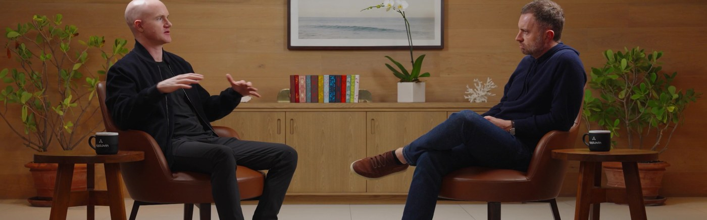
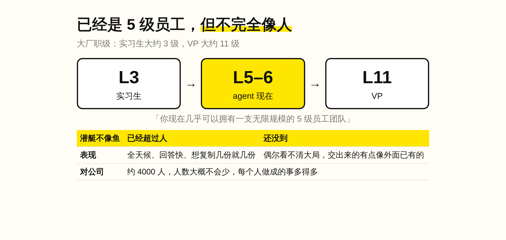
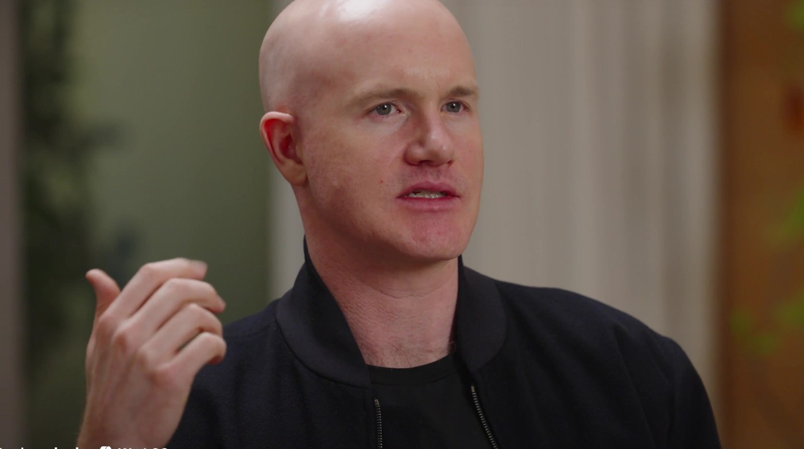
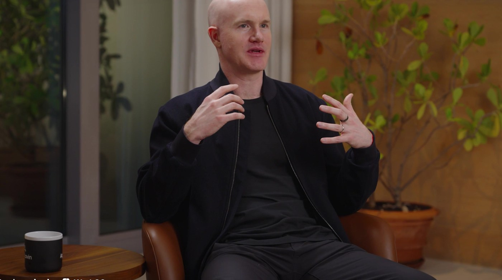
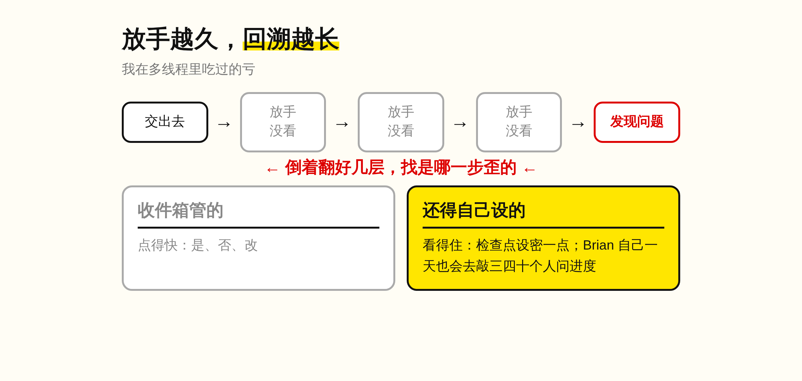
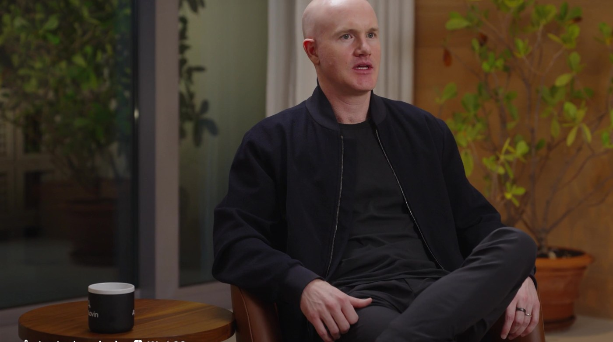

主持人问：十年后，全球的交易里有多少是 AI 跟 AI 之间完成的？对面那位 CEO 两只手比划着，答了五个九。

五个九就是 99.999%。说这话的是 Brian Armstrong，在美股上市的加密货币交易所 Coinbase 的联合创始人兼 CEO。主持人 David Senra 读了四百多部创始人传记，这是两人第二次对谈，60 分钟。

让我反复回去看的不是这个数字，是他现在怎么带自己那一队 agent。我的 agent 工作流跟他很像，也经常被它们的回复淹没，他的解法我看完就想抄。

1. 从问答，到给 agent 一块责任田

几年前 Coinbase 刚开始用 AI，用法跟所有人一样：给一个提示，拿回一个回答。

现在换成了另一种用法，给 agent 一个目标，比如「把 Coinbase 的开户流程在全世界这些国家做得更好用」。这个 agent 带着下面一队子 agent 去翻数据、做分析，回来汇报：最大的五个机会是这些，我建议先做第一、二、三个，你同意吗？

Brian 点一下「是」，这件事就往下走了。原话是：==它是带着该做什么的想法回来找我的，我来对齐它、引导它==。

2. 7 到 8 个主 agent，加一个幕僚长

Brian 自己手上有 7 到 8 个主 agent，各管一个他眼下关心的领域，上面还有一个「幕僚长 agent」统筹。每个主 agent 只要一开工，下面就会再拉起 3 到 5 个子 agent，写代码、做测试、催人评审。

这么一算，同时在干活的可能有三四十个，Brian 很快就看不过来了。

所以他们内部做了一个「待决收件箱」：所有 agent 要他拍板的事排好优先级，放在同一块屏幕上，按钮位置固定，按 1、2、3 就行。要改的地方，他用语音口述几句。只有五分钟的时候，先清掉最能推动整支 agent 团队往前走的那几个决定。是、否、否、否，这个稍微改一下，==像清邮箱一样清决策==。

我的工作流跟 Brian 类似，偶尔也会被 Codex 的 sol 模型的回复淹没。sol 的回复，像一个 overthinking 的聪明书呆子在汇报。智商很高，情商不够，推理一大段摊开，就是学不会结构化表达。

三屏读下来，还得自己去找它到底要我决定什么。

Brian 的收件箱解决的就是这件事：==agent 交回来的应该是一个决定，不是一篇作文==。

3. 每个团队、每个代码仓库，都有一个「脑」

Coinbase 内部在做一个叫 Coinbase Brain 的东西。每个员工、每个团队、每个 GitHub 仓库都有一个「脑」。每天晚上，它把当天的 A/B 测试、事故复盘、会议纪要、代码评审过一遍，提炼出关键教训写进去。agent 下次在这个领域干活先读这个脑，交出来的东西就更像公司想要的。

脑里也会打架，十四个月前 David 这么说、Brian 那么说，就要人来裁决。按 Brian 的说法，现在人的工作越来越像对齐、编辑、培育这些脑，==最终决定和最终的代码评审，还是人来做==。

这跟前几天那篇 Anthropic 讲 AI 记忆的稿子是同一个方向：记忆得有人定期去删、去裁决。

4. 已经是 5 级员工，但不完全像人

大厂职级里，实习生进来大概是 3 级，VP 大概是 11 级。Brian 的判断是，这些 agent 已经轻松相当于 5 级、6 级员工，而且你几乎可以有一支无限规模的 5 级员工团队。

但紧接着补了一句：AI 不完全像人，就像潜艇不完全像鱼。它全天候工作、回答很快、想复制多少份就复制多少份，这几点已经超过人；可它偶尔会看不清大局，交出来的东西有点像外面已有的（我那位 sol 书呆子大概属于前一种）。

有人问能不能用一百个人跑 Coinbase。Brian 的猜测是，公司现在大约四千人，人数大概不会少，但每个人能做成的事会多得多。

5. 每个人口袋里，一个私人银行家

回到开头那个 99.999%。Brian 想的是，agent 之间也要做生意，需要自己的市场和支付轨道，他押的是稳定币。

对普通人，Brian 描述了 agent 帮你理财的四层。第一层是自己打开 App 买一股 Meta。第二层是交代「Meta 占组合 10%，分批买进去」。第三层只给一个判断，比如 AI 的瓶颈会是能源，它帮你配一篮子资产、设好止盈止损。第四层是什么想法都没有，只想跟一个懂钱的朋友聊聊。==以前只有富人才有的私人银行家，以后每个人口袋里都有一个==。

讲这些的时候，Brian 说自己太兴奋了，晚上睡不着，得反复告诉自己该睡了。

对 Brian 这套工作流，我最大的保留在收件箱之外。收件箱让人点得快，可点得快不等于看得住。多线程里吃过的亏，是丢了细节的把控。一旦发现问题，回溯的过程很烦，因为可能已经放手太久了。这时候要倒着翻好几层，才找得到是哪一步歪的。Brian 自己其实也没全靠收件箱，他说一天会去敲三四十个人问进度。所以在我看来，==agent 开得越多，检查点越要设得密==，放手和看住得一起往前走。

整期 60 分钟，agent 工作流在 17 分钟到 30 分钟，Coinbase Brain 在 20 分钟，理财四层在 53 分钟，想看可以直接拖过去。

你现在同时开着几个 agent？交回来的是决定，还是作文？

