「==永远别让公司比它真实的价值多值一美元==」正式 IPO 之前，Dario Amodei 把别人劝他的这句话讲给了投资人。

那是 11 月 13 日，摩根大通纽约总部，Anthropic 的上市路演。Dario 是这家公司的 CEO，对面提问的是摩根大通掌门人 Jamie Dimon。

38 分钟的对谈里，我挑两件事讲：一件是这句话背后的做事方式，一件是 Anthropic 怎么判断下一个市场。

1. 上市前，他劝大家别高估自己

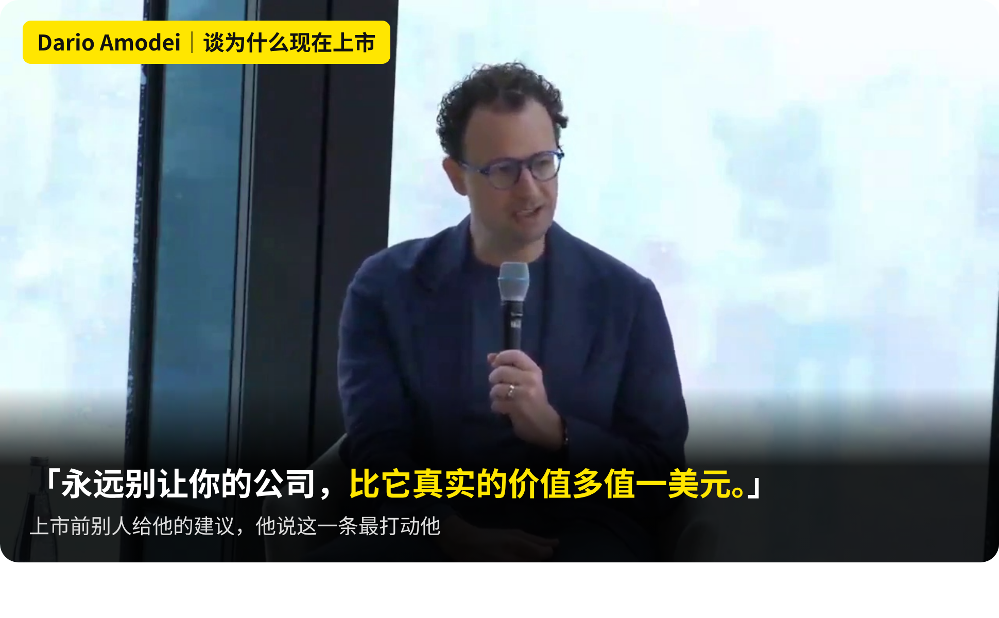

Anthropic 六年从零走到上市，Dario 没有经历过这个流程，所以事先请教了很多人，最打动他的建议就是开头那一句。

这句话在公司内部有一个对应的说法，叫 underpromise and overdeliver，意思是少承诺、多交付。具体到发布模型上，就是不提前放风，不发那种含糊的预告。因为他们的顺序是先把模型做出来，确认没有问题之后才发布，安全系统也按同样的顺序。

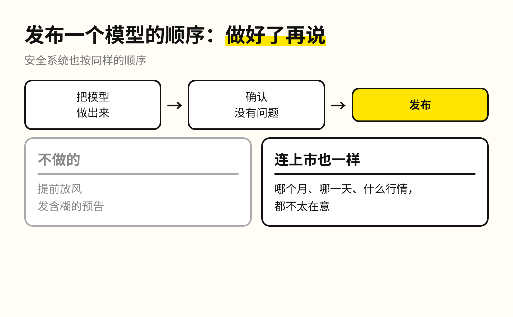

连上市选在哪个月、赶上什么行情，Dario 都说不太在意。对谈结束时，摩根大通的高管 Mary Erdoes 上台收尾时把招股书里的这一句又念了一遍，还补了一句：希望你们真的做到。

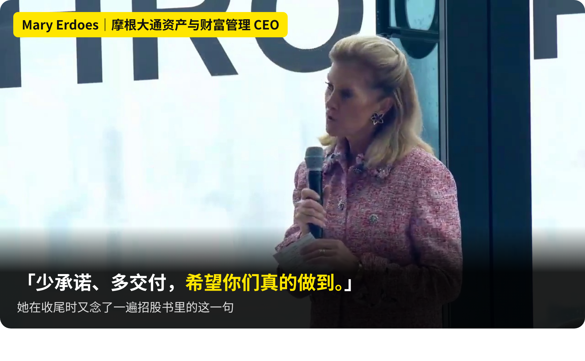

这让我想到中国人常说的本分：话不说满，做事保守一些。它放在工作里也是很容易让别人记住你的方式。因为对方的预期先被你管理好了，你交出来的东西才有机会超出预期，==信任就是这样一次一次积累起来的==。

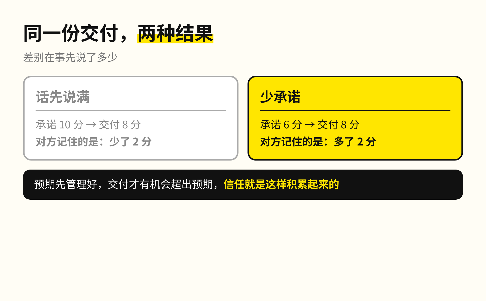

2. 2023 年，他们没去抢聊天机器人

Dimon 问了一个投资人都关心的问题：便宜的模型越来越多，这门生意以后会不会只剩下拼价格？

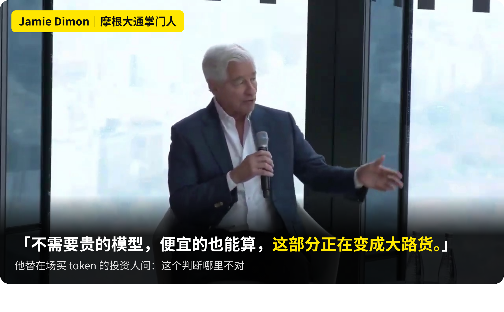

Dario 的回答是，单个应用确实会走到拼价格那一步，聊天机器人已经走到了。但 AI 包含很多个市场，==模型每变强一截，就会多出一个以前做不了的市场==。

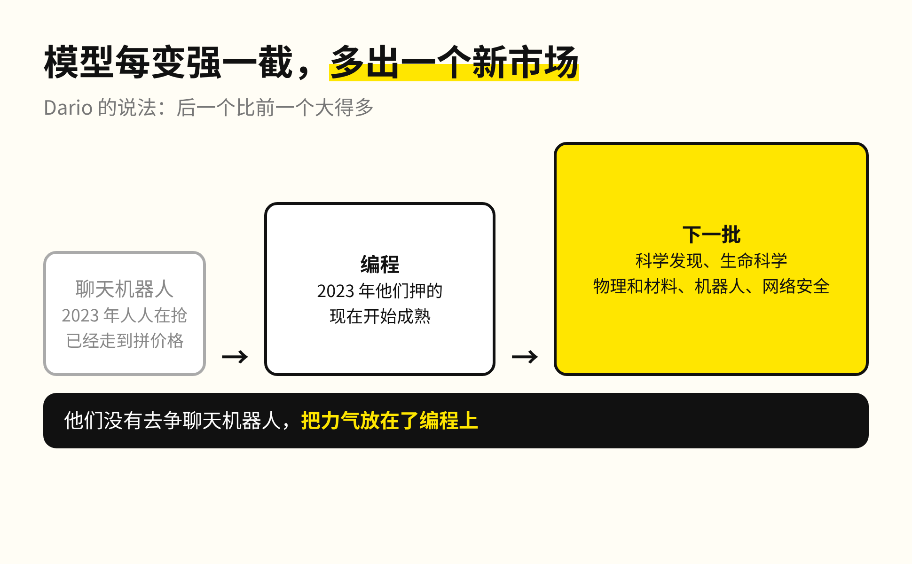

2023 年所有人都盯着聊天机器人。Anthropic 看了看模型的能力，判断它已经聪明到可以写代码，而且编程这个市场会比聊天机器人大得多。所以他们没有去争聊天机器人，把力气放在了编程上。

这一段我的感受很深刻。2023 到 2024 年，对话机器人非常火爆，Character.ai 这类陪聊产品也是一样。那时候我想和团队做一个 agent 方向的创业项目，最后没能完全跑通，现在想起来还是很可惜。

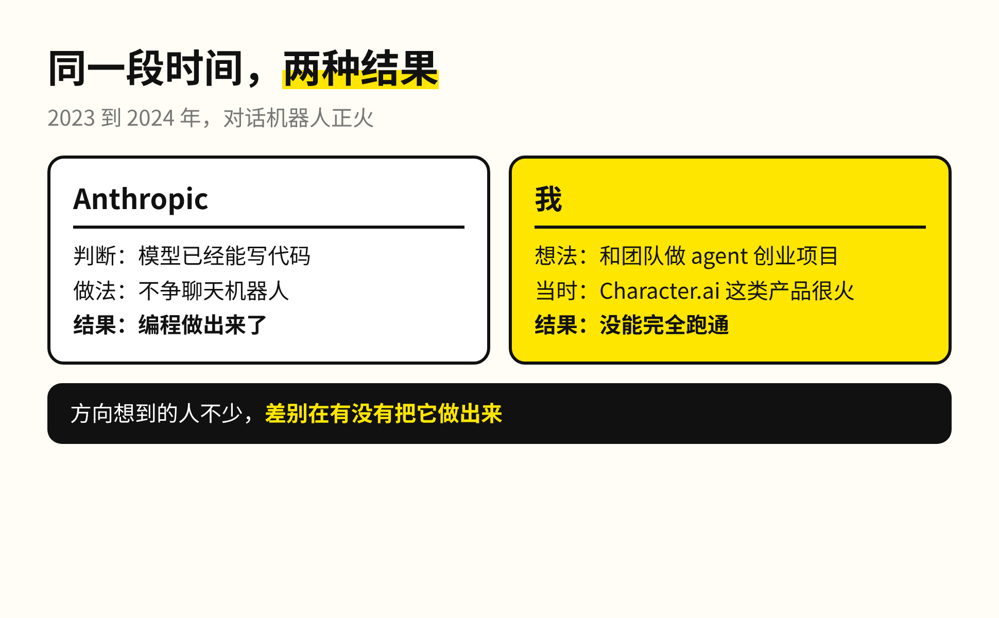

下一个市场在哪里，当时想到的人不少。差别在于，Anthropic 把它做出来了。

3. 每一步，都有人说是运气

Anthropic 敢这样押注，依据是一条在不同领域反复出现的规律，Dario 拿数学举了例子。

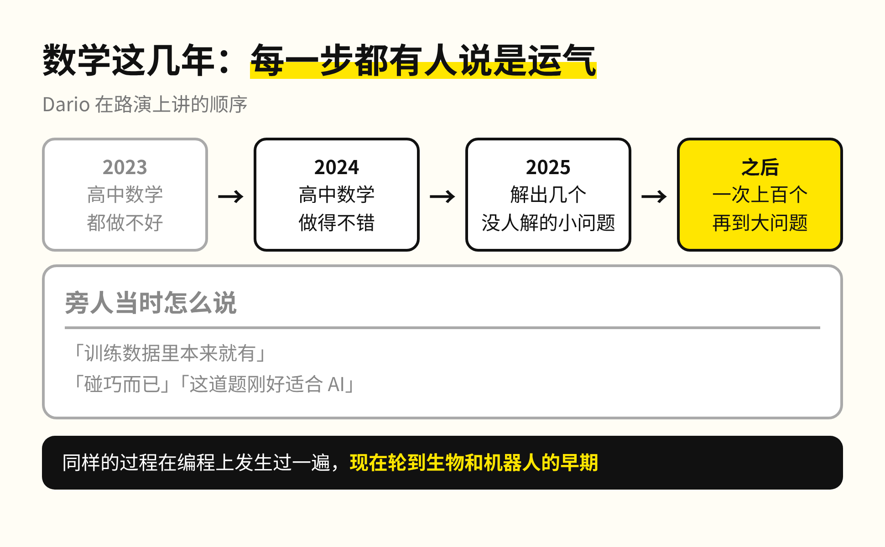

2023 年，模型连高中数学都做不好，当时的共识是它会聊天、不会逻辑。2024 年，高中数学做得不错了。2025 年，模型开始解出一些没人解出的小问题，旁人的反应是：训练数据里本来就有，或者只是碰巧。再往后模型一次解出上百个，接着是够得上菲尔兹奖的大问题，那是数学界分量很重的一个奖。

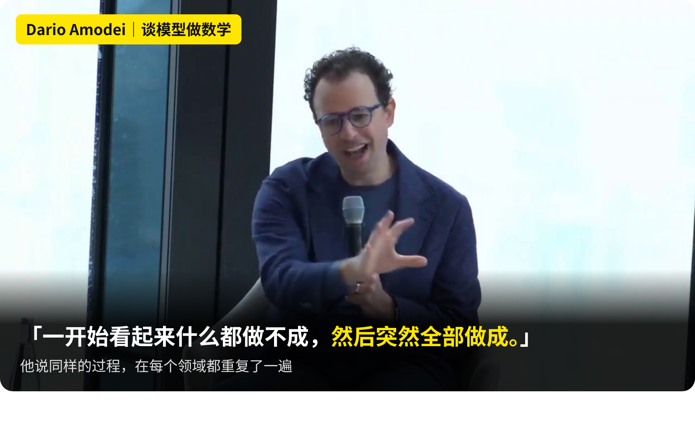

同样的过程，在编程上已经发生过一遍。所以当药企的 CEO 说，卡住新药的是临床试验、是生产、是审批，Dario 的判断是，这些环节正在被一点一点解决，几年之内会一下子全部打通。

4. 下一批市场，我看好机器人

Dario 点名的下一批有五个：科学发现、生命科学、物理和材料、机器人、网络安全。按照这个说法，它们会比编程更大，就像编程比聊天机器人更大一样。

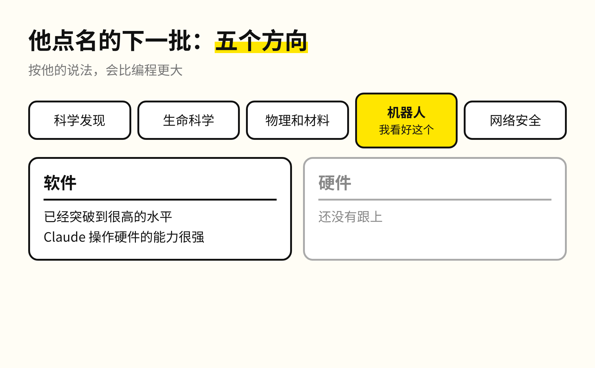

这五个里面我看好机器人。软件这一头已经突破到了很高的水平，硬件还没有跟上，但我已经能明显感觉到，Claude 操作硬件的能力达到了很高的高度。

有意思的是，讲到这些的时候，Dario 自己先泼了冷水：在任何一个具体领域，怀疑的人都可能是对的。治愈癌症和阿尔茨海默病需要多久，回答是不知道，可能 5 年、10 年，也可能 15 年。

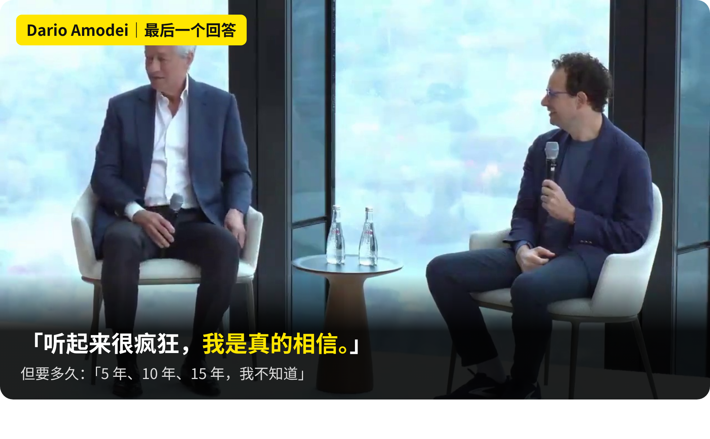

连描述愿景，用的也是少承诺的讲法。

这两件事在我看来是同一件。AI 行业每隔一两年就多出一个新市场，看到的人很多，提前喊出来的人更多。但==能让别人相信你的，只有已经交出来的东西==。Anthropic 没有提前去喊编程，等别人反应过来，Claude 已经在写代码了。我那个没跑通的项目，缺少的也正是交付这一步。

你现在看好的下一个市场是哪一个？我的答案是机器人。

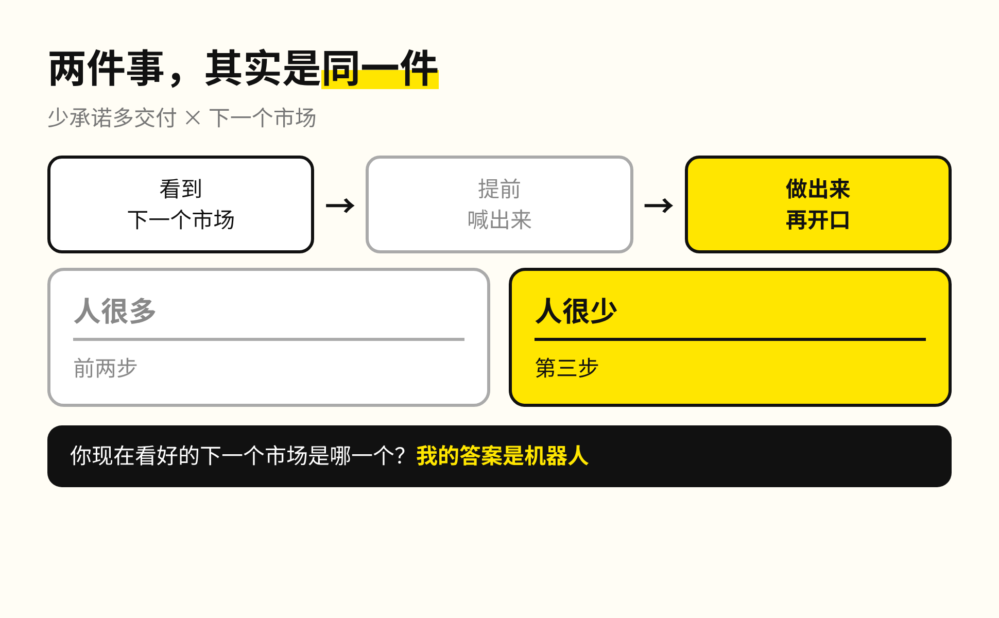
